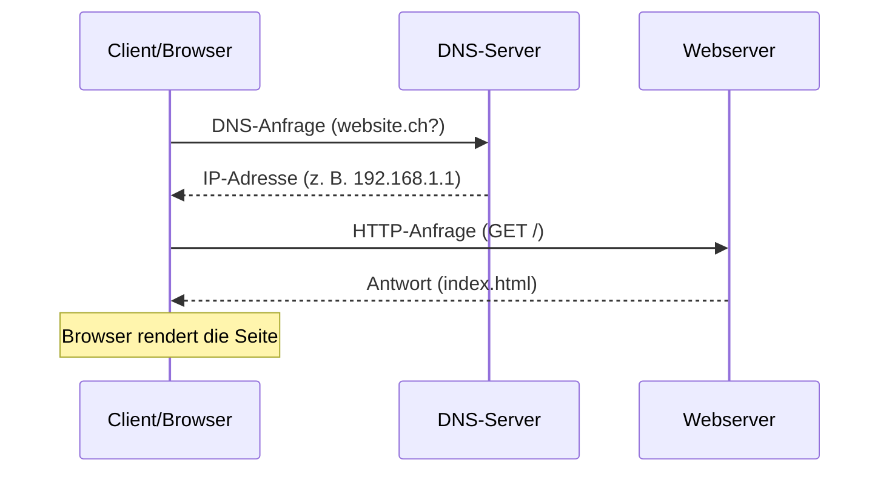

# Einführung Webentwicklung

## Grundbegriffe
- **Storyboard:** zeigt die Abfolge/den Ablauf einer Website oder Anwendung.
- **Wireframe:** einfache, strukturelle Skizze einer Seite ohne Design-Details.
- **Frontend:** der sichtbare, von Nutzern bedienbare Teil einer Website.
- **Backend:** der serverseitige Teil im Hintergrund, der Logik und Daten verwaltet.

## Die Website – drei Bausteine

| Teil | Funktion |
|---|---|
| HTML | Struktur |
| CSS | Design |
| JS (JavaScript) | Verhalten |

## Team einer Webentwicklung

![[webentwicklung-team.jpg]]

Jeder Bereich bringt eigene Tools und Skills mit – UX/UI Design (Wireframes, Site Diagrams, Storyboards), Frontend (HTML, CSS, JavaScript) und Backend (Server, Datenbanken, APIs).

## Wie eine Webseiten-Anfrage abläuft

![[web-anfrage-ablauf.jpg]]

**Kurz gesagt:** URL eingeben → DNS löst auf → Browser sendet Anfrage → Server antwortet → du siehst die Webseite.

- **DNS-Auflösung** ist das "Telefonbuch des Internets" – übersetzt einen Domainnamen in eine IP-Adresse.
- **Client** fragt an, **Host** (Server) antwortet.

## Standards und Qualität
- **Einhalten von Standards:** W3C-Konformität – Websites sollten sich an die offiziellen Web-Standards halten.
- **Barrierefreiheit:** Websites sollen für möglichst alle Menschen nutzbar sein.
- **Performance:** wie schnell und reibungslos eine Website läuft.

## Siehe auch
- [[HTML Grundlagen]]
- [[CSS Grundlagen]]
