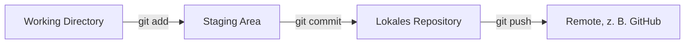

# Git – Warum Git und der lokale Workflow

Notizen aus der **Präsentation über Git**.

## Warum Git?
- **Änderungen verstehen:** Man sieht genau, *was* geändert wurde und *warum* (Commit-Nachricht).
- **Stände vergleichen:** Man kann zwei Versionen vergleichen und sieht die Unterschiede (`git diff`).
- **Fortschritt tracken:** Jeder Commit ist ein gespeicherter Zwischenstand. Man sieht den ganzen Verlauf (`git log`) und kann zu einem alten Stand zurück.
- **Paralleles Entwickeln:** Mehrere Leute arbeiten gleichzeitig in eigenen **Branches**, am Schluss wird alles zusammengeführt (merge).

## Der lokale Workflow
| Bereich | Was passiert | Befehl |
|---|---|---|
| **Working Directory** | Dateien ganz normal im eigenen Editor bearbeiten | – |
| **Staging Area** | Auswählen, welche Änderungen in den nächsten Commit kommen | `git add` |
| **Lokales Repository** | Die ausgewählten Änderungen als Version speichern | `git commit -m "..."` |
| **Remote** (z. B. GitHub) | Die Commits auf den Server hochladen | `git push` |



### Vergleich mit dem Einkaufen
- **Working Directory** = im Laden: Ich nehme Sachen in die Hand und schaue sie an (Dateien bearbeiten).
- **`git add`** = Die Chipstüte kommt in den **Einkaufswagen**. Sie ist für den Kauf bereit, aber noch nicht gekauft.
- **`git commit`** = An der Kasse **bezahlen**. Jetzt ist der Einkauf fest, mit Quittung (Commit-Nachricht).
- **`git push`** = Den Einkauf **nach Hause bringen**, damit ihn auch die anderen sehen.

> [!warning] Commit ist noch kein Push
> Nach `git commit` sind die Änderungen nur **lokal** auf meinem PC gespeichert. Erst mit `git push` kommen sie auf den Server, wo andere sie sehen.

## Wichtige Befehle
```bash
git status                  # Was ist geändert, was liegt im Einkaufswagen?
git add datei.txt           # eine Datei in die Staging Area legen
git add .                   # alle Änderungen in die Staging Area legen
git commit -m "Nachricht"   # Stand lokal speichern
git push                    # Commits auf GitHub hochladen
git log --oneline           # Verlauf anzeigen
git diff                    # Änderungen anzeigen, die noch nicht gestaged sind
```
