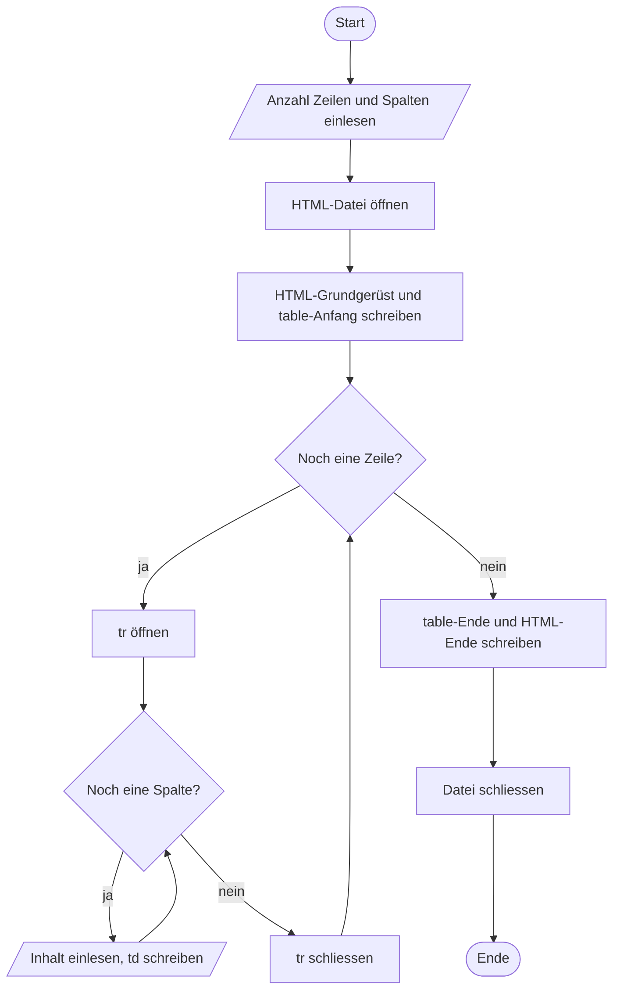

# Auftrag 05 – Tabellengenerator

Wir schauen jetzt wieder **C** an. Im Auftrag **Tabellengenerator** schreiben wir ein C-Programm, das eine **HTML-Tabelle erzeugt** und als `.html`-Datei speichert. So kommen C-Programmierung und [[HTML Grundlagen]] zusammen.

> [!info] Wo liegt der Auftrag?
> In Teams unter `C/Aufgaben/05_Table-generator`. Programmiert wird in **CLion**.

## Was das Programm macht
1. Es stellt Fragen: Wie viele **Zeilen** (rows)? Wie viele **Spalten**? Was soll in den Zellen **stehen**?
2. Danach wird die Tabelle **generiert** und in eine HTML-Datei geschrieben.
3. Die Datei öffnet man im Browser und sieht die fertige Tabelle.



## Aufbau der HTML-Datei
Ein HTML-File ist immer ähnlich aufgebaut (siehe [[HTML Grundlagen]]). Die Tabelle kommt in den `<body>`-Teil:

```html
<!DOCTYPE html>
<html lang="de">
<head>
    <meta charset="UTF-8">
    <title>Tabelle</title>
</head>
<body>
    <table border="1">
        <tr>
            <td>Zelle 1</td>
            <td>Zelle 2</td>
        </tr>
        <tr>
            <td>Zelle 3</td>
            <td>Zelle 4</td>
        </tr>
    </table>
</body>
</html>
```

| Element | Name | Bedeutung |
|---|---|---|
| `<table>` | table | Umschliesst die ganze Tabelle |
| `<tr>` | **t**able **r**ow | Eine **Zeile** |
| `<td>` | **t**able **d**ata | Eine normale **Zelle** in der Zeile |
| `<th>` | **t**able **h**eader | Eine **Kopfzelle**, wird fett und zentriert angezeigt |

## Selbstrecherche: Datei mit `.html`-Endung in C erstellen
Die Endung gibt man einfach im **Dateinamen** an. Für C ist eine HTML-Datei nur Text, erst der Browser macht daraus eine Tabelle. Mehr dazu in [[File Handling in C]].

```c
FILE *datei = fopen("tabelle.html", "w");   // "w" = Datei erstellen bzw. überschreiben
if (datei == NULL) {
    printf("Datei konnte nicht erstellt werden\n");
    return 1;
}
fprintf(datei, "<table border=\"1\">\n");   // wie printf, aber in die Datei
fclose(datei);                               // Datei schliessen
```

> [!tip] Anführungszeichen im HTML
> Steht im HTML selbst ein `"`, muss man es im C-String mit `\"` schreiben, sonst denkt C, der Text ist dort zu Ende.

## Wo landet die Datei? (`cmake-build-debug`)
CLion baut und startet das Programm im Ordner **`cmake-build-debug`**. Gibt man im Code nur den Dateinamen an (`"tabelle.html"`), wird die HTML-Datei **in diesem Ordner** erstellt und nicht neben `main.c`. Von dort kann man sie per Doppelklick im Browser öffnen. Wer sie woanders haben will, kann in der Run-Konfiguration von CLion das *Working directory* ändern.

## Kontrollstrukturen
Wir sollen mit **Kontrollstrukturen** arbeiten, damit wir programmieren lernen: Das Programm entscheidet selbst, **wie die Tabelle weitergeht** und **wann sie aufhört**.
- **Äussere `for`-Schleife** über die Zeilen: pro Durchgang ein `<tr>`.
- **Innere `for`-Schleife** über die Spalten: pro Durchgang ein `<td>`.
- Die Schleifen **stoppen**, sobald die eingegebene Anzahl erreicht ist (z. B. `i < zeilen`).
- Idee für mehr: Mit einem `if` die erste Zeile als Kopfzeile mit `<th>` schreiben.

```
für jede Zeile:
    "<tr>" schreiben
    für jede Spalte:
        Inhalt einlesen
        "<td>Inhalt</td>" schreiben
    "</tr>" schreiben
```

> [!warning] Eingabe mit Leerzeichen
> `scanf("%s", ...)` liest nur bis zum ersten Leerzeichen. "Tim Bürgin" würde also in zwei Zellen landen.

## Siehe auch
- [[File Handling in C]]
- [[HTML Grundlagen]]
