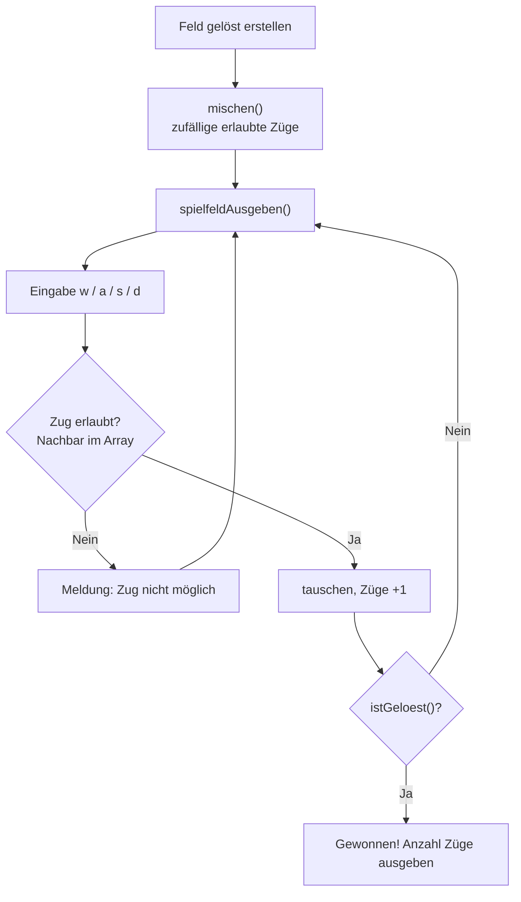

# Auftrag – Schiebepuzzle (Sliding Puzzle)

Noser Young Input: Wir benutzen **2D-Arrays** jetzt in einem praktischen Beispiel. Wir machen ein **Schiebepuzzle** und sollen es mit 2D-Arrays erstellen. Heute haben wir zuerst **geplant**.

> [!info] Wo kann man das nachlesen?
> Im **Leitfaden in Teams**. Am Morgen gibt es einen eigenen Call fürs Sliding Puzzle → [[Organisation & Administration#🏠 Homeoffice – Regeln und Calls|Homeoffice-Regeln]]

## Was ist ein Schiebepuzzle?
Ein Spielfeld mit nummerierten Plättchen und **einem leeren Feld**. Man schiebt ein Plättchen, das direkt neben dem leeren Feld liegt, in die Lücke. Ziel: Alle Zahlen stehen wieder der Reihe nach.

## Spielfeld als 2D-Array
Das Spielfeld ist eine Tabelle, also passt ein **2D-Array** perfekt → [[Arrays in C#2D-Arrays]]. Das leere Feld speichere ich als **0**.

```c
int feld[3][3] = {{1, 2, 3},
                  {4, 0, 6},
                  {7, 5, 8}};
```

![[schiebepuzzle-2d-array.svg]]

> [!important] Ein Zug ist ein Tausch
> Ein Zug tauscht das leere Feld mit **einem direkten Nachbarn**: oben, unten, links oder rechts. Schräg geht nicht, und der Nachbar muss **im Array** liegen (Index 0 bis 2). Sonst liest man ausserhalb vom Array → siehe Warnung in [[Arrays in C]].

## Planung
Ich teile das Programm in kleine Funktionen auf → [[Modulares Programmieren]].

- [ ] `spielfeldAusgeben()` – Feld mit zwei `for`-Schleifen ausgeben, 0 als Leerzeichen
- [ ] `leeresFeldSuchen()` – Zeile und Spalte der 0 finden
- [ ] `zugMachen()` – Eingabe (z. B. `w a s d`) lesen, prüfen ob der Zug erlaubt ist, dann tauschen
- [ ] `mischen()` – viele **zufällige, erlaubte** Züge vom gelösten Feld aus machen
- [ ] `istGeloest()` – prüfen, ob 1 bis 8 der Reihe nach stehen und die 0 bei `[2][2]` ist
- [ ] Züge zählen und am Schluss ausgeben

> [!warning] Nicht einfach zufällig befüllen
> Wenn man die Zahlen einfach zufällig ins Array schreibt, ist ungefähr die **Hälfte aller Puzzles unlösbar**. Darum vom **gelösten** Feld aus mit erlaubten Zügen mischen. Dann ist das Puzzle immer lösbar.

### Ablauf vom Spiel


### Idee für den Tausch
```c
// leeres Feld steht bei [leerZeile][leerSpalte]
int neuZeile = leerZeile + 1;   // Beispiel: Plättchen unter der Lücke nach oben schieben
int neuSpalte = leerSpalte;

if (neuZeile >= 0 && neuZeile < 3 && neuSpalte >= 0 && neuSpalte < 3)
{
    feld[leerZeile][leerSpalte] = feld[neuZeile][neuSpalte];
    feld[neuZeile][neuSpalte] = 0;
}
```
Die `if`-Abfrage prüft zuerst, ob der Nachbar **im Array** liegt. Erst dann wird getauscht.

## Arbeiten im Homeoffice
- Regelmässig **committen**, damit man den Fortschritt sieht → [[Git – Warum Git und der lokale Workflow]]
- Calls und Regeln → [[Organisation & Administration]]

## Siehe auch
- [[Arrays in C]]
- [[Modulares Programmieren]]
- [[Auftrag 05 – Tabellengenerator]]
