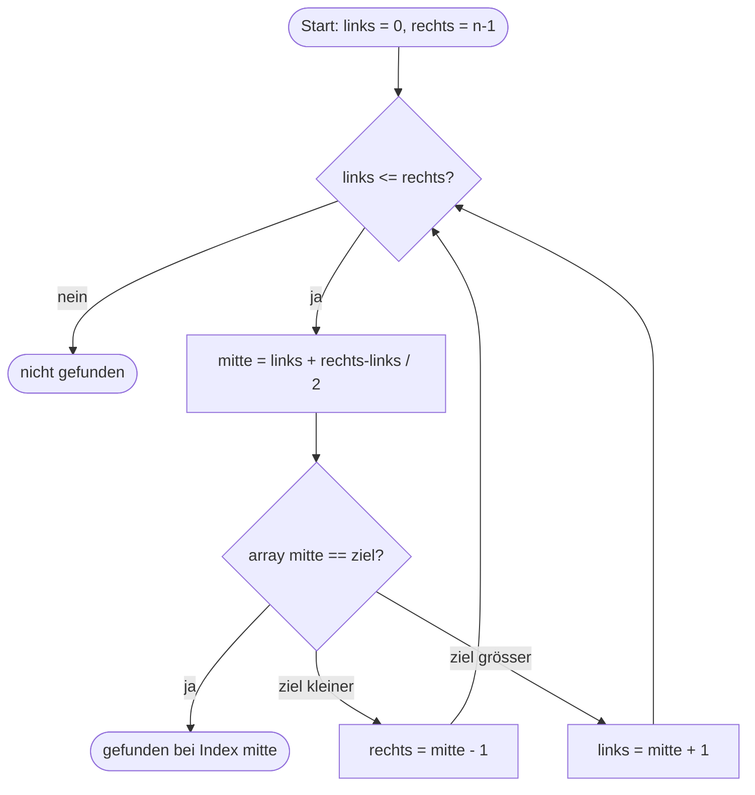

# Binäre Suche (Binary Search)

Noser Young Input: Wir schauen einen **Suchalgorithmus** an. Wir möchten herausfinden, **wo eine bestimmte Zahl in einem Array ist**, ohne zu wissen, an welchem Index sie steht.

> [!warning] Voraussetzung
> Die binäre Suche funktioniert **nur, wenn das Array schon sortiert ist**.

## Lineare Suche vs. binäre Suche
Wir schauen nicht die lineare Suche an, sondern die binäre Suche. Zum Vergleich:

| | Lineare Suche | Binäre Suche |
|---|---|---|
| Wie? | Vergleicht **jeden Wert** im Array der Reihe nach mit dem Zielwert, bis er trifft | Schaut immer in die **Mitte** und wirft die Hälfte weg, in der die Zahl nicht sein kann |
| Array sortiert? | Nicht nötig | **Muss sortiert sein** |
| Schritte bei 10 Mio. Zahlen | bis zu 10'000'000 | nur ca. **24** |

## So funktioniert sie
1. Das mittlere Element anschauen.
2. Ist es der Zielwert → gefunden.
3. Ist der Zielwert **kleiner** → nur noch in der linken Hälfte weitersuchen.
4. Ist der Zielwert **grösser** → nur noch in der rechten Hälfte weitersuchen.
5. Wiederholen, bis die Zahl gefunden ist oder nichts mehr übrig ist.

Die binäre Suche ist sehr nützlich, weil man so sehr schnell viele Elemente eliminieren kann. Bei 10 Mio. Zahlen kommen nach dem ersten Schritt nur noch 5 Mio. infrage, dann 2,5 Mio. usw. Es wird immer kleiner.



## Beispiel in C
```c
int binarySearch(const int array[], int laenge, int ziel)
{
    int links = 0;
    int rechts = laenge - 1;

    while (links <= rechts)
    {
        int mitte = links + (rechts - links) / 2;

        if (array[mitte] == ziel)
        {
            return mitte;          /* gefunden */
        }
        else if (array[mitte] < ziel)
        {
            links = mitte + 1;     /* rechte Hälfte */
        }
        else
        {
            rechts = mitte - 1;    /* linke Hälfte */
        }
    }
    return -1;                     /* nicht gefunden */
}
```

## Siehe auch
- [[Arrays in C]]
- [[Modulares Programmieren]]
- [[Auftrag 05 – Tabellengenerator]]
