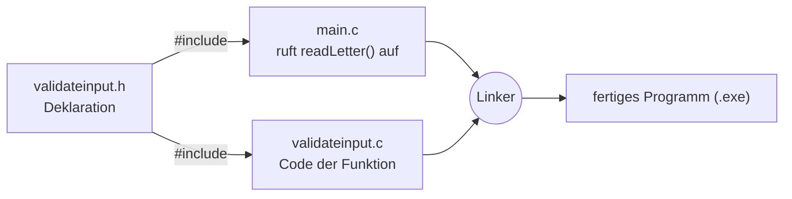

# Modulares Programmieren in C

Noser Young Input: Diese Woche arbeiten wir **in einem Team** und beschäftigen uns selbständig mit modularem Programmieren.

## Begriffe
- **Redundanz** heisst unnötiger oder überflüssiger Code, also Code, der mehrmals gleich vorkommt. Modulares Programmieren hilft, Redundanz zu vermeiden.
- **Header-Datei (`.h`)**: Darin steht nur, *welche* Funktionen es gibt und wie man sie aufruft (Deklaration). Sie ist wie ein Inhaltsverzeichnis.
- **Quelldatei (`.c`)**: Darin steht der eigentliche Code der Funktion (Definition).
- **Wiederverwendbare Funktion**: Eine Funktion, die man einmal schreibt und in vielen Programmen wieder benutzen kann.

## Unser Beispiel: readLetter-Funktion
Die Funktion `readLetter()` liest genau **einen Buchstaben** ein. Bei falscher Eingabe (Zahl, mehrere Zeichen, leer) gibt sie eine Fehlermeldung aus und fragt nochmals. Das Projekt liegt in CLion unter `ModulareAufgabe`.



**validateinput.h**
```c
#ifndef VALIDATEINPUT_H
#define VALIDATEINPUT_H

char readLetter(const char *prompt);

#endif
```

**main.c**
```c
#include <stdio.h>
#include "validateinput.h"

int main(void)
{
    char buchstabe = readLetter("Bitte einen Buchstaben eingeben: ");
    printf("Du hast den Buchstaben '%c' eingegeben.\n", buchstabe);
    return 0;
}
```

Der Code von `readLetter()` steht in `validateinput.c` (mit `fgets`, `strlen` und `isalpha`).

## Wichtig in CLion
In der `CMakeLists.txt` müssen **alle** Dateien stehen, sonst kommt der Fehler *undefined reference to `readLetter`*:
```cmake
add_executable(ModulareAufgabe main.c validateinput.c validateinput.h)
```

## Warum modular?
- **Wiederverwendbar:** `validateinput.h` und `.c` kann man in jedes neue Projekt kopieren.
- **Übersichtlich:** `main.c` bleibt kurz.
- **Teamarbeit:** Jeder arbeitet an seiner eigenen Datei, am Schluss verbindet der Linker alles zu einem Programm.
- **Der Header ist die Abmachung:** Das Team legt zuerst fest, wie die Funktionen heissen und welche Parameter sie haben. Wenn sich alle daran halten, passt am Schluss alles zusammen.
- In der Praxis teilt man die Dateien nicht per Mail, sondern mit [[Git – Warum Git und der lokale Workflow|Git]].

## Siehe auch
- [[Binäre Suche]]
- [[File Handling in C]]
