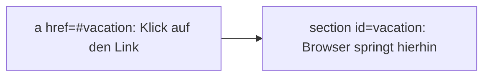

# HTML: Links und Navigation

Ein Link ist das, was das Web zum **Web** macht: Seiten verweisen aufeinander. Dafür gibt es das Element `<a>` (**anchor**, also Anker). Weitere Elemente: [[HTML Textelemente]] und [[HTML Listen]].

## Das `<a>`-Element
```html
<a href="about.html">Über mich</a>
```
- `href` steht für **hypertext reference** und enthält das **Ziel** des Links.
- Der Text zwischen `<a>` und `</a>` ist das, was man auf der Seite anklickt.
- Wichtig: Das Tag muss **sauber geschlossen** werden. Ein Link ohne `>` nach dem `href` oder ohne `</a>` bricht die Seite.

### Absolute und relative Links
| Art | Beispiel | Wann |
|---|---|---|
| **Absolut** | `href="https://steamcommunity.com/..."` | Link auf **eine andere Website** |
| **Relativ** | `href="about.html"` | Link auf eine **Datei im eigenen Projekt** |

Relative Referenzen sind kürzer, und sie funktionieren auch, wenn die ganze Website später auf einen anderen Server umzieht.

### Beispiel: Link zu meinem Steam-Profil
Hier ein echtes Beispiel auf meiner Seite: [Gamingburger007 auf Steam](https://steamcommunity.com/profiles/76561199547919597)

```html
<p>Hier findest du mich auf Steam:
    <a href="https://steamcommunity.com/profiles/76561199547919597" target="_blank" rel="noopener">Gamingburger007 auf Steam</a>
</p>
```
- `target="_blank"` öffnet den Link in einem **neuen Tab**.
- `rel="noopener"` ist eine Sicherheitseinstellung für fremde Seiten, die man bei `_blank` mit angeben sollte.

## `<a>` und `<link>` sind nicht dasselbe
- `<a>` ist für **Links zum Anklicken** auf der Seite.
- `<link>` steht im `<head>` und verbindet **Dateien** mit der Seite, z. B. das Favicon oder eine CSS-Datei (siehe [[HTML Grundlagen]]). Auf der Seite ist es **unsichtbar**.

## Navigation mit `<nav>` und Sprungmarken
Mit `<nav>` kennzeichnet man den Bereich mit der **Navigation**. Meist steckt darin eine Liste mit Links ([[HTML Listen]]).

```html
<nav>
    <ul>
        <li><a href="#html">Learning HTML</a></li>
        <li><a href="#vacation">Planning a Vacation</a></li>
    </ul>
</nav>
```

Ein `#` am Anfang bedeutet: **Sprung innerhalb derselben Seite** zu einem Element mit dieser `id`. Das Ziel braucht dann die passende `id`:

```html
<section id="vacation">
    <h2>I Am Also Planning a Vacation</h2>
</section>
```



![[html-nav-anker.png]]

Auf dem Bild sieht man oben die Navigation als Liste mit zwei Links. Ein Klick scrollt direkt zum passenden Abschnitt.

## `<section>`
`<section>` fasst **zusammengehörigen Inhalt** zu einem Abschnitt zusammen, quasi eine eigene "Schublade" im Code. Meist beginnt ein Abschnitt mit einer Überschrift. Mit `id` kann man ihn als Sprungziel nutzen.

## `<hr>`
`<hr>` steht für **horizontal rule**, also eine waagrechte Linie. Sie trennt Abschnitte inhaltlich voneinander (siehe [[HTML Textelemente]]).

## Zurück nach oben
```html
<p>
    <a href="#">Back to the Top</a>
</p>
```
Der Link `#` bringt einen direkt **an den Anfang der Seite** zurück. Die Seite wird dabei **nicht neu geladen**, es wird nur nach oben gescrollt. Praktisch am Ende von langen Seiten.

## Weitere Link-Arten
```html
<ul>
    <li>Download an <a href="html5.png" download>HTML5 favicon</a></li>
    <li>Contact me at <a href="mailto:random@email.com">my email address</a>.</li>
</ul>
```
- **`download`** lädt die Datei herunter, statt sie im Browser zu öffnen.
- **`mailto:`** öffnet das E-Mail-Programm mit der angegebenen Adresse.

Am Ende der Seite kann man auch im Copyright den Namen verlinken:
```html
<hr>
&lt;&lt;&lt; &copy; <a href="about.html">Dave Gray</a> &gt;&gt;&gt;
```

![[html-links-mailto-download.png]]

## Kurz zusammengefasst
- `<a href="...">` macht einen Link, `href` ist das Ziel.
- Relativ (`about.html`) für eigene Dateien, absolut (`https://...`) für fremde Seiten.
- `#id` springt innerhalb der Seite, `#` alleine springt nach oben.
- `<nav>` für die Navigation, `<section>` für Abschnitte.

## Siehe auch
- [[HTML Textelemente]]
- [[HTML Listen]]
- [[HTML Grundlagen]]
