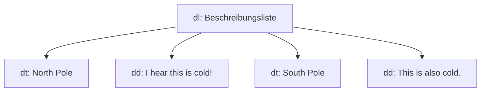

# HTML: Listen

Listen machen Inhalte **übersichtlicher und besser lesbar**. Es gibt drei Arten. Die Grundlagen zu Dokumentaufbau und Textelementen stehen in [[HTML Grundlagen]] und [[HTML Textelemente]].

| Element | Name | Was es macht |
|---|---|---|
| `<ul>` | **u**nordered **l**ist | Liste mit **Aufzählungspunkten**, die Reihenfolge ist egal |
| `<ol>` | **o**rdered **l**ist | **Nummerierte** Liste, die Reihenfolge ist wichtig |
| `<li>` | **l**ist **i**tem | Ein **einzelner Eintrag** in einer `<ul>` oder `<ol>` |

> [!important] `<li>` braucht eine Liste drumherum
> Ein `<li>` steht immer **innerhalb** von `<ul>` oder `<ol>` und wird mit `</li>` geschlossen. Alleine macht `<li>` keine Liste.

## Nummerierte Liste (`<ol>`)
```html
<h3>My Daily Schedule</h3>
<p>Let me tell you how:</p>
<ol>
    <li>...I learn more about web dev.</li>
    <li>...I plan out my schedule.</li>
    <li>...I use resources from <abbr title="Mozilla Developer Network">MDN</abbr>.</li>
</ol>
```
Der Browser nummeriert die Einträge **automatisch** mit 1, 2, 3. Im letzten Eintrag steckt eine Abkürzung mit `<abbr>` (siehe [[HTML Textelemente]]).

![[html-liste-code.png]]

So sieht es im Browser aus: Die Einträge sind nummeriert und die Abkürzung MDN ist gepunktet unterstrichen.

![[html-liste-ergebnis.png]]

## Liste mit Punkten (`<ul>`)
```html
<ul>
    <li>I've heard good things about the Caribbean.</li>
    <li>I've heard good things about going here:</li>
</ul>
```
`<ul>` sieht genau gleich aus wie `<ol>`, nur mit **Punkten statt Zahlen**. Man nimmt sie, wenn es keine feste Reihenfolge gibt.

## Beschreibungsliste (`<dl>`, `<dt>`, `<dd>`)
Eine **Description List** ist eine Liste aus Begriffen und ihren Erklärungen, ähnlich wie ein Wörterbuch.

| Element | Name | Bedeutung |
|---|---|---|
| `<dl>` | description list | Umschliesst die ganze Liste |
| `<dt>` | description **term** | Der **Begriff** |
| `<dd>` | description **details** | Die **Beschreibung** zum Begriff, wird eingerückt angezeigt |

```html
<h3>Places I Want to Avoid</h3>
<dl>
    <dt>North Pole</dt>
    <dd>I hear this is <strong>cold</strong>!</dd>

    <dt>South Pole</dt>
    <dd>This is also cold.</dd>

    <dt>Mountain Tops</dt>
    <dd>These are also cold.</dd>
</dl>
```

![[html-dl-beschreibungsliste.png]]

Rechts im Browser siehst du: Der Begriff steht links, die Beschreibung darunter und **eingerückt**. Im ersten `<dd>` ist `<strong>` benutzt, deshalb ist "cold" fett.



## Kurz zusammengefasst
- Aufzählung ohne Reihenfolge: `<ul>` mit `<li>`
- Nummerierte Schritte: `<ol>` mit `<li>`
- Begriff und Erklärung: `<dl>` mit `<dt>` und `<dd>`

## Siehe auch
- [[HTML Textelemente]]
- [[HTML Links und Navigation]]
- [[HTML Grundlagen]]
