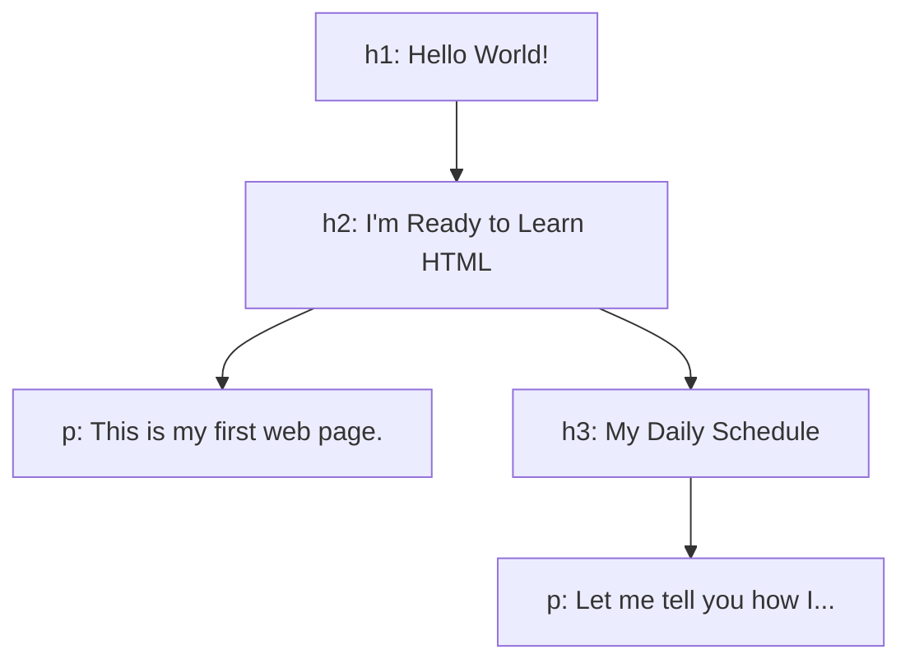

# HTML: Überschriften und Textelemente

Eine Website ist aufgebaut wie eine **Zeitung**: Es gibt Überschriften, Untertitel und Abschnitte (Paragraphen). Alles, was man sieht, steht im `<body>`. Die Grundlagen zum Dokumentaufbau stehen in [[HTML Grundlagen]].

## Überschriften und ihre Hierarchie
- `<h1>` ist die Haupt-Überschrift und am grössten, `<h2>` ist kleiner, `<h3>` wieder kleiner (bis `<h6>`).
- Ein Untertitel kann wieder einen Untertitel haben (`<h2>` unter `<h1>`, `<h3>` unter `<h2>`).
- Mit `<p>` schreibt man einen Absatz (Paragraph), z. B. den Text unter einer Überschrift.
- Jedes Element braucht ein **öffnendes und ein schliessendes Tag**: `<h1>Hello World!</h1>`. Das schliessende Tag hat einen `/`.



> [!important] Warum die Hierarchie wichtig ist
> Personen mit einem **Screenreader** lesen sich oft nur die Überschriften vor und entscheiden dann, wo sie weiterlesen. Darum muss die Reihenfolge stimmen: erst `<h1>`, dann `<h2>`, dann `<h3>`, ohne Ebenen zu überspringen.

![[html-ueberschriften.png]]

## Linien und Zeilenumbrüche
| Element | Wirkung |
|---|---|
| `<hr>` | Waagrechte **Linie**, die Abschnitte trennt |
| `<br>` | **Break**: macht einen Zeilenumbruch |
| `&nbsp;` | Geschütztes Leerzeichen (non-breaking space), wird **nicht** weggekürzt |

### Quiet Space Collapsing
HTML zeigt Leerzeichen und Zeilenumbrüche aus dem Code **nicht** an: Mehrere Abstände werden zu einem einzigen zusammengezogen (*white-space collapsing*). Abstände und Einrückungen muss man deshalb **ausdrücklich** schreiben, z. B. mit `<br>` oder `&nbsp;`.

## Block-Level und Inline-Level
- **Block-Level-Elemente** (z. B. `<h1>`, `<p>`, `<hr>`, `<address>`) beginnen in einer neuen Zeile und nehmen die ganze Breite ein. Innerhalb eines `<p>` darf kein weiteres Block-Element (z. B. `<h1>` oder ein zweites `<p>`) stehen.
- **Inline-Level-Elemente** (z. B. `<em>`, `<strong>`, `<abbr>`) stehen **mitten im Text** und brechen die Zeile nicht um.

## Hervorheben im Text
- `<em>` steht für **emphasis** (Betonung). Der Browser zeigt den Text kursiv, und Screenreader betonen die Stelle beim Vorlesen.
- `<strong>` steht für **starke Wichtigkeit**. Der Text ist fett, und Screenreader weisen darauf hin.

```html
<p>Das ist <em>wichtig</em> und das ist <strong>sehr wichtig</strong>.</p>
```

## Weitere Elemente
### `<abbr>`: Abkürzung
Zeigt den Text **gepunktet unterstrichen**. Die Langform steht im `title`-Attribut und erscheint beim Darüberfahren. Nicht für wichtige Inhalte verwenden, weil viele Lesehilfen es nicht lesen oder falsch übersetzen.

```html
<abbr title="Hyper Text Markup Language">HTML</abbr>
```

### `<address>`: Adresse
Sagt dem Browser ausdrücklich, dass jetzt eine **Adresse** (Kontaktangabe) folgt. Sie wird anders formatiert, und auch Screenreader erkennen sie besser.

### Copyright am Ende der Seite
Am Ende des Dokuments stehen Copyright und Name des Autors:

```html
<hr>
&lt;&lt;&lt; &copy; Tim Bürgin &gt;&gt;&gt;
```

Das sind **HTML-Entities** (Sonderzeichen-Codes): `&lt;` ergibt `<`, `&gt;` ergibt `>`, `&copy;` ergibt ©. Man braucht sie, weil ein echtes `<` vom Browser als Beginn eines Tags gelesen würde.

### Kommentare
```html
<!-- Dieser Text ist auf der Seite unsichtbar -->
```
Kommentare sieht nur, wer den Code anschaut. Ein Rechtsklick auf die Seite und **Untersuchen** (Inspect) zeigt den kompletten Quellcode samt Kommentaren. Darum nie Geheimes oder Passwörter in Kommentare schreiben.

## Fehler finden
Fehlt zum Beispiel das `>` eines Tags, kann das eine ganze Liste von Fehlern auslösen. Mit dem **W3C-Validator** (siehe [[HTML Grundlagen]]) findet man solche Fehler schnell.

## Tipp: Visual Studio Code
**Shift + Alt + Pfeil nach unten** kopiert die aktuelle Zeile nach unten. Das spart viel Tipparbeit, z. B. bei mehreren Überschriften.

## Siehe auch
- [[HTML Grundlagen]]
- [[CSS Grundlagen]]
- [[Wie das Web funktioniert]]
