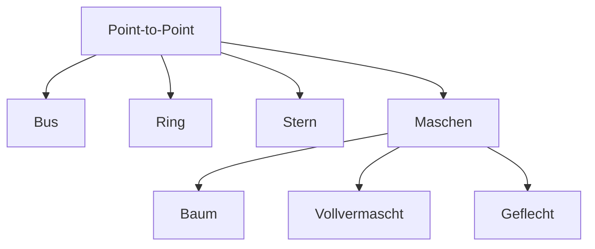

# Netzwerktopologien

Unterschiedliche Verbindungsarten von Rechnern in einem Netz nennt man Netzwerktopologie. Sie erfolgt meistens physikalisch, also per Kabel.

- Die einfachste Art der Topologie ist die **Point-to-Point**-Topologie (zwei Hosts direkt mit Kabel verbunden).
- Um mehrere Hosts miteinander zu verbinden, benutzt man meistens Netzwerkkomponenten mit Verteilfunktion (z. B. Switches oder Router).
- **Bus, Ring, Stern und Maschen** sind die vier Grundtopologien.

## Bus-Topologie

![[bus-topologie.jpg]]

> [!success] Vorteile
> Einfache Installation, kurze Leitungen. Verbindung aller Hosts über die gleiche Leitung (Bus).

> [!failure] Nachteile
> Begrenzte Netzausdehnung, bei Kabelbruch: Netzausfall.

## Ring-Topologie

![[ring-topologie.jpg]]

> [!success] Vorteile
> Verteilte Steuerung, grosse Netzausdehnung. Ringförmige Verbindung der Geräte über geschlossene Kabelstrecke.

> [!failure] Nachteile
> Aufwändige Fehlersuche, hoher Verkabelungsaufwand, Netzausfall bei Störungen.

## Stern-Topologie

![[stern-topologie.jpg]]

> [!success] Vorteile
> Einfache Vernetzung und Erweiterung, hohe Ausfallsicherheit. Sternförmige Verbindung mehrerer Hosts über eine zentrale Netzwerkkomponente (Hub/Switch).

> [!failure] Nachteile
> Hoher Verkabelungsaufwand, Netzausfall bei Überlastung der Zentrale.

## Maschen-Topologie (Mesh)

![[maschen-topologie.jpg]]

> [!success] Vorteile
> Dezentrale Steuerung, hohe Ausfallsicherheit, beliebig weite Netzerweiterung. Keine verbindlichen Strukturen, nicht zwingend eine Verbindung zwischen allen Hosts.

> [!failure] Nachteile
> Teure Vernetzung, aufwändige Administration.

## Weitere Topologien
- **Baum-Topologie:** kostengünstig, hohe Ausfallsicherheit
- **Vollvermaschte Topologie:** volle Bandbreite
- **Geflecht-Topologie:** hohe Geschwindigkeit, einfaches Management
- In der Praxis oft eine **Mischung aus mehreren Topologien**

## Universelle Gebäudeverkabelung (UGV)
Man kann dasselbe Kabel für unterschiedliche Nutzungen verwenden, was sehr flexibel macht. In der Brüstung, in einem Aufputz-Kanal, in Rohren oder einer Trasse kann man Kabel verlegen und so verstecken. Sie ist dort entstanden, wo wir noch keine Konvergenz hatten (getrennte Netze für Telefon/Daten).

- **Letzte Meile:** Man kann wählen, welche Zentrale am Ende vom Kabel ist. Point-to-Multi-Point ist von Swisscom.
- Norm **EN 50173-1** beschreibt, wie eine strukturierte Verkabelung aussehen muss.

## Siehe auch
- [[Netzwerk Grundlagen]]
- [[OSI-Modell]]
