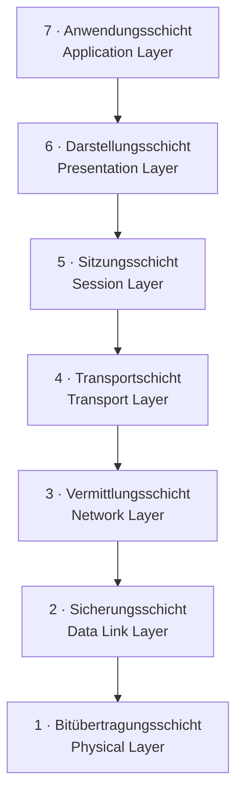

# OSI-Modell einfach erklärt

OSI = **Open Systems Interconnection**. Referenzmodell für Netzwerkprotokolle. Probleme sind dadurch leichter lösbar, weil die Kommunikation zwischen den Schichten klar definiert ist.

![[osi-modell-uebersicht.jpg]]

Beim Endgerät werden die Schichten beim Empfang **andersherum** durchlaufen als beim Senden.

## Die 7 Schichten (von oben nach unten)

### Schicht 7 – Anwendungsschicht (Application Layer)
Schnittstelle zur Anwendung: Anfrage raus, Wiedergabe im erforderlichen Format rein.

### Schicht 6 – Darstellungsschicht (Presentation Layer)
Verschlüsselung, Komprimierung und Übersetzung, z. B. in HTTP oder HTTPS. Daten sollen von jeder Hard- und Software empfangen und gelesen werden können.

### Schicht 5 – Kommunikationsschicht / Sitzungsschicht (Session Layer)
Verbindungen zwischen den Endsystemen – die "Sitzung" bzw. "Session". Zeit zwischen Öffnen und Schliessen der Kommunikation. Checkpoints helfen bei Vermittlungsfehlern.

### Schicht 4 – Transportschicht (Transport Layer)
Fehler beim Transport: Daten werden bei Bedarf erneut geschickt. Zwischen Sender und Empfänger.

### Schicht 3 – Vermittlungsschicht (Network Layer)
Zerlegung in Datenpakete → Transport → Zusammenfügen der Pakete beim Empfänger. Hier sind die **IP-Adressen** angesiedelt, siehe [[IP-Adressierung & Subnetting]].

### Schicht 2 – Sicherungsschicht (Data Link Layer)
Datentransfer zwischen zwei Geräten **im selben Netzwerk**. Zerlegung in Fragmente → Transport → Zusammenfügen der Fragmente. Hier ist die **MAC-Adresse** angesiedelt.

### Schicht 1 – Bitübertragungsschicht (Physical Layer)
Schnittstelle zum Übertragungsmedium (Kabel). Überträgt den reinen Bitstrom zwischen Sender und Empfänger.

> [!tip] Merkhilfe
> Oben = näher an der Anwendung/Mensch, unten = näher an der Hardware/Kabel. Beim Senden geht man 7→1, beim Empfangen 1→7.

## Siehe auch
- [[Netzwerk Grundlagen]]
- [[IP-Adressierung & Subnetting]]
- [[Netzwerktopologien]]
