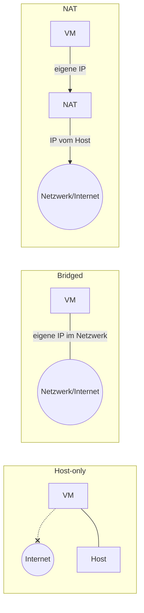

# Virtualisierung & VM-Netzwerktypen

> Siehe auch deine beiden ausführlichen Word-Anleitungen: "Windows-11-Enterprise-VM-Anleitung" und "Host-Bridged-NAT-VM-Anleitung" – hier die Kurzfassung der Kernpunkte aus dem Unterricht.

## Grundlagen
- Windows Editionen hinsichtlich Funktionsumfang vergleichen
- Windows Datenschutzkonform installieren: lokales Konto, angepasste Einstellungen

## VM-Netzwerktypen
**Host-Basiert, Bridged, NAT** sind Arten von virtualisierten Verbindungen. Man muss immer abschätzen, was die VM braucht.

### Host-Basiert (Host-only)
- Heisst: es gibt **kein Internet** für die VM – die VM kann nur mit dem Host kommunizieren.

### Bridged (Extern)
- Beim Bridged-Network wird eine **"normale" Verbindung** zum Internet hergestellt.
- Benutzt die **IP-Adresse vom Host**-Netzwerk (die VM erscheint wie ein eigenes Gerät im Netzwerk).

### NAT-Basiert
- **Virtualisierter NIC**, **virtualisiertes NAT**
- NAT erstellt eine **eigene IP-Adresse** für die VM
- Die IP im (externen) Netzwerk ist die vom Host
- **NAT** = Network Address Translator

## Windows-Editionen (Lizenzvarianten)
- Windows Pro
- Windows Pro N
- Windows Education
- Windows Education N
- Windows Pro Education
- Windows Pro Education N

> [!note] Es gibt andere Windows-Varianten, die spezifisch für Europa gemacht wurden, aufgrund der Normen und Nutzerrichtlinien etc. (die "N"-Varianten, z. B. ohne Media Player).

## Siehe auch
- [[BIOS & UEFI]]
- [[Lizenzierung – OEM, Retail, KMS, MAK]]
- [[Betriebssysteme Übersicht]]
