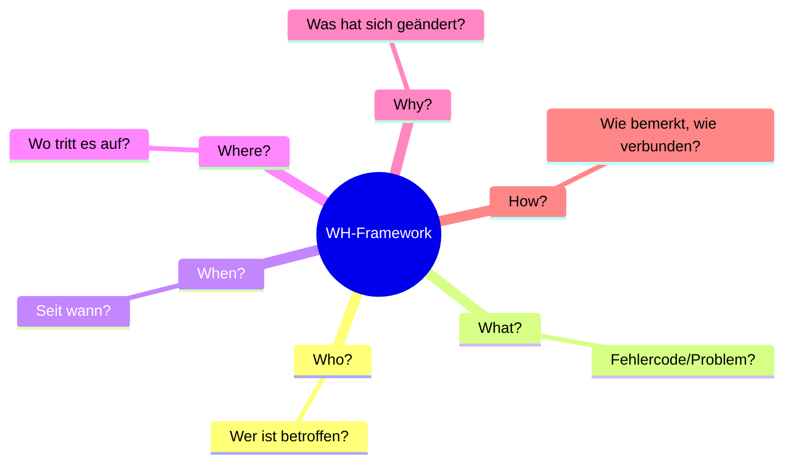

# Week 01 – The WH Framework

Grundwerkzeug, um ein vages IT-Problem in konkrete, beantwortbare Fragen zu zerlegen. Für jeden Anker (Who/What/When/Where/Why/How) eine spezifische Frage stellen.

## Die 6 WH-Anker

| Anchor | Frage im Beispiel "Printer Not Found" |
|---|---|
| Who? | Is it just you or the whole office? |
| What? | What is the error message or the error code? |
| When? | When wasn't it working, or when did it stop working? |
| Where? | Is it only in your office or also at home? Which floor/room? |
| Why? | Have you made any changes on the computer or an update? |
| How? | How did you notice the problem? How are you connecting? |

### Weiteres Beispiel: "Email Not Sending"
- **Who?** Is it just you or also the other colleagues?
- **What?** What Email provider do you use / what kind mail are you using?
- **When?** When did the problem occur?
- **Where?** Is the problem only in your office? Or also at home?
- **Why?** Are all replies or just certain ones?
- **How?** How did you notice the problem?

## Missing Information Checklist (Worksheet)
Für jeden WH-Anker: was fragt man, und warum ist es wichtig?

| WH | What to ask | Why it matters |
|---|---|---|
| Who? | Are you the only one with this problem, or are there others? | Um das Problem einzugrenzen und zu sehen, ob andere betroffen sind |
| What? | What is the error code or the specific problem? | |
| When? | When did you notice the problem, or when did it stop working? | |
| Where? | Is it only at your office or everywhere? | |
| Why? | Have you made any changes or did you update your Windows version? | |
| How? | How did you notice the problem, and how are you connected to the device? | |

## WH-Questions – Deutsch/Englisch-Übersetzung (Übung)

| # | Deutsch | Englisch |
|---|---|---|
| 1 | Was ist das Problem? | What is the problem? |
| 2 | Wo tritt es auf? | Where does it occur? |
| 3 | Wann passiert es? | When does it happen? |
| 4 | Warum passiert es? | Why does it happen? |
| 5 | Wie zeigt es sich? | How does it show itself? |
| 6 | Wer ist betroffen? | Who is affected? |
| 7 | Womit hängt es zusammen? | What is it connected to? |
| 8 | Wie oft passiert es? | How often does it happen? |
| 9 | Wie lange dauert es? | How long does it last? |
| 10 | Wie viel Schaden entsteht? | How much damage occurs? |

## Praxis-Szenario: The Overloaded Helpdesk (HZ1)

**Firma:** Müller & Partner AG – Schweizer Logistikunternehmen, 180 Mitarbeitende, Standorte Zürich & Winterthur.
**Ticketing:** E-Mail-Postfach + Tabelle, keine Helpdesk-Software.
**Metrics:** Durchschnittliche Antwortzeit unbekannt, nie gemessen; letzten Monat +30 neue Tickets durch 2 Onboardings.

> [!quote] Sandra Keller (Manager)
> "People say it takes forever to get help – and the fix isn't always right. Someone waited three days for a password reset. I need something concrete. The ERP rollout is in six weeks."

**Eigene Research-Fragen dazu:**
1. Which location takes forever to respond?
2. How is the fix not right?
3. Why did he wait 3 days?

Dieses Szenario (HZ1) wird in Woche 6 vertieft, siehe [[W06 – Big-6-Modell & Research-Plan]].

## Siehe auch
- [[W02 – Suchoperatoren & Tools]]
- [[W06 – Big-6-Modell & Research-Plan]]
