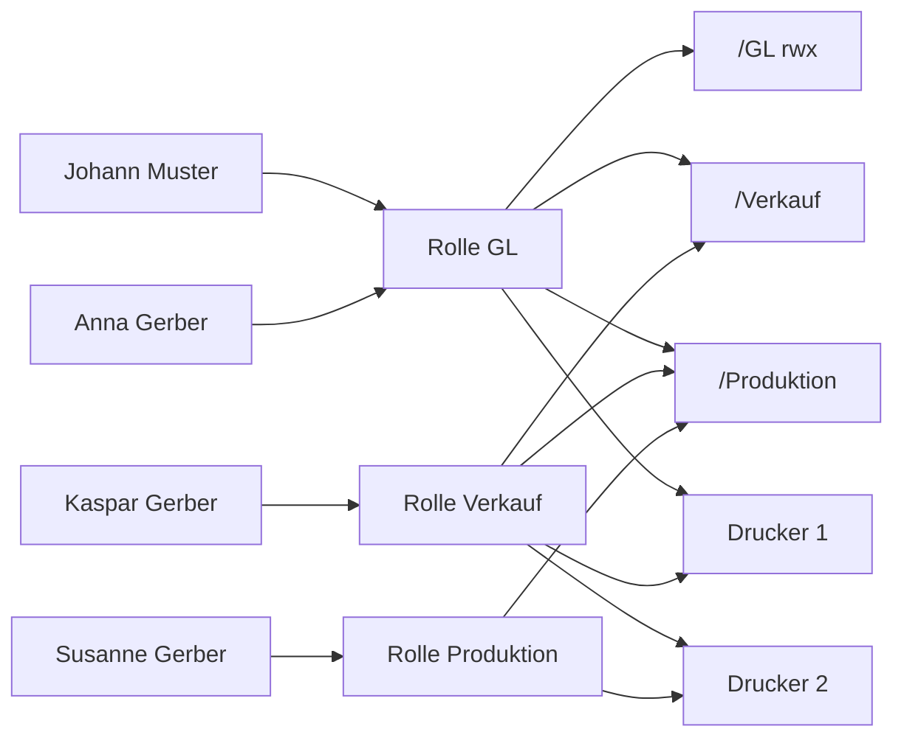

# Benutzer, Gruppen & Berechtigungen (Ressourcenverwaltung)

> [!info] Worum geht es?
> In einem Netz gibt es **Ressourcen** (Drucker, Scanner, Speicher, Applikationen, Cloud-Zugänge). Nicht jeder in der Firma und schon gar keine Fremden sollen auf alles zugreifen. Darum richtet man eine **Zugangskontrolle** ein. Im Modul 117 **ohne zentrale Verwaltung**, also lokal auf jedem PC (Peer-to-Peer, siehe [[Netzwerkarten & Betriebsarten]]).
> Die praktische Umsetzung mit Excel-Matrix steht in [[Hausaufgabe 02.11. – Benutzer, Gruppen & Berechtigungs-Matrix]] und [[Hausaufgabe 09.11. – IT-Dokumentation & Berechtigungs-Matrix]].

## Die vier Begriffe

| Begriff | Frage | Beispiel |
|---|---|---|
| **Benutzer** | **WER** ist es? | `DEREVA` (Eva Derungs) |
| **Gruppe** | **WEM** werden Rechte gegeben? | `GroupVerkauf` |
| **Berechtigung** | **WAS** darf man tun? | Lesen, Ändern, Vollzugriff |
| **Freigabe** | **WO** darf man das tun (übers Netz)? | `\\192.168.100.51\Verkauf` |

> [!important] Freigabe ≠ Berechtigung
> - **Freigabe** = einen Ordner im Netzwerk **sichtbar machen**
> - **Berechtigung** = was jemand mit den Daten **machen darf** (lesen, schreiben, löschen)
> Details zu den zwei «Barrieren»: [[Dateizugriffsrechte – NTFS & Freigaben]]

## Benutzer
- Jeder Mensch hat einen **eigenen Benutzernamen** (Klartextname oder E-Mail), dazu ein **Passwort** und heute oft eine Handynummer für **Mehrfaktor-Authentisierung (MFA)**.
- Situationen: ein Benutzer an einem PC · ein Benutzer an mehreren PCs · mehrere Benutzer am gleichen PC · Benutzer in verschiedenen Gruppen.
- Werkzeug unter Windows **Pro**: **`lusrmgr.msc`** (lokale Benutzer und Gruppen). In der **Home**-Version gibt es das nicht.

## Gruppen statt Einzelrechte (Rollenbasierte Zugriffskontrolle, RBAC)

> [!danger] Goldene Regel
> **Berechtigungen werden NUR an Gruppen verteilt**, nie direkt an einzelne Benutzer.

**Warum?** Beispiel aus dem Skript: Rechte direkt an 7 Personen zu verteilen geht noch. Bei **50+ Mitarbeitenden** oder wenn jemand die Firma **verlässt**, muss man auf vielen Systemen einzeln anpassen → zu viel Aufwand, Lücken bleiben offen.

**Mit Gruppen/Rollen:**
1. **Rollen** erstellen und ihnen **Ressourcen** zuteilen (z. B. Rolle GL: Verkauf, Produktion, GL-Files, Drucker 1)
2. **Benutzer den Rollen** zuordnen
3. Neue Mitarbeiterin in die Gruppe → hat **sofort alle Rechte** der Gruppe. Aus der Gruppe entfernt → verliert **sofort alle Rechte**.
4. Projekt fertig → Projektgruppe **deaktivieren**, es «geistern» keine Berechtigungslücken herum.

**Rechte-Kürzel im Skript:** `r` = nur lesen · `w` = schreiben · `x` = ausführen (Programme starten)

## Berechtigungsarten in der Berechtigungsmatrix (TBZ-Folien)

| Kürzel | Bedeutung |
|---|---|
| **R** | Lesen (Read) |
| **M** | Ändern (Manipulate / Modify) |
| **X** | Ausführen (eXecute) |
| **F** | alle Rechte (Full = Vollzugriff) |
| **nR** (durchgestrichen) | **keine Rechte / Recht verweigern** |
| **–** | kein Eintrag (nichts erteilt) |

Auf einer anderen Folie: **F** = Full/Vollzugriff · **C** = Change (Lesen + Schreiben) · **R** = Read.

## Berechtigungsmatrix (BM)

![[berechtigungsmatrix-beispiel.png]]

> [!warning] Standardgruppen IMMER erstellen
> **GroupMA** (alle Mitarbeitenden) und **GroupAdmin** (Vollzugriff überall) werden vom Kunden oft **nicht explizit verlangt**, müssen aber von uns **immer** erstellt werden.

> [!danger] Zwei Tabellen, nie mischen!
> Niemals Gruppenzugehörigkeit und Berechtigungen in **einer** Tabelle mischen. **Immer zwei Tabellen:**
> 1. **Tabelle 1:** Wer gehört zu welcher Gruppe?
> 2. **Tabelle 2:** Berechtigungsmatrix (welche Gruppe hat auf welchen Ordner welches Recht?)

**Tabelle 1 – Gruppenzugehörigkeit (Beispiel)**

| Benutzer | Kurzzeichen | GroupVerkauf | GroupFinanzen | GroupGL | GroupMA | GroupAdmin |
|---|---|---|---|---|---|---|
| Eva Derungs | DEREVA | ✔ | | | ✔ | |
| … | | | | | ✔ | |
| IT-Admin | | | | | ✔ | ✔ |

**Tabelle 2 – Berechtigungsmatrix (Beispiel aus der Folie)**

| Gruppe \ Ordner | PfadAbteilung1 | PfadAbteilung2 | PfadAbteilung3 | PfadGL | PfadMA |
|---|---|---|---|---|---|
| GroupName1 | RMX | – | – | nR | – |
| GroupName2 | – | RMX | – | nR | – |
| GroupName3 | – | – | RMX | nR | – |
| GroupGL | R | R | R | RMX | – |
| **GroupMA** | – | – | – | – | RMX |
| **GroupAdmin** | F | F | F | F | F |

### Beispiel-BM aus Teams (Excel)
Links die **Verzeichnisse (Security, NTFS)**, rechts die **Freigaben (Share)**:

| Gruppe | gruppen | Sekretariat | Buchhaltung | GL | Informatik | Aussendienst | apps | public | %username% | ⟶ Share: Abteilungen | Programme | Public | %username%$ |
|---|---|---|---|---|---|---|---|---|---|---|---|---|---|
| Sekretariat | – | rw | – | – | – | r | – | – | – | – | – | – | – |
| Buchhaltung | – | – | rw | r | – | – | – | – | – | – | – | – | – |
| GL | – | – | – | rw | – | – | – | – | – | – | – | – | – |
| Informatik | rw | rw | rw | rw | rw | rw | rw | – | rw | – | rw | – | rw |
| Aussendienst | – | – | – | – | – | rw | – | – | – | – | – | – | – |
| %username% | – | – | – | – | – | – | – | – | rw | – | – | – | rw |
| Jeder | r | – | – | – | – | – | r | rw | – | rw | r | rw | – |

- Ordnerstruktur anzeigen mit **`tree`**, Rechte prüfen mit **`cacls`/`icacls d:\gruppen`**
- Freigaben anzeigen mit **`net share`**, eine Freigabe prüfen mit **`net share abteilungen`**
- `%username%` = Home-Verzeichnis des jeweiligen Benutzers, `$` am Ende = **versteckte Freigabe**

### Rollen-Tabelle aus dem Skript (Kap. 5.3)

| Rolle | Drucker | Verzeichnis (r,w,x) | Verzeichnis (r) | Applikation |
|---|---|---|---|---|
| Geschäftsleitung | p1 | /GL, /Preise | /Technik, /Admin | MS 365, Buchhaltung, ERP/CRM |
| Produktion | p2, Plotter 1 | /Produktion, /Technik | /Katalog | MS 365, CAD-CAM |
| Verkauf | p1, p2 | /Verkauf | /Katalog, /Preise | MS 365, ERP/CRM |
| Einkauf | p2, p3 | /Einkauf | /Katalog, /Preise, /Lieferanten | MS 365, ERP/CRM |
| Technik | p1, p2, p3, Plotter 1 | /Technik | | MS 365, Tools |

Danach: Rollen ↔ Mitarbeitende mit **Kurzzeichen, Mail, Mobil** (z. B. GL – Heiri Müller – HMU).

## Berechtigungsmanagement richtig machen
Berechtigungen müssen **dokumentiert**, vom **Management bewilligt** und **periodisch überprüft** werden. Oft gibt die Technik Rechte, die das Management gar nicht will.
Vorgabe: **BSI IT-Grundschutz-Kompendium, Baustein ORP.4** (Identitäts- und Berechtigungsmanagement). Es muss beantworten:
- **WER** hat wo Zugriff? (Personen)
- **WO** hat wer Zugriff? (Verzeichnisse, Funktionen, Applikationen)
- **Wer SOLLTE** worauf Zugriff haben? (Qualifikation, **Data-Owner-Konzept**)

**Vorgehen:**
1. Wem gehören die Daten? Meist ist der **Verfasser der Data Owner**.
2. Wer soll welche Daten und Funktionen sehen und benutzen? Wer ausser dem Owner darf ändern?
3. Wer braucht überhaupt Zugriff auf welche Ressourcen?
4. **Rollen** definieren → Tabelle Rollen ↔ Ressourcen mit r/w/x
5. Mitarbeitende den Rollen zuordnen

> [!warning] Home-Verzeichnisse
> Home-Directories werden **automatisch erstellt** und gehören **immer dem Benutzer**. Niemand sonst darf hineinschauen. Man darf sie **nicht** Rollen zuweisen (wäre nicht legal).

> In der Praxis macht man das mit spezieller Software, in Firmen gelten **die Firmenvorgaben**. Für M117/LB3 reichen einfache Tabellen.

## Grundlage: die Systemdokumentation
Jede Firma hat eine eigene. Sie definiert:
- **wie** was benannt wird (Namenskonzept)
- die **Pfade** der Datenablagen
- **Passwort-Richtlinien**
- das **Adressierungskonzept** (IP)
→ Beispiel: [[LB3 – Projekt Sota GmbH#Teilauftrag 3 – IT-Konzept & Systemdokumentation]]

## Freigaben in der Firma
- In Firmennetzen gilt meist: **KEINE eigenen Freigaben** auf Arbeitsplatz-PCs! Sonst lässt sich die Sicherheits-Policy nicht durchsetzen und niemand hat mehr den Überblick.
- Besser: die Ressourcenzuteilung eines **NAS, File- oder Printservers** nutzen (Demo: demo.synology.com → «Benutzer und Gruppe»).
- In M117 machen wir trotzdem lokale Freigaben, weil es **keinen zentralen Server** geben soll.

### Druckdienste in einem kleinen Netz
1. **Alter PC als Druckserver** (nicht eine benutzte Arbeitsstation: wird sie ausgeschaltet, ist der Druckdienst weg)
2. **Dedizierter Printserver** (z. B. Raspberry Pi oder fertiges Gerät)
3. **Interner Printserver** im Druckzentrum/Multifunktionsgerät
4. **Druckserver im Router** (z. B. Fritzbox)

Auch dort lassen sich Gruppen und User einrichten. Man merkt: Ohne zentrale Benutzerverwaltung stösst man schnell an Grenzen, darum setzt man in der Praxis oft doch einen Windows- oder Linux-Server ein.

## Begriffe, die verwechselt werden

| Begriff A | ≠ | Begriff B |
|---|---|---|
| **Gruppe** (Benutzergruppe für Rechte) | | **Arbeitsgruppe** (Windows-Workgroup: PCs, die sich im Netz sehen) |
| **Windows-Arbeitsgruppe** (Peer-to-Peer, lokale Konten) | | **Windows-Domäne** (zentrale Verwaltung, Active Directory) |
| **lokale Freigabe** (File Server Resource Manager) | | **Server-Freigabe** (Server Manager) · **Cloud-Freigabe** (Kombination) |
| **Cloud-Speicher** | | **Speicher in der Cloud** |

## Siehe auch
- [[Dateizugriffsrechte – NTFS & Freigaben]]
- [[Benutzerverwaltung – Admin vs. Standardbenutzer]]
- [[Anforderungen & Netzwerkdienste#Cloud-Speicherung]]
- [[LB3 – Projekt Sota GmbH]]
