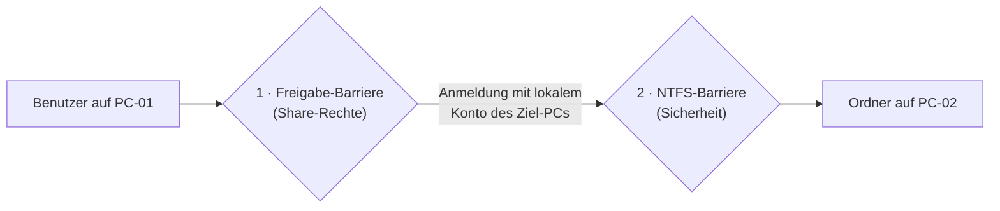

# Dateizugriffsrechte – NTFS & Freigaben

## Dateisystem-Grundlagen
- **Sekundärspeicher** (HDD, SSD) speichert Dateien dauerhaft. **Primärspeicher** = RAM.
- Das **Dateisystem** organisiert die Dateien als **Baumstruktur** mit Verzeichnispfaden.

| Begriff | Bedeutung | Beispiel |
|---|---|---|
| **Absoluter Pfad** | ab dem **Root** (Laufwerk) angegeben | `C:\Users\FelixMuster\Documents\ArduinoProjekte` |
| **Relativer Pfad** | nur ein Teilpfad, abhängig vom **CWD** (Current Working Directory) | `.\Documents\ArduinoProjekte` |
| `.` | das aktuelle Verzeichnis | `cd .\Documents` |
| `..` | das übergeordnete Verzeichnis | `cd ..\Downloads` |
| `cd ..` | eine Stufe **höher** Richtung Wurzel wechseln | |

### FAT32 vs. NTFS

| | **FAT32** (File Allocation Table) | **NTFS** (New Technology File System) |
|---|---|---|
| Berechtigungen | **keine!** | **ja** (ACL pro Datei/Ordner) |
| Max. Dateigrösse | **4 GiB** (≈ 4,3 GB) | praktisch unbegrenzt |
| Verwaltung | Tabelle | **MFT** (Master File Table), sehr kleine Dateien direkt in der MFT |
| Einsatz | USB-Sticks (kompatibel). Für grosse Dateien **exFAT** nehmen | Windows-Systemlaufwerk. Auf USB-Sticks eher ungünstig (Windows-proprietär) |

Formatieren/anschauen mit **`diskmgmt.msc`** (Datenträgerverwaltung).

> [!example] Kontrollfrage: verlorener FAT32-Stick mit Passwörtern
> **Ja, Sorgen machen!** FAT32 hat **keine Berechtigungen**, jeder kann alles lesen. Besser: NTFS mit Berechtigungen **und** sensible Daten zusätzlich **verschlüsseln**.
> Aber auch bei **NTFS** ist eine kopierte Datei standardmässig für **«Jeder»** lesbar. Schutz nur, wenn man einen Ordner «Secret» erstellt, die **Vererbung unterbricht**, nur den eigenen Benutzer mit Vollzugriff einträgt und die Datei dort hineinlegt.

## Warum Benutzerkonten?
Ohne Benutzer-Accounting gibt es **keine Dateizugriffsrechte**, jeder mit Zugang zum PC könnte alles lesen. Das Dateisystem muss Rechte unterstützen (NTFS) und das Konto braucht ein **Passwort**.

**Pro Benutzer** Rechte vergeben geht, aber jedem neuen Benutzer muss man alles einzeln zuweisen → riesiger Aufwand.
**Pro Gruppe** ist besser: Die neue Benutzerin «Gina» in Gruppe Blau hat **sofort alle Rechte** der Gruppe. → [[Benutzer, Gruppen & Berechtigungen]]

## Lokale vs. zentrale Benutzerverwaltung

| | **Lokal** (Peer-to-Peer, Arbeitsgruppe) | **Zentral** (Domäne) |
|---|---|---|
| Wo | jeder PC hat eigene Benutzerverwaltung | eine Verwaltung für die ganze Domäne |
| «Joe» | ist auf PC1 ein **anderer** Benutzer als auf PC2 | ist auf **allen** PCs derselbe |
| Grösse | Heimnetz, kleine Firma. Arbeitsgruppen funktionieren bis **max. ca. 20 Nutzer** (technisch und vom Aufwand her) | sinnvoll schon ab **> 10 Mitarbeitenden** |
| Dienst | – | **Verzeichnisdienst** (Directory Service), bei Microsoft **Active Directory** |
| Modul | **M117** | späteres Modul |

In einer Arbeitsgruppe hat **keine Maschine Kontrolle über eine andere**. Mit AD-Gruppen setzt man das **Prinzip der geringsten Rechte** (Least Privilege) am besten durch.

## UNIX vs. Windows

| | UNIX/Linux | Windows |
|---|---|---|
| Modell | 3 feste Klassen: **owner – group – others** | **ACL** (Access Control List / Zugriffssteuerungsliste): beliebig viele Einträge |
| Rechte | `rwx` je Klasse, z. B. `rw-` = 110₂ = 6, `r--` = 100₂ = 4 → `664` | pro Benutzer/Gruppe eigene Rechte |

**Ausführen bei Ordnern** = den Ordner **betreten** und den Inhalt sehen (`dir`/`ls`). Ohne dieses Recht kommt man nicht hinein, auch wenn man Rechte auf die Dateien darin hätte. Bei **Dateien** ist Ausführen nur bei Programmen, Batch-Dateien und Skripten wichtig.

## NTFS-Berechtigungen (Standardansicht)
(Rechtsklick → Eigenschaften → **Sicherheit**)

| Recht | Was erlaubt es? |
|---|---|
| **Vollzugriff** | **alles** auf Objekt und Unterobjekte: Lesen, Schreiben, Löschen, Ändern **plus Berechtigungen ändern und Besitz übernehmen** |
| **Ändern** | Lesen, Schreiben, Ausführen **und Löschen** des Objekts. **Nicht:** Berechtigungen ändern, Besitz übernehmen |
| **Lesen, Ausführen** | Inhalt und Attribute lesen, **Programme ausführen**, Ordner durchsuchen. Keine Änderungen |
| **Ordnerinhalt anzeigen** | nur bei Ordnern: wie «Lesen, Ausführen» (Ordner und Unterordner durchsuchen und lesen) |
| **Lesen** | **nur lesen** (Inhalt, Attribute, Berechtigungen). Kein Ausführen |
| **Schreiben** | nur **schreiben**: neue Dateien/Ordner, Attribute setzen. Kein Ausführen, kein Löschen |
| Spezielle Berechtigungen | erweiterte Ansicht («Erweitert»): die einzelnen Detailrechte |

**Hierarchie:** Vollzugriff ⊃ Ändern ⊃ (Lesen, Ausführen + Schreiben) · Lesen, Ausführen ⊃ Ordnerinhalt anzeigen ⊃ Lesen

> [!example]- Kontrollfragen mit Musterlösungen
> **B) «Lesen, Ausführen» heisst zusätzlich zu Lesen:** Eine Datei in Form eines Programms/Batch kann auch **ausgeführt** werden.
> **C) Was bringt «Vollzugriff» zusätzlich zu «Ändern»?** Berechtigungen ändern · Besitz übernehmen · untergeordnete Ordner/Dateien löschen. (Nicht: Vollzugriff aufs ganze Dateisystem, nicht Adminrechte.)
> **D) Was enthält «Ändern»?** Ändern, Lesen/Ausführen, Ordnerinhalt anzeigen, Lesen, Schreiben. **Was enthält «Lesen, Ausführen»?** Lesen/Ausführen, Ordnerinhalt anzeigen, Lesen.
> **E) «testuser» hat auf seinem eigenen Ordner «TestDirectoryA» Schreiben verweigert bekommen:** Er kann den Ordner **nicht mehr ändern oder löschen**, kann ihn aber **lesen**. Um das zu korrigieren, braucht es **Adminrechte**. Dass er den Ordner erstellt hat, gibt ihm **nicht** automatisch alle Rechte.

> [!warning] Verweigern schlägt Erlauben
> Ein explizites **Verweigern** (nR) gilt vor einem Erlauben, auch wenn der Benutzer über eine andere Gruppe das Recht hätte. Darum sparsam einsetzen.

## Vererbung
- Neue Ordner und Dateien **übernehmen** die Berechtigungen des **übergeordneten Ordners**.
- Bei Windows ist die Vererbung **standardmässig aktiv**.
- Will man das nicht: **pro Ordner explizit deaktivieren** (Sicherheit → Erweitert → «Vererbung deaktivieren»), dabei die geerbten Rechte übernehmen oder entfernen.

## Zugriff übers Netzwerk: zwei Barrieren

1. **Freigabe-Barriere:** In Peer-to-Peer-Netzen muss sich der externe Benutzer mit einem **lokalen Konto des Ziel-PCs** anmelden (Konto mit **Passwort**, leere Passwörter gehen übers Netz nicht).
2. **NTFS-Barriere:** Die Rechte auf dem Ordner entscheiden, ob er wirklich zugreifen darf.

> [!important] Es gilt das strengere Recht
> Übers Netzwerk wirken **Freigabe- und NTFS-Rechte zusammen**, das **restriktivere** gewinnt. Praxis: Freigabe grosszügig (z. B. Jeder: Ändern), die feinen Rechte über **NTFS** steuern. Lokal am PC zählen nur die NTFS-Rechte.

## UNC-Pfade
**UNC** = Uniform (im Skript: Unified) Naming Convention. Im Explorer in die Adresszeile eingeben:

| Variante | Beispiel | Voraussetzung |
|---|---|---|
| `\\Hostname\Freigabename` | `\\pc4\dokumente` | Name muss aufgelöst werden (DNS, hosts-Datei, NetBIOS) |
| **`\\IP-Adresse\Freigabename`** | `\\192.168.1.23\dokumente` | **funktioniert immer** (Favorit in M117) |
| `\\FQDN\Freigabename` | `\\pc4.firmaxy.local\dokumente` | FQDN muss per DNS auflösbar sein |

> Kontrollfrage: `\\10.0.1.100\projekte2024` = UNC-Pfad zur Freigabe **projekte2024** auf dem Rechner mit IP **10.0.1.100**.

Netzlaufwerk verbinden: `net use M: \\192.168.100.51\Sota` · Freigabe per Befehl erstellen: `net share Sota=C:\Sota /grant:Jeder,CHANGE`

## IPERKA: zuerst planen!
Vor dem Einrichten von Benutzern, Ordnern und Rechten sorgfältig planen (**P** wie Planung):
- **Namenskonzept** (Benutzer- und Gruppennamen)
- Zuordnung **Benutzer → Gruppen** (Tabelle 1)
- Auflistung der **Verzeichnisse**: wem sie gehören und **wer welchen Zugriff** hat (Tabelle 2, F/C/R)
- **Freigaben** planen
- Tipp: Benutzerdaten vom Betriebssystem trennen (zweites Laufwerk oder zweite Partition)

## Auftrag «TBZ-PC» (VM)

| Vorgabe | Wert |
|---|---|
| OS | Windows 10 Pro (aus Azure for Education, mit TBZ-Account) |
| Netzwerk | nur lokal |
| Hostname / Arbeitsgruppe | `TBZ-PC` / `M117` |
| IP / Router | `172.16.100.100/24` / `172.16.100.1` |
| DNS 1 / DNS 2 | `172.16.100.2` / `172.16.100.3` |
| Gruppen | **Fabrikation**, **Entwicklung** |
| Benutzer | Paul, Berta (Fabrikation) · Fredi, Nora (Entwicklung) · **Xaver (beide)** |
| `C:\ablage\fabrikation` | Owner Paul · RW: Paul, Berta · R: Nora |
| `C:\ablage\entwicklung` | Owner Nora · RW: Fredi, Nora |
| Freigabe | `C:\ablage\datashare` als **datashare**, Jeder: RW |

Meine Planung dazu: [[Berechtigungs-Matrix TBZ-PC & Muster.xlsx]]

> [!tip] VM-Tipps aus den Folien
> - VMware: Netzwerkadapter **Bridged** (an echtes Netz) → IP-Adresse muss **eindeutig** sein. Bridged-Adapter im *Virtual Network Editor* auf den WLAN-Adapter setzen.
> - Ping erlauben: Firewall-Regel **Datei- und Druckerfreigabe (Echoanforderung – ICMPv4)** aktivieren (nicht einfach die Firewall abschalten).
> - Konflikt **Hyper-V ↔ VMware**: `bcdedit /set hypervisorlaunchtype off` (für VMware) bzw. `… Auto` (für Hyper-V), danach **Neustart**.

## Siehe auch
- [[Benutzer, Gruppen & Berechtigungen]]
- [[Netzwerk konfigurieren & testen (Befehle)]]
- [[Praxisauftrag VM-Netzwerk]]
- [[Hausaufgabe 02.11. – Benutzer, Gruppen & Berechtigungs-Matrix]]
