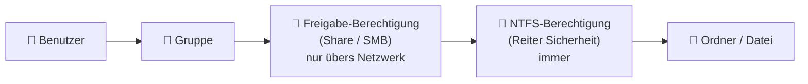
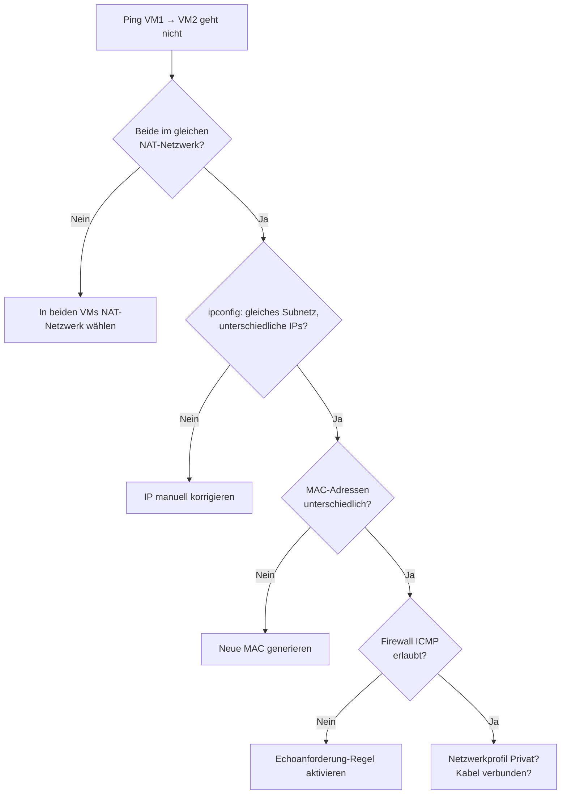

# 📚 Hausaufgabe auf 02.11.2026 – Benutzer, Gruppen, Rechte & Freigaben

> [!danger] ⏰ Fällig: Montag, 02.11.2026 um 08:00
> Abgabe in **Teams** – mehrere Übermittlungen sind zulässig.
> Die Input-Dokumente liegen in **Teams** abgelegt.

> [!abstract] Überblick
> | # | Block | Ergebnis | Status |
> |---|---|---|:-:|
> | 1 | 📖 Repetition & Zusammenfassung | [[#📖 Lernzusammenfassung]] | ✅ |
> | 2 | 🔍 Beispiel-BM nachvollziehen | [[#🔍 Beispiel-BM nachvollziehen]] + [[#❓ Fragen zur BM – mit Antworten]] | ✅ |
> | 3 | 📊 Auftrag Berechtigungs-Matrix | [[Berechtigungs-Matrix Vorlage.xlsx]] + [[Berechtigungs-Matrix VM2.xlsx]] | ✅ |
> | 4 | 🛠️ Checkliste & Probleme | [[#🛠️ Offene Probleme der Klasse – analysiert und gelöst]] | ✅ |

---

## ✅ Aufgaben-Checkliste

> [!todo]+ 1 · Repetition und Notizen / Zusammenfassung ✅
> - [x] Input **Einführung Benutzer, Gruppen, Rechte und Freigaben** → zusammengefasst unter [[#👤 Benutzer]], [[#👥 Gruppen]], [[#🔐 Zwei Ebenen von Rechten]]
> - [x] Input **Weiterführung Benutzer, Gruppen, Berechtigungs-Matrix** → zusammengefasst unter [[#📊 Berechtigungs-Matrix (BM)]]
> - [x] Befehle zum Thema gesammelt → [[#💻 Befehle (CMD)]]

> [!todo]+ 2 · Beispiel einer BM studieren und nachvollziehen ✅
> - [x] **Ordneransicht** – Was sieht man? → Die Ordnerstruktur der Freigabe, also welche Ordner es gibt und wie sie verschachtelt sind. Jeder Ordner ist eine Zeile in der BM.
> - [x] **Rechte** – Wo prüft man sie? → Rechtsklick → Eigenschaften → Reiter **Sicherheit** (NTFS). Pro Gruppe sieht man Vollzugriff / Ändern / Lesen …
> - [x] **Freigabe** – Wo prüft man sie? → Reiter **Freigabe** → **Erweiterte Freigabe** → **Berechtigungen** (Share-Rechte).
> - [x] **`tree`** – Was macht der Befehl? → Zeigt die Ordnerstruktur als Baum → Beispielausgabe unter [[#🔍 Beispiel-BM nachvollziehen]]
> - [x] **`net share`** – Was macht der Befehl? → Listet alle Freigaben des PCs auf → Beispielausgabe unter [[#🔍 Beispiel-BM nachvollziehen]]
> - [x] **Fragen** notiert und beantwortet → [[#❓ Fragen zur BM – mit Antworten]]

> [!todo]+ 3 · Auftrag Berechtigungs-Matrix ✅
> - [x] **Template** in Excel erstellt → [[Berechtigungs-Matrix Vorlage.xlsx]] (Kopfdaten, Dropdowns V/Ä/L/–, Farben, automatischer UNC-Pfad, Legende, Blatt *Gruppen & Benutzer*)
> - [x] **Eigene BM** erstellt → [[Berechtigungs-Matrix VM2.xlsx]] (Freigabe auf VM2 vom [[Praxisauftrag VM-Netzwerk]], inkl. Blatt *Befehle* zum Einrichten)
> - [x] Kontrolle: Wie prüft man, ob die BM stimmt? → `net share Freigabe` (Share-Rechte) und `icacls C:\Freigabe\Team` (NTFS-Rechte) mit der Tabelle vergleichen

> [!todo]+ 4 · Checkliste abarbeiten – Probleme analysieren und fixen ✅
> - [x] Ping VM1 ↔ VM2 → Ursachen und Lösung: [[#1 · Ping von VM1 zu VM2 geht nicht]]
> - [x] NAT / Internet → Ursachen und Lösung: [[#2 · NAT geht nicht]]
> - [x] Ablage OVA / VDI → Lösung: [[#3 · Ablage der OVA und VDIs]]
> - [x] RAM, CPU, TPM, Secure Boot → Werte: [[#4 · VM-Einstellungen RAM, CPU, TPM]]
> - [x] Clone-Probleme → Lösung: [[#5 · Clone-Probleme]]

> [!success] Abgabe
> - [ ] Diese Notiz (als PDF: `Strg+P` → *Als PDF exportieren*) + beide Excel-Dateien in **Teams** hochladen

---

## 📖 Lernzusammenfassung

### 👤 Benutzer
- Jeder Mensch, der am PC arbeitet, bekommt ein **eigenes Benutzerkonto** (nie Konten teilen) – nur so weiss man, wer was gemacht hat.
- **Administrator** = darf alles, **Standardbenutzer** = darf nur seine eigenen Sachen ändern → siehe [[Benutzerverwaltung – Admin vs. Standardbenutzer]]
- Für den Zugriff übers Netzwerk braucht der Benutzer **ein Passwort** – leere Passwörter funktionieren über SMB nicht.
- Lokale Benutzer verwalten: `lusrmgr.msc` oder `net user`

### 👥 Gruppen
- Rechte werden **an Gruppen** vergeben, **nicht an einzelne Benutzer**. Benutzer kommen in die passende Gruppe.
- Vorteil: Neuer Mitarbeiter → nur in die Gruppe aufnehmen, fertig. Austritt → aus der Gruppe nehmen. Kein Ordner muss angefasst werden.
- Ein Benutzer kann in **mehreren Gruppen** sein.
- Wichtige eingebaute Gruppen: `Administratoren`, `Benutzer`, `Gäste`, `Jeder`, `Authentifizierte Benutzer`, `SYSTEM`
- Eigene Gruppen sinnvoll benennen, z. B. mit Präfix: `GRP_Team`, `GRP_Lesen`

> [!tip] Faustregel
> **Benutzer → Gruppe → Recht auf Ordner.** Steht in der BM ein einzelner Benutzername, fehlt meistens eine Gruppe.

### 🔐 Zwei Ebenen von Rechten



| | **Freigabe-Berechtigung** (Share) | **NTFS-Berechtigung** (Sicherheit) |
|---|---|---|
| Wo einstellen? | Eigenschaften → *Freigabe* → Erweiterte Freigabe → Berechtigungen | Eigenschaften → *Sicherheit* |
| Wann gilt sie? | **nur** beim Zugriff übers Netzwerk (`\\PC\Freigabe`) | **immer**, lokal und übers Netzwerk |
| Stufen | Lesen · Ändern · Vollzugriff | Lesen · Lesen & Ausführen · Ordnerinhalt anzeigen · Schreiben · Ändern · Vollzugriff |
| Vererbung | nein | ja, auf Unterordner und Dateien |

> [!important] Die drei wichtigsten Regeln
> 1. **Übers Netzwerk gilt das Strengere** von Freigabe- und NTFS-Recht. (Freigabe *Lesen* + NTFS *Ändern* → effektiv nur **Lesen**.)
> 2. **Verweigern schlägt Zulassen.** Ein explizites *Verweigern* gewinnt fast immer – darum sparsam einsetzen.
> 3. **Rechte addieren sich** über mehrere Gruppen: Gruppe A (*Lesen*) + Gruppe B (*Ändern*) → *Ändern*.

> [!example] Praxis-Tipp
> Die **Freigabe grosszügig** setzen (z. B. `Authentifizierte Benutzer: Ändern`) und die **feinen Rechte über NTFS** steuern. So muss man nur an einer Stelle genau sein – genau so ist meine BM aufgebaut.

### 📊 Berechtigungs-Matrix (BM)
Eine **Berechtigungs-Matrix** ist eine Tabelle, die zeigt, **welche Gruppe auf welchen Ordner welche Rechte hat**. Sie ist die **Planung vor** dem Einrichten und die **Dokumentation danach**.

- **Zeilen** = Ordner / Freigaben
- **Spalten** = Gruppen
- **Zellen** = Recht (mit Legende abgekürzt)

**Legende:** `V` = Vollzugriff · `Ä` = Ändern · `L` = Lesen · `–` = kein Zugriff

#### Meine BM – VM2 (Praxisauftrag VM-Netzwerk)
> [!tip] Verbesserte Version 1.1 vom 08.11.2026
> Nach der Theorie aus Woche 7 verbessert (Kürzel R / M / X / F, Standardgruppen GRP_MA und GRP_Admin, Tabelle 1 als Matrix) → [[Hausaufgabe 09.11. – IT-Dokumentation & Berechtigungs-Matrix#📊 Berechtigungs-Matrix verbessert (v1.1)]] und [[Berechtigungs-Matrix VM2 v1.1.xlsx]]

Server **VM2** · `192.168.50.12` · Freigabe-Recht: `Administratoren: Vollzugriff`, `Authentifizierte Benutzer: Ändern`

| Ordner | UNC-Pfad | Administratoren | GRP_Team | GRP_Lesen | Vererbung |
|---|---|:-:|:-:|:-:|---|
| `C:\Freigabe` | `\\VM2\Freigabe` | V | L | L | Basis (von C:\ entfernt) |
| `C:\Freigabe\Public` | `\\VM2\Freigabe\Public` | V | Ä | Ä | ja |
| `C:\Freigabe\Team` | `\\VM2\Freigabe\Team` | V | Ä | L | ja, + GRP_Team Ändern |
| `C:\Freigabe\Admin` | `\\VM2\Freigabe\Admin` | V | – | – | **nein (unterbrochen)** |

| Benutzer | Gruppe |
|---|---|
| `tim` | Administratoren |
| `user1` | GRP_Team |
| `user2` | GRP_Lesen |

> [!note] Excel-Dateien
> - 📄 [[Berechtigungs-Matrix Vorlage.xlsx]] – leere Vorlage: Kopf (Server, IP, Erstellt von, Datum, Version), Spalten Lokaler Pfad · Freigabename · Unterordner · **UNC-Pfad (automatisch)** · Freigabe-Recht · NTFS pro Gruppe · Vererbung · Bemerkung, Dropdown V/Ä/L/– mit Farben, Legende, Blatt *Gruppen & Benutzer* mit Mitgliederzählung
> - 📄 [[Berechtigungs-Matrix VM2.xlsx]] – ausgefüllt für meine Freigabe, plus Blatt **Befehle** mit allen CMD-Befehlen zum Einrichten

### 💻 Befehle (CMD)

| Befehl | Was macht er? |
|---|---|
| `tree C:\Freigabe /F /A` | Ordnerstruktur als Baum (`/F` = mit Dateien, `/A` = einfache Zeichen zum Kopieren) |
| `net share` | alle Freigaben auf diesem PC auflisten |
| `net share Freigabe` | Details einer Freigabe (Pfad, Share-Rechte) |
| `net share Daten=C:\Daten /GRANT:Benutzer,CHANGE` | Ordner freigeben (`READ`, `CHANGE` oder `FULL`) |
| `net share Daten /DELETE` | Freigabe entfernen (Ordner bleibt) |
| `icacls C:\Daten` | NTFS-Rechte anzeigen |
| `icacls C:\Daten /grant "GRP_Team:(OI)(CI)M"` | *Ändern* für GRP_Team, vererbt auf Unterordner `(CI)` und Dateien `(OI)` |
| `icacls C:\Daten /inheritance:r` | Vererbung unterbrechen und geerbte Rechte entfernen |
| `net user` / `net localgroup` | Benutzer bzw. Gruppen auflisten |
| `net localgroup GRP_Team /add` | neue lokale Gruppe erstellen |
| `net localgroup GRP_Team user1 /add` | Benutzer in Gruppe aufnehmen |
| `whoami /groups` | In welchen Gruppen bin ich? |

**icacls-Kürzel:** `F` = Vollzugriff · `M` = Ändern · `RX` = Lesen & Ausführen · `R` = Lesen · `W` = Schreiben

> [!warning] Admin-CMD
> `net share … /GRANT`, `icacls … /grant` und `net localgroup … /add` brauchen eine **CMD als Administrator**.

---

## 🔍 Beispiel-BM nachvollziehen

**1. Ordneransicht** – im Explorer `C:\Freigabe` öffnen: drei Unterordner *Admin*, *Public*, *Team*. Jeder Ordner = eine Zeile in der BM.

**2. `tree C:\Freigabe /F /A`** – Beispielausgabe:
```text
Auflistung der Ordnerpfade
C:\FREIGABE
+---Admin
+---Public
|       Test.txt
\---Team
```

**3. `net share`** – Beispielausgabe:
```text
Freigabename  Ressource                       Beschreibung
-------------------------------------------------------------------------------
C$            C:\                             Standardfreigabe
IPC$                                          Remote-IPC
ADMIN$        C:\WINDOWS                      Remoteverwaltung
Freigabe      C:\Freigabe
Der Befehl wurde erfolgreich ausgeführt.
```
→ `C$`, `ADMIN$` und `IPC$` sind **versteckte Standard-Freigaben** von Windows (`$` = versteckt). Die eigene Freigabe ist **Freigabe**.

**4. Rechte und Freigabe vergleichen** – die Häkchen im Reiter *Sicherheit* und *Erweiterte Freigabe* müssen genau dem entsprechen, was in der BM steht. Wenn nicht, ist entweder die BM oder die Einstellung falsch.

---

## ❓ Fragen zur BM – mit Antworten

> [!question]+ Warum braucht es überhaupt eine Berechtigungs-Matrix?
> Damit man **auf einen Blick** sieht, wer worauf Zugriff hat, ohne jeden Ordner einzeln anzuklicken. Sie hilft beim **Planen**, bei der **Fehlersuche** und bei **Kontrollen** (z. B. Datenschutz: Wer sieht Lohndaten?).

> [!question]+ Warum stehen in der BM Gruppen und nicht Benutzer?
> Weil Rechte an Gruppen vergeben werden. Kommt ein neuer Mitarbeiter, ändert sich die BM nicht – er kommt nur in die Gruppe.

> [!question]+ Freigabe = *Lesen*, NTFS = *Vollzugriff*. Was darf ich übers Netzwerk – und lokal?
> Übers Netzwerk nur **Lesen** (das Strengere gilt). Lokal am PC **Vollzugriff**, weil dort nur NTFS zählt.

> [!question]+ Was bedeutet das `$` am Ende eines Freigabenamens (z. B. `C$`)?
> Die Freigabe ist **versteckt**: Sie erscheint nicht in der Netzwerkansicht, ist mit dem vollen Pfad (`\\VM2\C$`) aber erreichbar – nur für Administratoren.

> [!question]+ Was heisst „Vererbung unterbrechen“ und wann braucht man das?
> Normalerweise übernimmt ein Unterordner die Rechte vom übergeordneten Ordner. Bei einem **geheimen Ordner** (z. B. *Admin*) unterbricht man die Vererbung, damit die Rechte von oben **nicht** mitkommen und nur noch die Admins Zugriff haben.

> [!question]+ Warum *Verweigern* nicht einfach überall benutzen?
> Weil *Verweigern* fast immer gewinnt – auch gegen *Zulassen* aus einer anderen Gruppe. Ist ein Admin zufällig auch in einer Gruppe mit *Verweigern*, sperrt man ihn aus. Besser: einfach **kein Recht** geben.

> [!question]+ Was ist der Unterschied zwischen *Ändern* und *Vollzugriff*?
> *Ändern* = lesen, schreiben, löschen. *Vollzugriff* = zusätzlich **Rechte ändern** und **Besitz übernehmen**. Darum bekommen normale Benutzer nur *Ändern*.

> [!question]+ Was ist ein UNC-Pfad?
> Der Netzwerkpfad zu einer Freigabe: `\\Servername\Freigabename\Unterordner`, z. B. `\\VM2\Freigabe\Team` oder `\\192.168.50.12\Freigabe`.

---

## 🛠️ Offene Probleme der Klasse – analysiert und gelöst

> [!summary] Übersicht
> | Problem | Häufigste Ursache | Lösung | Prüfen mit |
> |---|---|---|---|
> | Ping VM1 → VM2 geht nicht | Firewall blockiert ICMP, falscher Netzwerk-Modus, IP/MAC doppelt nach Clone | NAT-Netzwerk wählen, IPs prüfen, ICMP-Regel aktivieren | `ipconfig`, `ping 192.168.50.12` |
> | NAT geht nicht | Kein Gateway/DNS bei statischer IP | Gateway `192.168.50.1`, DNS `192.168.50.1` oder `8.8.8.8` | `ping 8.8.8.8`, `nslookup google.ch` |
> | OVA/VDI auf OneDrive | Standardordner liegt im OneDrive | VMs nach `C:\VMs` verschieben, Standardordner ändern | VirtualBox → Einstellungen → Allgemein |
> | RAM, TPM etc. | zu wenig RAM, kein TPM/EFI | 4 GB RAM, 2 CPUs, 64 GB, TPM 2.0, EFI + Secure Boot | `tpm.msc`, `msinfo32` in der VM |
> | Clone-Probleme | gleiche MAC/IP/Name, verknüpfter Klon, VDI kopiert | Vollständiger Klon mit neuen MACs, umbenennen, neue IP | `getmac`, `hostname`, `ipconfig` |

### 1 · Ping von VM1 zu VM2 geht nicht
> [!bug]+ Ursachen & Checks (von oben nach unten)
> - [x] Beide VMs am **gleichen NAT-Netzwerk** – nicht nur „NAT“! Bei reinem *NAT* ist jede VM in ihrem eigenen Netz und sieht die andere nicht.
> - [x] Häkchen **Kabel verbunden** gesetzt (VM-Einstellungen → Netzwerk → Erweitert).
> - [x] Beide IPs im **gleichen Subnetz**, aber **unterschiedlich** (`.11` und `.12`) → `ipconfig`
> - [x] Nach einem Clone: **IP doppelt?** Statische IP wird mitgeklont → bei VM2 ändern.
> - [x] Nach einem Clone: **gleiche MAC?** → `getmac` auf beiden VMs vergleichen, siehe [[#5 · Clone-Probleme]].
> - [x] **Firewall**: Regel *Datei- und Druckerfreigabe (Echoanforderung – ICMPv4 eingehend)* aktivieren – oder in der Admin-CMD:
>   `netsh advfirewall firewall add rule name="Ping erlauben" protocol=icmpv4:8,any dir=in action=allow`
> - [x] Netzwerkprofil auf **Privat** (Einstellungen → Netzwerk und Internet → Ethernet).

> [!success] Lösung
> In beiden VMs das **NAT-Netzwerk** `192.168.50.0/24` wählen, VM1 = `192.168.50.11`, VM2 = `192.168.50.12`, Profil **Privat** und **ICMPv4-Regel** auf **beiden** VMs aktivieren. Danach klappt `ping` in beide Richtungen.



### 2 · NAT geht nicht
> [!bug]+ Ursachen & Checks
> - [x] Bei **statischer IP** fehlen oft **Gateway** und **DNS** → ohne Gateway kein Internet. Im VirtualBox-NAT-Netzwerk ist das Gateway immer die **`.1`**.
> - [x] Schritt für Schritt testen:
>   1. `ping 192.168.50.1` → Gateway erreichbar?
>   2. `ping 8.8.8.8` → Internet erreichbar? (Wenn ja, aber Webseiten gehen nicht → DNS-Problem)
>   3. `nslookup google.ch` → DNS funktioniert?
> - [x] NAT-Netzwerk im **Netzwerk-Manager aktiviert**?
> - [x] Host selber hat Internet? Ein **VPN** am Host kann NAT stören.

> [!success] Lösung
> In der VM: IP `192.168.50.11`, Maske `255.255.255.0`, **Gateway `192.168.50.1`**, **DNS `192.168.50.1`** (oder `8.8.8.8`). Für den Praxisauftrag selber ist Internet nicht nötig – VM ↔ VM reicht.

### 3 · Ablage der OVA und VDIs
> [!bug]+ Warum nicht auf OneDrive?
> - VDIs sind **riesig** (20–60 GB) und ändern sich bei jedem Start → OneDrive synchronisiert ständig.
> - OneDrive kann Dateien auf „**nur online**“ setzen → VM startet nicht mehr oder die VDI geht **kaputt**.
> - Gratis-Speicher ist schnell voll.

> [!success] Lösung
> 1. Ordner `C:\VMs\` (VMs) und `C:\VMs\Export\` (OVAs) anlegen.
> 2. VirtualBox → Datei → Einstellungen → Allgemein → **Standardordner für VMs** = `C:\VMs`
> 3. Bestehende VMs: VM ausschalten → Rechtsklick → **Verschieben…** (nicht im Explorer kopieren!)
> 4. OVA-Export (Datei → Appliance exportieren) nach `C:\VMs\Export\`. Backup auf **externe SSD** statt OneDrive.
>
> > [!tip] Gleiches Problem wie beim Vault
> > Darum liegt auch dieser Obsidian-Vault unter `C:\Work\` und nicht im OneDrive.

### 4 · VM-Einstellungen RAM, CPU, TPM
> [!bug]+ Windows 11 braucht mindestens
> | Einstellung | Minimum | Wo in VirtualBox? |
> |---|---|---|
> | RAM | 4 GB (4096 MB) | System → Hauptplatine |
> | CPU | 2 Kerne | System → Prozessor |
> | Festplatte | 64 GB | Massenspeicher |
> | TPM | 2.0 | System → Hauptplatine → TPM |
> | Firmware | EFI + Secure Boot | System → Hauptplatine → *EFI aktivieren* / *Secure Boot* |
> | Grafik | 128 MB | Anzeige |

> [!success] Lösung
> - Pro VM **4 GB RAM, 2 CPUs, 64 GB, TPM 2.0, EFI + Secure Boot**.
> - **Nie mehr als ca. die Hälfte** des Host-RAMs an VMs geben – bei **2 VMs gleichzeitig** zählt der RAM beider zusammen (2 × 4 GB = 8 GB → Host braucht mind. 16 GB).
> - **VirtualBox 7.x** verwenden (ältere Versionen kennen kein TPM 2.0).
> - Kontrolle in der VM: `tpm.msc` → „Das TPM ist einsatzbereit“, `msinfo32` → *Sicherer Startzustand: Ein*.
> - Ist **Hyper-V** auf dem Host aktiv (z. B. für [[Virtualisierung & VM-Netzwerke|Modul 187]]), läuft VirtualBox langsamer (Schildkröten-Symbol unten rechts), funktioniert aber.

### 5 · Clone-Probleme
> [!bug]+ Ursachen
> - **Gleiche MAC-Adresse** → beide VMs „streiten“ sich im Netzwerk.
> - **Gleiche IP** (statische IP wird mitgeklont) → IP-Konflikt.
> - **Gleicher Computername** → SMB-Freigaben funktionieren nicht richtig.
> - **Verknüpfter Klon** → hängt vom Original ab, geht kaputt, wenn das Original verschoben/gelöscht wird.
> - **VDI im Explorer kopiert** → Fehler *„UUID already exists“*.

> [!success] Lösung
> 1. Rechtsklick → **Klonen** → **Vollständiger Klon** → MAC-Richtlinie: **„Neue MAC-Adressen für alle Netzwerkadapter erzeugen“**
> 2. Im Klon **PC umbenennen** (Einstellungen → System → Info → *Diesen PC umbenennen*, z. B. `VM2`) und neu starten
> 3. **Neue IP** setzen (`192.168.50.12`)
> 4. Für viele Klone sauber: Original vorher mit **Sysprep** (`/generalize`) vorbereiten → neue SID → [[Erweiterte Installationsoptionen – Imaging & Sysprep]]
> 5. Falls schon eine VDI kopiert wurde: `VBoxManage internalcommands sethduuid "C:\VMs\VM2\VM2.vdi"` gibt ihr eine neue UUID
> 6. Kontrolle: `getmac`, `hostname`, `ipconfig` auf beiden VMs → alles muss unterschiedlich sein

---

## 🔗 Siehe auch
- [[Praxisauftrag VM-Netzwerk]] – Checkliste, Netzwerkplan, SMB-Freigabe
- [[Virtualisierung & VM-Netzwerke]] – NAT, Bridged, Host-only
- [[IP-Adressierung & Subnetting]]
- [[Benutzerverwaltung – Admin vs. Standardbenutzer]]
- [[Erweiterte Installationsoptionen – Imaging & Sysprep]]
- [[Reflexion Modul 117]]
- [[Hausaufgabe 09.11. – IT-Dokumentation & Berechtigungs-Matrix]] – verbesserte BM v1.1 und IT-Dokumentation
