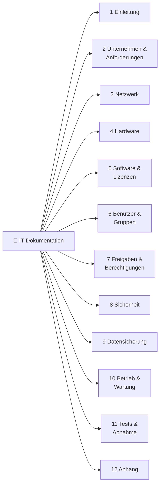

# 📚 Hausaufgabe auf 09.11.2026 – IT-Dokumentation & Berechtigungs-Matrix

> [!danger] ⏰ Fällig: Montag, 09.11.2026 um 08:00
> Abgabe in **Teams** – mehrere Übermittlungen sind zulässig.
> Falls die VMs immer noch nicht laufen: beim Lehrer melden.

> [!abstract] Überblick
> | # | Block | Ergebnis | Status |
> |---|---|---|:-:|
> | 1 | 🔢 IP-Berechnungs-Repetition prüfen | Evaluation in Teams → [[#🔢 IP-Repetition]] | ⏳ |
> | 2 | 📊 Berechtigungs-Matrix verbessern + Lernjournal | [[Berechtigungs-Matrix VM2 v1.1.xlsx]] + [[Reflexion Modul 117]] | ✅ |
> | 3 | 📋 IT-Doku: Liste mit Inhalten und Überthemen | [[#📋 IT-Dokumentation – Überthemen und Inhalte]] | ✅ |
> | 4 | 📄 IT-Doku: Word-Vorlage | [[Bürgin_IT-Dokumentation_Vorlage_M117.docx]] | ✅ |
> | 5 | ✏️ IT-Doku: Themen mit Unterpunkten abfüllen | in der Word-Vorlage, Kapitel 1–12 | ✅ |

---

## ✅ Aufgaben-Checkliste

> [!todo]+ 1 · IP-Berechnungs-Repetition prüfen ⏳
> - [ ] Evaluation in **Freigaben / Teams** öffnen und mit meinen Lösungen vergleichen
> - [ ] Jeden Fehler verstehen und unten bei [[#🔢 IP-Repetition]] notieren
> - [ ] Unklares mit [[IP-Adressierung & Subnetting]] nachrechnen

> [!todo]+ 2 · Berechtigungs-Matrix verbessern, im Lernjournal dokumentieren ✅
> - [x] Neue Inputs (Woche 7) gelesen → [[#📖 Neue Theorie aus Woche 7]]
> - [x] Meine BM vom 01.11. nach der Theorie verbessert → [[Berechtigungs-Matrix VM2 v1.1.xlsx]] (Original bleibt: [[Berechtigungs-Matrix VM2.xlsx]])
> - [x] Was ich geändert habe und warum → [[#📊 Berechtigungs-Matrix verbessert (v1.1)]]
> - [x] Lernjournal → [[Reflexion Modul 117]]
> - [x] Zusätzlich: BM für den VM-Auftrag **TBZ-PC** geplant (IPERKA: P) → [[Berechtigungs-Matrix TBZ-PC & Muster.xlsx]]

> [!todo]+ 3–5 · IT-Dokumentation ✅
> - [x] Liste mit **Überthemen und Inhalten** → [[#📋 IT-Dokumentation – Überthemen und Inhalte]]
> - [x] **Word-Vorlage** mit Titelblatt (Titel, Bild, Version, Name), Änderungsindex, Inhaltsverzeichnis, Kopf- und Fusszeile, Seitenzahlen → [[Bürgin_IT-Dokumentation_Vorlage_M117.docx]]
> - [x] **Themen/Titel mit Unterpunkten** abgefüllt (12 Kapitel, Platzhalter in `[ ]`, graue Ausfüllhilfen mit ➜)

> [!success] Abgabe
> - [ ] Diese Notiz als PDF (`Strg+P` → *Als PDF exportieren*) + Word-Vorlage + Berechtigungs-Matrix v1.1 in **Teams** hochladen

---

## 🔢 IP-Repetition
%% Hier selber eintragen: Aufgabe, mein Fehler, richtige Lösung, warum. %%

| Aufgabe | Mein Fehler | Richtige Lösung | Warum |
|---|---|---|---|
|  |  |  |  |

> [!tip] Schnell-Check beim Rechnen
> 1. **Netz-ID** = IP **UND** Subnetzmaske (alle Host-Bits auf 0)
> 2. **Broadcast** = alle Host-Bits auf 1
> 3. **Nutzbare Hosts** = 2^(Host-Bits) − 2 → bei /24 also 254
> 4. Erste Host-IP = Netz-ID + 1, letzte Host-IP = Broadcast − 1

---

## 📖 Neue Theorie aus Woche 7

### Wer, wem, was, wo
| Begriff | Bedeutet |
|---|---|
| **Benutzer** | **wer** es ist |
| **Gruppe** | **wem** Rechte gegeben werden |
| **Berechtigung** | **was** man tun darf (Lesen, Schreiben, Löschen …) |
| **Freigabe** | **wo** man das tun darf (Ordner übers Netzwerk sichtbar machen) |

### Kürzel für die Berechtigungs-Matrix
| Kürzel | Bedeutung |
|:-:|---|
| `R` | Lesen (**R**ead) |
| `M` | Ändern (**M**anipulate) |
| `X` | Ausführen (e**X**ecute) – bei Ordnern: hineingehen und Inhalt auflisten |
| `F` | alle Rechte (**F**ull) |
| `nR` | Recht verweigert |

→ Diese Kürzel ersetzen mein altes `V / Ä / L` aus der [[Hausaufgabe 02.11. – Benutzer, Gruppen & Berechtigungs-Matrix|Hausaufgabe vom 02.11.]]. Bei `L` sah man nicht, ob Ausführen erlaubt ist.

### Die wichtigsten Regeln
> [!important] Was ich mir merken muss
> 1. **Rechte nur an Gruppen**, nie an einzelne Benutzer.
> 2. **Standardgruppen immer erstellen:** `GroupMA` (alle Mitarbeitenden) und `GroupAdmin` – auch wenn der Kunde sie nicht verlangt.
> 3. **Nie mischen:** Immer **zwei Tabellen** machen. Tabelle 1 = wer in welcher Gruppe ist, Tabelle 2 = Berechtigungs-Matrix.
> 4. **Vererbung** ist bei Windows immer an. Wenn ein Unterordner andere Rechte braucht, muss man sie gezielt unterbrechen.
> 5. Zugriff von aussen geht in **zwei Schritten**: zuerst durch die **Freigabe**, dann entscheiden die **NTFS-Rechte**.

### Lokal oder zentral?
| | Lokal (Arbeitsgruppe, Peer-to-Peer) | Zentral (Domäne) |
|---|---|---|
| Wo sind die Benutzer? | auf jedem PC einzeln | an einem Ort für alle PCs |
| Joe ist … | auf PC1 ein anderer Benutzer als auf PC2 | überall derselbe Benutzer |
| Sinnvoll für | Heimnetz, kleine Netze (max. ca. 20 Benutzer) | Firmen, schon ab ca. 10 Mitarbeitenden |
| Microsoft-Produkt | Arbeitsgruppe, `lusrmgr.msc` | **Active Directory** (kommt in einem späteren Modul) |

> [!warning] Begriffe nicht verwechseln
> **Gruppe** (Benutzergruppe mit Rechten) ≠ **Arbeitsgruppe** (Verbund von PCs im Netzwerk).

### FAT32 oder NTFS?
- **FAT32** kennt **keine Berechtigungen** und Dateien dürfen max. 4 GiB gross sein. Ein FAT32-Stick kann von allen gelesen werden.
- **NTFS** kennt Berechtigungen (ACL = Zugriffssteuerungsliste). Für grössere Dateien auf einem Stick ohne Rechte: **exFAT**.
- Wichtig: Auch auf NTFS liegt eine neue Datei normal unter **Jeder** und ist auf einem fremden PC lesbar. Schutz gibt es erst mit eigenen Rechten (Vererbung unterbrechen, nur mich eintragen) oder Verschlüsselung.

### UNC-Pfad – drei Varianten
| Variante | Beispiel | Braucht |
|---|---|---|
| `\\Hostname\Freigabe` | `\\pc4\dokumente` | Namensauflösung (DNS, Hosts-Datei) |
| `\\IP-Adresse\Freigabe` | `\\192.168.50.12\Freigabe` | nichts – funktioniert immer (**Favorit in M117**) |
| `\\FQDN\Freigabe` | `\\pc4.firmaxy.local\dokumente` | DNS-Dienst |

### IPERKA: zuerst planen
Bevor ich Benutzer, Ordner und Rechte einrichte, plane ich: **Namenskonzept**, **Benutzer → Gruppen**, **Ordner mit Besitzer und Rechten**, **Freigaben**. Genau dafür sind die zwei Tabellen da. Die Grundlage dafür ist die **Systemdokumentation** der Firma – also die IT-Dokumentation unten.

---

## 📊 Berechtigungs-Matrix verbessert (v1.1)
Meine BM für die Freigabe auf **VM2** (`192.168.50.12`) aus dem [[Praxisauftrag VM-Netzwerk]], verbessert nach der neuen Theorie.

| Was | Vorher (v1.0, 01.11.) | Jetzt (v1.1, 08.11.) | Warum |
|---|---|---|---|
| Kürzel | `V / Ä / L / –` | `F / RMX / RX / R / nR / –` | Kürzel aus der Theorie, Ausführen (X) wird sichtbar |
| Standardgruppen | nur eingebaute Gruppen | **GRP_Admin** und **GRP_MA** ergänzt | müssen laut Theorie immer erstellt werden |
| Freigabe-Recht | Administratoren: F, Authentifizierte Benutzer: Ändern | GRP_Admin: F, GRP_MA: Ändern | Rechte nur an eigene Gruppen, nicht an alle Konten des PCs |
| Basis `C:\Freigabe` | GRP_Team L, GRP_Lesen L | GRP_MA `RX` nur «Dieser Ordner» | alle sehen die Unterordner, kommen aber nur mit eigenem Recht hinein |
| Public | GRP_Team Ä + GRP_Lesen Ä | GRP_MA `RMX` | eine Gruppe für «alle» statt zwei Einträge |
| Tabelle 1 | eine Gruppe pro Benutzer | Matrix mit `x` | ein Benutzer kann in mehreren Gruppen sein (user1: GRP_Team **und** GRP_MA) |
| Dokumentation | – | Blatt **Änderungen** (Änderungsindex) | man sieht, was wann geändert wurde |

### Tabelle 1 – Gruppenzugehörigkeit
| Benutzer | GRP_Admin | GRP_Team | GRP_Lesen | GRP_MA |
|---|:-:|:-:|:-:|:-:|
| `tim` | x |  |  |  |
| `user1` |  | x |  | x |
| `user2` |  |  | x | x |

### Tabelle 2 – Berechtigungs-Matrix (NTFS)
| Ordner | UNC-Pfad | GRP_Admin | GRP_Team | GRP_Lesen | GRP_MA | Vererbung |
|---|---|:-:|:-:|:-:|:-:|---|
| `C:\Freigabe` | `\\VM2\Freigabe` | F | – | – | RX | Basis (von C:\ entfernt) |
| `C:\Freigabe\Public` | `\\VM2\Freigabe\Public` | F | – | – | RMX | ja |
| `C:\Freigabe\Team` | `\\VM2\Freigabe\Team` | F | RMX | RX | – | ja |
| `C:\Freigabe\Admin` | `\\VM2\Freigabe\Admin` | F | – | – | – | **nein (unterbrochen)** |

Freigabe `Freigabe`: **GRP_Admin Vollzugriff**, **GRP_MA Ändern**. Administratoren und SYSTEM behalten zusätzlich F (Windows-Standard).

> [!example] Die wichtigsten Befehle (Admin-CMD auf VM2)
> ```bat
> net localgroup GRP_MA /add
> net localgroup GRP_MA user1 /add
> net share Freigabe=C:\Freigabe /GRANT:GRP_Admin,FULL /GRANT:GRP_MA,CHANGE
> icacls C:\Freigabe /inheritance:r /grant Administratoren:(OI)(CI)F SYSTEM:(OI)(CI)F GRP_Admin:(OI)(CI)F GRP_MA:RX
> icacls C:\Freigabe\Public /grant GRP_MA:(OI)(CI)M
> icacls C:\Freigabe\Team /grant GRP_Team:(OI)(CI)M GRP_Lesen:(OI)(CI)RX
> ```
> `GRP_MA:RX` **ohne** `(OI)(CI)` gilt nur für den Ordner selbst und wird nicht vererbt. Alle Befehle stehen im Blatt **Befehle** der Excel-Datei.

### Planung für den VM-Auftrag TBZ-PC
Im Theorie-Input gibt es einen neuen Auftrag: VM **TBZ-PC**, Arbeitsgruppe **M117**, IP `172.16.100.100/24`, Gruppen *Fabrikation* und *Entwicklung*, Benutzer Paul, Berta, Fredi, Nora, Xaver. Die Planung mit beiden Tabellen und Testprotokoll ist in [[Berechtigungs-Matrix TBZ-PC & Muster.xlsx]] (dort ist auch das Muster vom Lehrer verbessert).

> [!warning] Stolperstein beim TBZ-PC
> - Nora soll *fabrikation* **nur lesen**. Damit die Rechte trotzdem nur an Gruppen gehen, gibt es die Gruppe **Fabrikation_R** (nur Nora).
> - Auf `C:\ablage` die **Vererbung von C:\ unterbrechen** und «Benutzer» / «Authentifizierte Benutzer» entfernen. Sonst können alle Benutzer in *fabrikation* lesen.
> - Xaver ist in beiden Gruppen und darf darum in beiden Ordnern arbeiten.

---

## 📋 IT-Dokumentation – Überthemen und Inhalte
Die IT-Dokumentation (Systemdokumentation) beschreibt die ganze Informatik einer Firma so, dass jemand anderes sie betreuen kann. Laut Theorie steht darin, **wie was benannt wird**, die **Pfade der Datenablagen**, die **Passwortrichtlinien** und das **Adressierungskonzept**.



| Nr. | Überthema | Inhalte (Unterpunkte) |
|:-:|---|---|
| 1 | **Einleitung** | Zweck des Dokuments · Ausgangslage · Geltungsbereich und Abgrenzung · Zielgruppe |
| 2 | **Unternehmen und Anforderungen** | Firmenprofil · Standort und Räumlichkeiten · Anforderungen an die IT · Ansprechpersonen und Support |
| 3 | **Netzwerk** | Netzwerkplan (logisch) · physischer Plan und Verkabelung · IP-Konzept (Netz-ID, Maske, Gateway, DNS, DHCP-Bereich) · IP-Adressliste · Netzwerkdienste (DHCP, DNS, WLAN) |
| 4 | **Hardware-Inventar** | Netzwerkgeräte · Server und Speicher · Clients · Peripherie (mit Seriennummer, Standort, Garantie) |
| 5 | **Software und Lizenzen** | Betriebssysteme · Anwendungen · Lizenzübersicht (OEM, Retail, Volumen, Abo) |
| 6 | **Benutzer und Gruppen** | Namenskonvention · Benutzerliste · Gruppenzugehörigkeit (**Tabelle 1**) |
| 7 | **Freigaben und Berechtigungen** | Ordnerstruktur · Freigaben · Berechtigungs-Matrix (**Tabelle 2**) · Grundsätze (Least Privilege, Vererbung, UNC) |
| 8 | **Sicherheit** | Passwortrichtlinie · Firewall und Virenschutz · Updates und Patches · physische Sicherheit |
| 9 | **Datensicherung** | Backup-Konzept (3-2-1-Regel) · Backup-Plan · Wiederherstellung (Restore-Test) |
| 10 | **Betrieb und Wartung** | Wartungsplan · Störungsbehebung · Notfallkontakte |
| 11 | **Tests und Abnahme** | Testprotokoll (Ping, Freigabe, Rechte) · Abnahme mit Unterschrift |
| 12 | **Anhang** | Glossar · Quellen · Abbildungs- und Tabellenverzeichnis |

> [!note] Passwörter gehören **nicht** in die IT-Doku
> Sie kommen in einen Passwort-Manager oder ein separat gesichertes Dokument. In der Doku steht nur die **Passwortrichtlinie**.

### Word-Vorlage
📄 [[Bürgin_IT-Dokumentation_Vorlage_M117.docx]] – 16 Seiten:
- **Titelblatt** mit Titel, Netzplan-Bild, Dokument, Unternehmen, Version, Status, Autor, Klasse/Modul, Datum
- **Änderungsindex** (Version, Datum, Autor, Änderung) und Hinweise zur Vorlage
- **Inhaltsverzeichnis** (beim Öffnen «Felder aktualisieren» mit *Ja* bestätigen)
- Kopfzeile `Bürgin_ICT 26 C` · Version, Fusszeile *Seite X von Y*
- Kapitel 1–12 mit Unterpunkten, Beispieltabellen, Platzhaltern in `[ ]` und grauen Ausfüllhilfen (➜)

![[it-doku-titelblatt.png|420]]
*Titelblatt der Vorlage*

![[it-doku-kapitel-netzwerk.png|420]]
*Kapitel 3 Netzwerk mit Netzplan, IP-Konzept und IP-Adressliste*

---

## 🔗 Siehe auch
- [[Hausaufgabe 02.11. – Benutzer, Gruppen & Berechtigungs-Matrix]] – erste Version der BM, Befehle, Probleme der Klasse
- [[Praxisauftrag VM-Netzwerk]] – VM1 und VM2, SMB-Freigabe
- [[IP-Adressierung & Subnetting]]
- [[Lizenzierung – OEM, Retail, KMS, MAK]] – für Kapitel 5 der IT-Doku
- [[Benutzerverwaltung – Admin vs. Standardbenutzer]]
- [[Reflexion Modul 117]]
