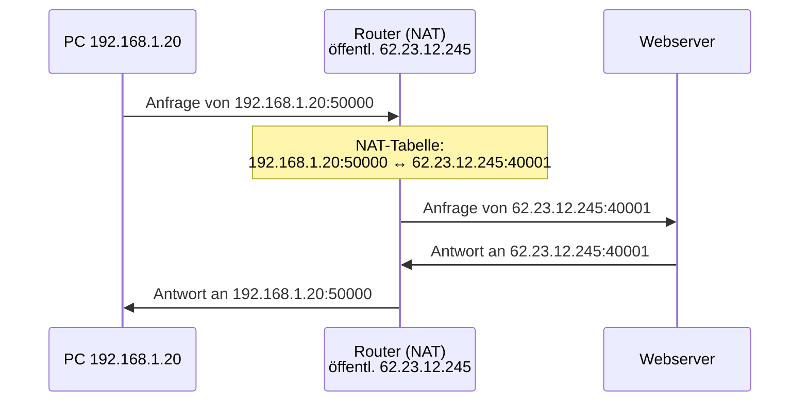

# Netzwerkadressierung

## MAC-Adresse
Die MAC-Adresse ist eine **physische bzw. hardwarebezogene Adresse** einer Netzwerkschnittstelle.
- 48 Bit bei klassischen Ethernet-MAC-Adressen
- wird auf **OSI-Schicht 2** verwendet (siehe [[OSI-Modell]])
- dient zur Kommunikation innerhalb eines lokalen Netzwerks
- Beispiel: `00:1A:2B:3C:4D:5E`
- Formatierung: 2er-Päckchen mit Stichen oder Punkten getrennt

## IP-Adresse
Eine IP-Adresse ist eine **logische Netzwerkadresse**, um Geräte bzw. Netzwerkschnittstellen in einem Netzwerk zu adressieren.

### IPv4
- 32 Bit, besteht aus 4 Oktetten
- Beispiel: `192.168.1.10`
- gehört zur **OSI-Schicht 3**

### IPv6
- 128 Bit, deutlich grösserer Adressraum als IPv4

## Subnetzmaske und CIDR

### Subnetzmaske
Bestimmt, welcher Teil einer IP-Adresse das **Netzwerk** und welcher Teil den **Host** beschreibt.
Beispiel: `192.168.1.0/24` → Subnetzmaske: `255.255.255.0`

### CIDR
CIDR = **Classless Inter-Domain Routing**. Ermöglicht eine flexible Aufteilung von IP-Netzen. Der CIDR-Suffix gibt an, wie viele Bits für den **Netzwerkanteil** verwendet werden.

Beispiel `192.168.1.0/24`:
- 24 Bit Netzwerkanteil
- 8 Bit Hostanteil (da IPv4 insgesamt 32 Bit hat: 32 − 24 = 8 Host-Bits)

### Beispiele für CIDR

| CIDR/Suffix | Subnetzmaske | Host-Bits |
|---|---|---|
| /8 | 255.0.0.0 | 24 |
| /16 | 255.255.0.0 | 16 |
| /24 | 255.255.255.0 | 8 |
| /30 | 255.255.255.252 | 2 |

> [!important] Bei einem normalen IPv4-Subnetz sind die **Netzwerkadresse** und **Broadcast-Adresse reserviert**. Deshalb gilt bei einem /30-Netz: 2² = 4 IP-Adressen insgesamt, davon 1 Netzwerkadresse, 2 nutzbare Host-Adressen, 1 Broadcast-Adresse.

### Netzwerkadresse
Die **erste Adresse** eines Subnetzes.
Beispiel `192.168.1.0/24` → Netzwerkadresse: `192.168.1.0`

### Broadcast-Adresse
Die **letzte Adresse** eines IPv4-Subnetzes. Mit ihr können alle Geräte eines Subnetzes gleichzeitig angesprochen werden.
Beispiel `192.168.1.0/24` → Broadcast: `192.168.1.255`

### Host-Adresse
Eine **nutzbare IP-Adresse** innerhalb eines Subnetzes, die einem Gerät bzw. einer Netzwerkschnittstelle zugewiesen werden kann.
Beispiel `192.168.1.0/24`:
- Netzwerkadresse: 192.168.1.0
- mögliche Host-Adressen: 192.168.1.1 – 192.168.1.254
- Broadcast: 192.168.1.255

### Gateway-Adresse
Das Standard-Gateway ist normalerweise die IP-Adresse eines **Routers**, über den ein Gerät andere Netzwerke erreichen kann.
Beispiel: PC `192.168.1.20`, Gateway `192.168.1.1`.
> Ein Gateway ist keine zusätzliche reservierte Adresse wie Netzwerk- oder Broadcast-Adresse. Eine normale Host-Adresse kann als Gateway verwendet werden.

### Gerätename
Der Gerätename (Hostname) identifiziert ein Gerät innerhalb eines Netzwerks.
Beispiele: `PC-01`, `SERVER-01`, `LAPTOP-TIM`, `NAS-01`

## Private IPv4-Adressen
Private Adressen werden innerhalb von lokalen Netzwerken verwendet und **nicht direkt im öffentlichen Internet geroutet**.

| Klasse | Bereich | CIDR | Adressanzahl |
|---|---|---|---|
| A / grosse Netzwerke | 10.0.0.0 – 10.255.255.255 | 10.0.0.0/8 | 2²⁴ = 16'777'216 |
| B / mittlere Netzwerke | 172.16.0.0 – 172.31.255.255 | 172.16.0.0/12 | 2²⁰ = 1'048'576 |
| C / kleine Netzwerke | 192.168.0.0 – 192.168.255.255 | 192.168.0.0/16 | 2¹⁶ = 65'536 |

> [!note] Die alten Bezeichnungen Klasse A, B und C werden bei CIDR nicht mehr für die eigentliche Netzplanung verwendet. Sie können aber zum Lernen der privaten Bereiche als Eselsbrücke vorkommen.

## APIPA
APIPA = **Automatic Private IP Addressing**. Bereich: `169.254.0.0/16`.
Ein Gerät kann sich selbst eine APIPA-Adresse geben, wenn es beispielsweise **keine IP-Adresse von einem DHCP-Server erhält**. APIPA-Adressen werden normalerweise nur für die lokale Kommunikation verwendet. Ein Standard-Gateway wird dabei normalerweise **nicht** verwendet.

## Localhost
Der Localhost bezeichnet **das eigene Gerät**. Bei IPv4: `127.0.0.0/8`. Die bekannteste Adresse ist `127.0.0.1`. Wenn ein Dienst auf dem eigenen Computer läuft, kann man ihn beispielsweise über `http://127.0.0.1` erreichen – die Verbindung bleibt dabei auf dem eigenen Computer.

## Spoofing
Spoofing bedeutet, dass ein Angreifer eine Identität bzw. Adresse **fälscht oder vortäuscht**. Beispiele: MAC-Spoofing, IP-Spoofing, E-Mail-Spoofing.
> Spoofing ist nicht automatisch dasselbe wie eine Man-in-the-Middle-Attacke, kann jedoch bei bestimmten Angriffen eingesetzt werden.

## CSMA/CD
CSMA = **Carrier-Sense Multiple Access**. Legen die Regeln fest wie ein Austausch zwischen 2 Rechnern in einem Netzwerk abläuft.
CSMA-CD ist die bekannteste Variante: **CD = Collision Detection**.
Die Rechner hören das Netzwerk die ganze Zeit ab, um zu schauen, ob gerade Dateien ausgetauscht werden oder ob die Bahn frei ist, um Daten zu senden. Kommt es zu einer Kollision, sendet der Rechner, der das Problem als erstes erkannt hat, ein JAM-Signal. Dadurch erfahren alle Rechner, dass es zu einer Kollision kam, und die Übertragung kann ordnungsgemäss funktionieren.

## Vertiefung aus W02 (Theorie Netzwerkadressierung) und Skript Kap. 2.2–2.3

### Die drei Adressen eines Geräts

| | MAC-Adresse | IP-Adresse (IPv4) | Gerätename |
|---|---|---|---|
| Art | **physisch**, Hardware | **logisch** | Name |
| Eindeutig | **weltweit** | im (lokalen) Netz | im lokalen Netz |
| Länge | 48 Bit | 32 Bit | – |
| OSI-Schicht | **2** | **3** | wird vom Betriebssystem gebraucht |

### Netz-ID und Host-ID
Eine IP-Adresse hat **zwei Teile**:
- **Netzwerk-ID** (Netzanteil): gleich für alle Geräte im selben Netz
- **Host-ID** (Geräteanteil): Nummer des Geräts in diesem Netz
- Die **(Sub-)Netzmaske** sagt, wo die Grenze ist: **1 = Netz, 0 = Host**.

> [!example] Beispiel `192.168.12.21/24`
> ```
> IP      11000000.10101000.00001100.00010101   192.168.12.21
> Maske   11111111.11111111.11111111.00000000   255.255.255.0  (/24 = 24 Einsen)
> Netz    11000000.10101000.00001100.00000000   192.168.12.0
> ```
> Das Gerät ist im Netz **192.168.12.0** und hat die Geräteadresse **21**.

> [!tip] Merksatz
> Eine IPv4-Adresse, die mit **.0** endet und einen Suffix **/xx** hat, bezeichnet eine **Netzadresse**. Der Suffix ist in **RFC 4632** (CIDR) beschrieben.

### Warum IP-Adressen? (Vergleich mit Telefonnummern)
Wie bei `0041 79 …` (Land, Netz, Teilnehmer) weiss jeder Router anhand der Adresse, in welches Netz ein Paket muss. Jeder Provider hat eine **AS-Nummer** (Autonomous System), z. B. **AS57370 Swisscom**, mit zugeteilten Netzen wie `178.238.168.0/21`. Alle Router weltweit routen Adressen aus diesem Netz zur Swisscom.

> [!example] `178.238.168.0/21`
> Maske /21 = `11111111.11111111.11111000.00000000` = 255.255.**248**.0
> Die ersten 21 Bit sind das Netz, die restlichen **11 Bit** sind Hosts → 2¹¹ = 2048 Adressen.
> Erster Host: `178.238.168.1`. (Weiteres Unterteilen in Subnetze ist **nicht** Thema von M117.)

### CIDR statt Netzklassen
- **CIDR** (Classless Inter-Domain Routing) wurde **1993** eingeführt und hat die **Netzklassen** abgelöst.
- CIDR ist **kein Routing-Protokoll**, sondern ein **Verfahren**, um den Adressraum effizienter zu nutzen.
- Der **Suffix** gibt an, wie viele Bits von vorne zum Netz gehören.
- **/30** ist das kleinste sinnvolle IPv4-Netz (Netz + 2 Hosts + Broadcast), z. B. für Router-Verbindungen wie `202.12.68.0/30`.

### Die alten Netzklassen (kommen in Übungen vor)

| Klasse | 1. Oktett | Standard-Maske | Suffix | Private Bereiche |
|---|---|---|---|---|
| **A** | 1 – 126 (0 und 127 reserviert) | 255.0.0.0 | /8 | 10.0.0.0/8 |
| **B** | 128 – 191 | 255.255.0.0 | /16 | 172.16.0.0/12 |
| **C** | 192 – 223 | 255.255.255.0 | /24 | 192.168.0.0/16 |
| D | 224 – 239 | – | – | Multicast (keine Host-Adressen) |
| E | 240 – 255 | – | – | reserviert / experimentell |

> [!tip] Klasse am ersten Oktett erkennen (binär)
> beginnt mit **0** → A · mit **10** → B · mit **110** → C · mit **1110** → D

### Öffentliche vs. private Adressen
Weil es **zu wenige IPv4-Adressen** gibt (2³² ≈ **4,29 Milliarden**) und IPv6 nur langsam kommt, wurden **private Bereiche** reserviert. Sie sind **kostenlos**, werden von **keinem Router ins Internet** geroutet und sind nur im LAN gültig.
- **Grossfirmen:** 1 privates Netz mit 16'777'216 Adressen (10.0.0.0/8)
- **Mittlere Firmen:** 16 private Netze mit je 65'536 Adressen (172.16–172.31)
- **Kleinfirmen und Haushalte:** 256 private Netze mit je 256 Adressen (192.168.0–255)

**Weitere spezielle Adressen (auswendig lernen!):**

| Bereich | Bedeutung | Gateway |
|---|---|---|
| `0.0.0.0/8` | «This network» | |
| `127.0.0.0/8` | **Loopback / localhost** (127.0.0.1 bis 127.255.255.254) | keiner |
| `169.254.0.0/16` | **APIPA / Link Local** (169.254.1.0 bis 169.254.254.255) | 0.0.0.0 |

### NAT (Network Address Translation)
Private Adressen müssen beim Router mit **NAT** in eine öffentliche Adresse umgeschrieben werden:
1. Ein interner PC (z. B. 192.168.1.20) will einen Webserver im Internet erreichen.
2. Der Router merkt sich **interne IP und Port** in seiner **NAT-Tabelle** und schickt die Anfrage mit seiner **öffentlichen IP** weiter.
3. Die Antwort kommt an die öffentliche IP zurück, der Router schaut in der NAT-Tabelle nach und leitet sie an den **richtigen internen Host** weiter.



### IPv6 im Detail
- **128 Bit**, geschrieben als **8 Felder à 16 Bit** in **Hex**, getrennt durch Doppelpunkte.
- Aufbau am Beispiel `2001:0db8:3c4d:0015:0000:0000:1a2f:1a2b`:

| Teil | Bits | Beispiel | Bedeutung |
|---|---|---|---|
| **Standortpräfix** | 48 (Felder 1–3) | `2001:0db8:3c4d` | **öffentliche** Topologie, vom ISP oder der RIR zugewiesen |
| **Teilnetz-ID** | 16 (Feld 4) | `0015` | **private** Topologie (Standorttopologie), vom Admin vergeben |
| **Schnittstellen-ID** (Token) | 64 (Felder 5–8) | `0000:0000:1a2f:1a2b` | das Gerät, automatisch aus der **MAC-Adresse** (EUI-64) oder manuell |

**Kürzen:** führende Nullen pro Feld weglassen, **eine** Folge von Null-Feldern durch `::` ersetzen (nur einmal pro Adresse!):
`2001:0db8:3c4d:0015:0000:0000:1a2f:1a2b` → `2001:db8:3c4d:15::1a2f:1a2b`

**CIDR bei IPv6:** Adresse + `/` + Präfixlänge, z. B. `2002::1234:abcd:ffff:c0a8:101/64`.
**IPv4 in IPv6:** `192.168.12.21` = `::ffff:c0a8:c15` (Umrechner: vultr.com IPv4-Converter).

| | IPv4 | IPv6 |
|---|---|---|
| Adressraum | 32 Bit | 128 Bit |
| Anzahl Adressen | 4'294'967'296 (≈ 4,3 Mrd.) | ≈ 3,4 × 10³⁸ (340 Sextillionen) |
| Adresslogik | NAT nötig | mehrere Scopes, kein NAT nötig |
| Autokonfiguration | DHCP | serverlos (SLAAC), Reconfiguration, DHCPv6 |
| Sicherheit | IPSec optional | IPSec vorgesehen, Ende-zu-Ende |
| Mobilität | Mobile IP | Mobile IP mit Direct Routing |

## Übungen
Alle gelösten Übungen (Netz-ID/Host-ID, Klassen, Broadcast, Masken für n Geräte, `ipconfig`-Fragen): [[IP-Berechnungen – Übungen mit Lösungen]]. Umrechnen binär/dezimal/hex: [[Zahlensysteme – Binär, Dezimal, Hexadezimal]].

## Siehe auch
- [[Netzwerk Grundlagen]]
- [[Netzwerktopologien]]
- [[OSI-Modell]]
- [[Netzwerk konfigurieren & testen (Befehle)]]
