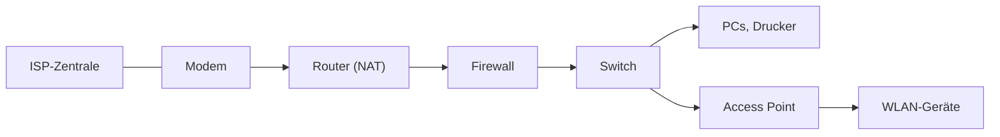

# Internetzugang

Das Internet ist ein **Zusammenschluss sehr vieler einzelner IP-Netze**. Für einen Internetzugang verbindet man das eigene LAN mit dem Netz eines **Internet Service Providers (ISP)**.

## Die Kette vom ISP bis zum Client

| Gerät | Aufgabe |
|---|---|
| **Modem** | Überträgt die Daten über die Leitung vom ISP zum Kunden. Es braucht auf **beiden Seiten** ein Modem. |
| **Router** | Verbindet das IP-Netz des ISP mit dem LAN, macht **NAT** (siehe [[IP-Adressierung & Subnetting]]). |
| **Firewall** | Hält Angreifer ab (Datendiebstahl, **Denial of Service**). |
| **Switch** | Schliesst mehrere Geräte per Kabel ans LAN an. |
| **Access Point** | Lässt WLAN-Geräte ohne Kabel ins LAN, siehe [[WLAN-Standards]]. |

## Anschlussarten (Medium zum Kunden)

| Technik | Medium | Übertragungsrate (ca.) | Bemerkung |
|---|---|---|---|
| **FTTH** (Fibre to the Home) | Glasfaser bis in die Wohnung | bis **10 Gbit/s** | in grossen Städten |
| **DOCSIS** | TV-Koaxialkabel (z. B. Sunrise/UPC) | 500–800 Mbit/s | Data Over Cable Service Interface Specification, 1997 von CableLabs |
| **xDSL** | Kupferdrähte (Telefonleitung) | bis 500 Mbit/s | Rate sinkt mit der **Distanz** zum nächsten Netzknoten |
| Funk | Mobilfunk (GSM/4G/5G) | variabel | |
| Satellit | Funk über Satellit | variabel | |

> [!important] Fachsprache: Übertragungsrate statt «Bandbreite»
> Die **Übertragungsrate** misst man in **Bit/s**. Die **Bandbreite** kommt aus der Signaltheorie und wird in **Hertz (Hz)** angegeben. Fachleute sagen deshalb Übertragungsrate, nicht Bandbreite.

## Kombigerät des ISP
In kleinen LANs (und zuhause) steckt alles in **einem Gerät**: Modem + Router mit NAT + Firewall + WLAN-AP + Switch (die «eierlegende Wollmilchsau»). In grösseren Firmen sind das einzelne, getrennte Geräte.

> [!failure] Nachteile des Kombigeräts
> 1. Keine zwei ISPs möglich → **keine Redundanz**
> 2. Keine Lastverteilung zwischen zwei ISPs (**kein Load Balancing**)
> 3. Weniger Schutz gegen **Denial of Service**
> 4. Schwache, kaum gewartete Firewalls → unsicher
> 5. Ein Gerät für alles → **Single Point of Failure**

> [!success] Vorteil
> Günstig und in den meisten Fällen gut genug. Professionelle Anschlüsse haben hohe Installations- und Monatskosten (genauer im Modul 146).

## ISP auswählen
Wichtig sind: Standort (welches Medium ist verfügbar?), maximale Übertragungsrate, Kombigerät, monatliche Kosten.
*Aufgabe im Skript:* Tabelle mit ISP · max. Übertragungsrate · Medium · Kombigerät · Kosten für den eigenen Wohnort erstellen und begründen, welchen man wählt.

## Siehe auch
- [[Netzwerk Grundlagen]]
- [[IP-Adressierung & Subnetting]]
- [[WLAN-Standards]]
