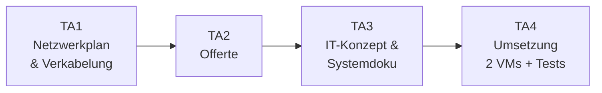

# LB3 – Projekt Sota GmbH (Gruppenarbeit, 4 Teilaufträge)

> [!warning] Name im Skript
> Im Skript heisst die Gruppenarbeit noch **LB2**. In unserer Klasse ICT26c ist sie die **LB3**, die LB2 ist die Theorieprüfung über den ganzen Stoff. Termine: [[Modul 117 – Überblick#📝 Termine & Leistungsbeurteilungen ICT26c]].

## Ausgangslage
Die **Sota GmbH** ist stark gewachsen und zieht in ein grösseres Gebäude. Dort soll eine **komplett neue IT-Infrastruktur** entstehen. Weil IT nicht ihr Kerngeschäft ist, vergibt sie den Auftrag nach einer öffentlichen Ausschreibung an eine externe Firma, also an **uns** (fiktiver Firmenname erlaubt).
Die **beste**, nicht unbedingt die günstigste Offerte gewinnt.

## Bedingungen
- **2er-Team**, Aufteilung der Arbeit schriftlich festhalten
- **Pro Teilauftrag ein eigenes Dokument** mit Titelblatt und Namen, kundentauglich formatiert, Abgabe als **PDF**
- Jeder Teilauftrag wird mit der Lehrperson besprochen und nach Bewertungsblatt bewertet
- Notenrichtwert: kundentaugliche, seriöse, korrekte Arbeit = **5**; besonderer Einsatz = 5.5–6; Chef müsste nacharbeiten = 4–4.5; unbrauchbar = 3



Die Teilaufträge **der Reihe nach** bearbeiten.

---

## Teilauftrag 1 – Physischer & logischer Netzwerkplan
**Voraussetzungen im Gebäude:**
- Alle Räume im Erdgeschoss
- Telefon- und Kabel-TV-Leitungen in **20-mm-Röhrchen** vorhanden, selbst entscheiden, ob sie brauchbar sind
- Wände dürfen durchbohrt werden
- Steckdosen bei den IT-Geräten selbst anbringen
- Ein **Nachmieter** soll die Grundinstallation weiter nutzen können (→ [[Universelle Gebäudeverkabelung (UGV)]])
- **Fix installiertes WLAN**: AP-Anschlüsse an geeigneten Orten planen und begründen

**Vorgehen:**
1. **Logischen Netzwerkplan** zeichnen. Die Kundenskizze nur als Idee nehmen, richtig **hierarchisch** zeichnen. Alle Geräte benennen, noch **keine** Nummern und Adressen, aber Platz dafür lassen (kommt in TA3). → [[Logischer & physischer Netzwerkplan]]
2. **Gebäudeplan** zeichnen (Visio-Vorlage `00_Buero_Plan.vsdx` aus dem TBZ-GitLab):
   - **Rot** = UGV, fixe Verkabelung
   - **Blau** = fliegende Verkabelung (Patchkabel)
   - Legende dazu
   - Rack an geeignetem Ort, als **separate Zeichnung vollständig bestückt**
   - klar, wo die **Dosen** sind
3. UGV, Patchkabel, Rack, Dosen und WLAN gehören auf die **Materialliste**.

## Teilauftrag 2 – Offerte
Details und Vorlage: [[Offerte erstellen]]
- Materialkosten (Preisliste mit allen Positionen, Lieferant, Hersteller, Typ, Menge, Preis inkl. MwSt.)
- Dienstleistungskosten (14 vorgegebene Positionen, 1 Arbeitstag = 8 h)
- Wartung/Support (optional)
- Angebotsbedingungen (Rechnung, Zahlung, Haftung, Gerichtsstand, Gültigkeit)
- Danach Präsentation beim «CEO» (Lehrperson): gute Argumente vorbereiten.

## Teilauftrag 3 – IT-Konzept & Systemdokumentation
**Anforderungen der Geschäftsleitung:**
- **Kein** zentraler Verzeichnis-, Namens- und Datendienst (kein File-Server, DNS, DHCP)
- **Lokale Administration**: jeder PC wird einzeln aufgesetzt
- Internet, DNS, Web- und Mail-Hosting über den **ISP**

### Namenskonzept

| Namensart | Regel | Beispiel |
|---|---|---|
| Anwendername | **NNNVVV** (3 Buchstaben Nachname + 3 Buchstaben Vorname) | `DEREVA` (Eva Derungs) |
| Arbeitsgruppe | `SOTA` | |
| PC-Namen | `PC-xy` | PC-01, PC-02 |
| Router | `RT-xy` | RT-01 |
| Switches | `SW-xy` | SW-01 |
| Drucker | `PR-xy` | PR-01 |

### Adresskonzept

| Komponente | Regel | IP-Adressen |
|---|---|---|
| Netzwerk intern | | `192.168.100.0/24` |
| Externe IP (Router, FW) | vom ISP | `62.23.12.245` |
| DNS primär / sekundär | | `62.23.12.245` / `62.23.12.246` |
| Router, Switches | fix, manuell, **.1 ist immer der Router** | `.1 – .20` |
| Drucker | fix, manuell | `.31 – .50` |
| PCs | fix, manuell | `.51 – .150` |
| Gäste | dynamisch (DHCP) | `.151 – .200` |
| Reserve | | `.201 – .254` |

### Berechtigungsmatrix
Rollenbasierte Gruppen für diese Ordner bilden und Rechte (r, w, x) vergeben, dann die User aus dem **Organigramm** (GL, Verkauf, Finanzen, Abwicklung, IT-Verantwortlicher) zuordnen:
```
m:\Sota\
m:\Sota\Verkauf
m:\Sota\Finanzen
m:\Sota\Abwicklung
m:\Sota\GL
```
→ [[Benutzer, Gruppen & Berechtigungen]]

### Inhalt der Dokumentation
- logisches Netzschema nach Standard, mit allen Angaben (Namen, IPs)
- rollenbasierte Berechtigungsmatrix
- IP-Konzept und Namenskonzept der Geräte
- **WLAN-SSID**
- alle Usernamen und Kurzzeichen
- weitere sinnvolle Angaben → Vorlage: [[Hausaufgabe 09.11. – IT-Dokumentation & Berechtigungs-Matrix]]

## Teilauftrag 4 – Umsetzung (Hands-on Lab), 24–28 Lektionen
**Vorbereitung:**
- Host mit ca. **8 GB RAM** und **80 GB** freiem Speicher, Virtualisierung (VirtualBox, VMware Workstation Player oder Hyper-V) → [[Virtualisierung (M117)]]
- **Zwei VMs** im **internen Netzwerk**, die sich auf Layer 3 pingen können (ICMP). Bei Windows dafür die eingehende Firewall-Regel *Datei- und Druckerfreigabe (Echoanforderung)* aktivieren.
- Mindestens eine VM braucht einen **zweiten Adapter** (NAT oder Bridge) fürs Internet.

**Tasks (pro zugeteiltem Mitarbeiter):**
1. **Admin-Benutzer** für den IT-Admin mit allen Rechten (Passwort = Benutzername), alles Weitere mit ihm erledigen
2. **Computername** anpassen
3. **Arbeitsgruppe** `SOTA` setzen
4. **IP-Adresse und Subnetzmaske** gemäss Konzept
5. **Benutzerkonten für alle Mitarbeitenden** nach Namenskonvention (Passwort = Benutzername)
6. **Rollenbasierte Gruppen** (Verkauf, Finanzen, Abwicklung) und User zuordnen
7. **Ordnerstruktur** unter `C:\Sota` (in der Praxis ein anderes Laufwerk)
8. **NTFS-Rechte** auf den Ordnern vergeben → [[Dateizugriffsrechte – NTFS & Freigaben]]
9. Ordner einzeln **freigeben**
10. **Testen und dokumentieren** nach [[Netzwerk testen – Testkonzept & Sicherheit]], so dass ein Kollege es nachmachen könnte
11. Abgabe als PDF, dann **Live-Demo** bei der Lehrperson

## Bewertungsblatt (100 Punkte)

| Teil | Kriterien | Punkte |
|---|---|---|
| **TA1** | Physisches Schema sauber (2), richtige Farben (1), Rack vollständig & richtig bestückt (5), Rack sauber gezeichnet (1), Dosen sinnvoll, keine zu langen Patchkabel (2), logischer Plan korrekt (2), alle Geräte angeschrieben (2) | **15** |
| **TA2** | Materialliste komplett (5), Dienstleistungen komplett (5), Offerte sauber formatiert (5) | **15** |
| **TA3** | Berechtigungsmatrix komplett (3), rollenbasiert (2), Netzschema korrekt (5), Netzschema mit allen Angaben (5) | **15** |
| **TA4** | VM-Umgebung korrekt (10), PCs pingbar (5), Admin (2), Computername (2), Arbeitsgruppe (2), Netzangaben (5), Rollen (5), MA in Rollen (5), Berechtigungen (2), Testszenario (5), Tests durchgeführt & dokumentiert (5), Tests diskutiert (2), Demo kundengerecht (5) | **55** |

> [!abstract] Notenformel
> **Note = Punkte / 100 × 5 + 1**  (z. B. 80 Punkte → 5.0)

## Siehe auch
- [[Praxisauftrag VM-Netzwerk]]
- [[Hausaufgabe 02.11. – Benutzer, Gruppen & Berechtigungs-Matrix]]
- [[Modul 117 – Überblick]]
