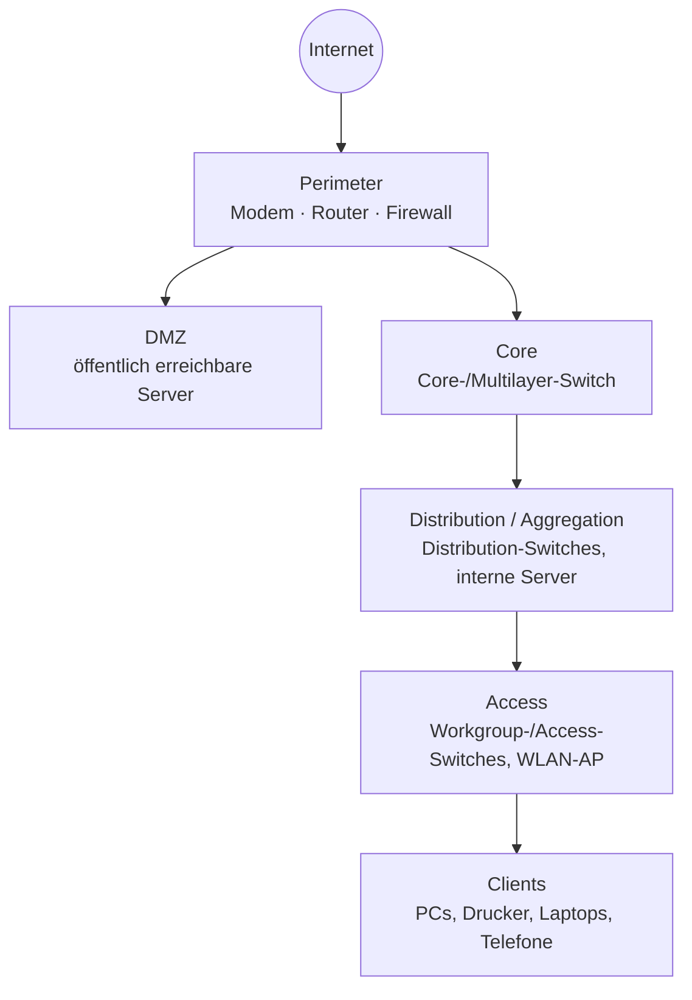
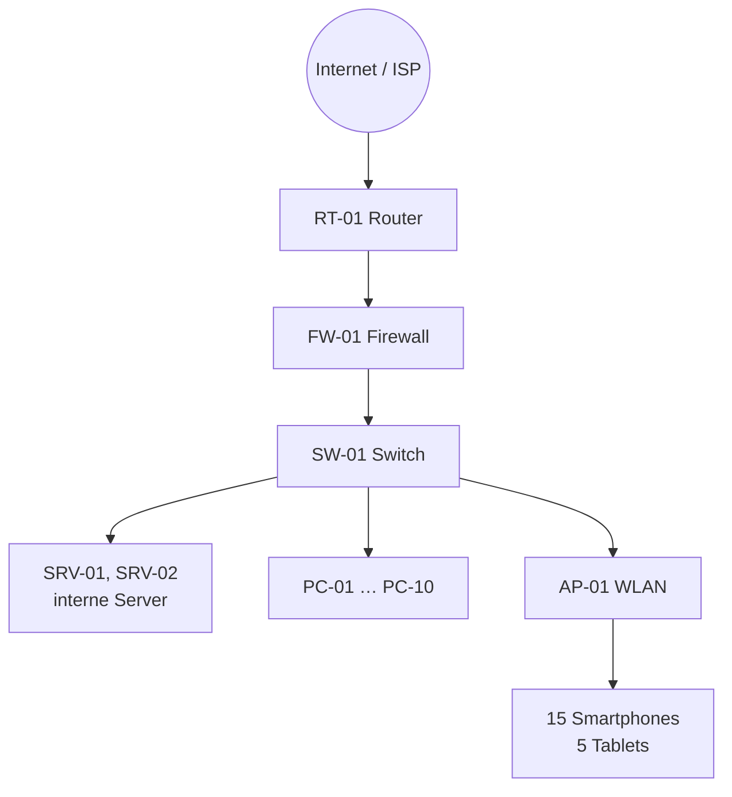

# Logischer & physischer Netzwerkplan

> [!info] Was ist ein Netzwerkplan?
> Er stellt **sämtliche Verbindungen** innerhalb der Firma grafisch dar: alle Geräte, Verbinder und Verteiler, und er zeigt den **«Ausgang»** aus dem Netzwerk (Internet). Man unterscheidet den **logischen** und den **physischen** Plan. Kurzfassung auch in [[Netzwerk Grundlagen#Netzwerkpläne]].

| | **Logischer Plan** | **Physischer Plan** |
|---|---|---|
| Zeigt | **wie** das Netz aufgebaut ist (Hierarchie, Dienste) | **wo** im Gebäude Geräte und Kabel sind |
| Inhalt | Topologie, Gerätenamen + Bezeichnung, **IPs** (Geräte-IP, Range pro Raum), Geschwindigkeiten, Routing, administrative Domänen | Grundriss mit Räumen, **Dosen**, **Kabelwegen**, Rack, Access Points, WLAN-Abdeckung, Distanzen |
| Zweck | Netzarchitektur dokumentieren, sich im Netz sofort zurechtfinden | Installation planen, **Kabellängen** ablesen, **Stückliste** erstellen |
| Redundanz | | muss klar eingezeichnet sein, unterschiedliche Kabelpfade gekennzeichnet |

## Logischer Netzwerkplan

### Regel Nr. 1: Hierarchisch zeichnen
Das logische Schema **MUSS hierarchisch** aufgebaut sein: von oben nach unten (oder links→rechts / unten→oben), in Stufen:

![[logischer-netzplan-hierarchie.png]]
*Bild 3 aus dem Skript: korrekt gezeichnetes Netz mit den Stufen Perimeter, Core, Distribution, Access.*

### Wie viele Hierarchiestufen braucht es?

| Firmengrösse | Switch-Stufen |
|---|---|
| **Kleinstfirma** (bis ca. 20 MA) | oft nur **ein Switch** (Workgroup-Switch) nach der Firewall |
| **Mittlere Firma** (bis ca. 100 MA) | **Distribution + Access** (2 Stufen), ca. **20 Geräte pro Workgroup-Switch** |
| **Grosse Firma** | alle drei Stufen (Core, Distribution, Access), **redundant** (doppelte Geräte) |

Im Modul 117 geht es nur um kleine Firmen bis ca. 100 Mitarbeitende. Später (Modul 146) zeichnet man das Schema als **Zonenplan**.

### No-Gos (schlechtes Beispiel aus dem Internet)
1. **Sich kreuzende Linien** gehen gar nicht.
2. **Keine Hierarchie** erkennbar.
3. Die tatsächlichen **Verbindungen sind unklar**.
4. **Rolle eines Geräts unklar** (z. B. ein PC zwischen Firewall und Switch?)
5. **Server und Drucker am gleichen Switch**
6. **PC direkt am Core-Switch** (Multilayer)

### Beschriftung
- Alle Geräte sind **angeschrieben**, am besten mit Bezeichnung und Haupteigenschaft.
- **Nicht zu viel** ins Schema schreiben: lieber nur **Nummer und Netzwerkadresse**. Alles andere gehört ins zugehörige **Dokument** (das immer aktuell gehalten werden muss).
- Beispiele:
  - `SW-Bad-001` → Switch Nr. 001 an der Badenerstrasse
  - `PC-Neu-012, DHCP` → PC Nr. 012 an der Neugasse, bekommt IP per DHCP
  - `WSR-Bad-003, 192.168.23.3` → Webserver Nr. 003 an der Badenerstrasse mit fixer IP
- Namenskonventionen: [[Universelle Gebäudeverkabelung (UGV)#Beschriftung und Namenskonvention]] und [[LB3 – Projekt Sota GmbH#Namenskonzept]]

### Werkzeuge
**Visio** oder gratis **draw.io / diagrams.net** (app.diagrams.net).

## Physischer Netzwerkplan

![[physischer-netzplan-beispiel.png]]
*Bild 18 aus dem Skript: UGV rot, Patchkabel blau, Access Points grün, Dosen orange.*

**Farben (Vorgabe LB3):**
- 🔴 **Rot** = UGV, fixe Verkabelung
- 🔵 **Blau** = fliegende Verkabelung (Patchkabel)
- 🟢 Grün = Access Points · 🟠 Orange = Dosen
- immer mit **Legende**

**Regeln:**
- Wo jedes Kabel verläuft, wird im physischen Plan festgelegt. Daraus liest man die **Kabellängen** ab und erstellt die **Stückliste**.
- Kabel laufen in **Kanälen**, evtl. vom Boden zur Decke → mitrechnen. Doppelböden und Decken sind üblich.
- **Überlängen** einplanen.
- **Dosen sinnvoll setzen**, so dass keine zu langen Patchkabel nötig sind.
- **Access Points nicht an Aussenwänden** (WLAN soll intern bleiben). Jeder AP hat eine **eigene Dose** mit Patchkabel.
- Das **Rack** wird zusätzlich als **eigene Zeichnung**, vollständig bestückt, gezeichnet.
- Als Zwischenschritt kann man das **Montageprinzip** zeichnen (Rack – Patchpanel – UGV – Dosen), siehe [[Universelle Gebäudeverkabelung (UGV)#Aufbau im Rack (Verteilerschrank)]].

## Übungsaufgaben aus dem Unterricht
> [!example] W01 – logischer Netzwerkplan
> Eine Firma hat **10 PCs, 15 Smartphones, 5 Tablets** und **2 interne Server**. Internet-Uplink zum ISP, abgesichert durch eine **Firewall**. Webservices beim Provider gehostet → **keine DMZ**. Zeichne ein logisches Schema mit den **minimal nötigen** Hierarchiestufen und begründe es.
>
> **Lösungsidee:** Internet → Modem/Router (ISP) → Firewall → **ein** Switch (Kleinstfirma, < 20 Geräte am Kabel) → 10 PCs, 2 Server, 1 WLAN-AP → 15 Smartphones + 5 Tablets. Eventuell Server an einen eigenen Switch, damit Server und Clients getrennt sind.

> [!example] Skript Aufgabe 4 (grössere Variante)
> **50 PCs, 80 Smartphones, 30 Tablets, 2 Server**, Firewall, keine DMZ → zu viele Geräte für einen Switch: **Distribution-Switch + mehrere Access-Switches** (ca. 20 Geräte pro Access-Switch, z. B. 3 für die PCs, 1 für Server, mehrere APs für die 110 WLAN-Geräte).

## Siehe auch
- [[Netzwerk Grundlagen]]
- [[Universelle Gebäudeverkabelung (UGV)]]
- [[LB3 – Projekt Sota GmbH]]
- [[IP-Adressierung & Subnetting]]
