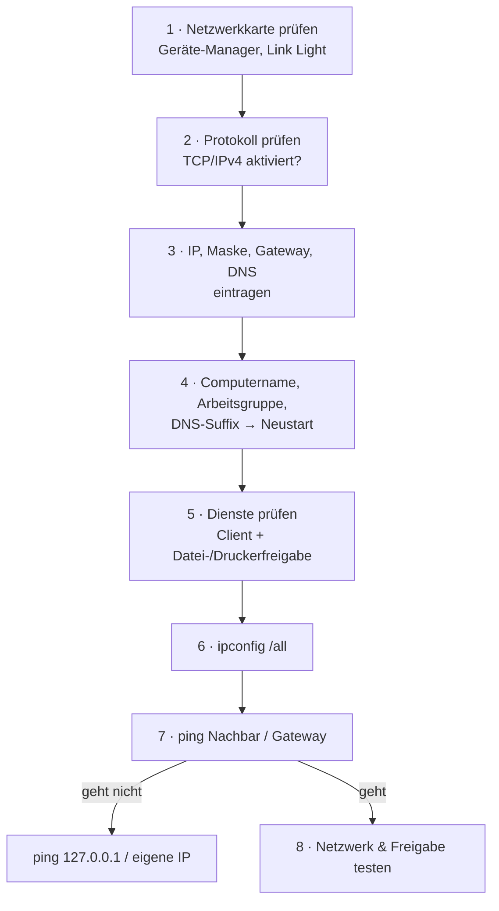

# Netzwerk konfigurieren & testen (Windows)

> [!info] Die drei Hauptteile der Netzwerkkonfiguration
> 1. **Netzwerkkarte** (inkl. richtige Kabel und Stecker)
> 2. **Netzwerkprotokoll** (TCP/IPv4: IP, Maske, Gateway, DNS)
> 3. **Netzwerkdienste** (Client für Microsoft-Netzwerke, Datei- und Druckerfreigabe)

## Schritt für Schritt (Checkliste mit Kontrolle)

| # | Teilziel | Vorgehen (Windows) | Test / Erwartung |
|---|---|---|---|
| 1 | **Netzwerkkarte** kontrollieren | `Win + R` → `sysdm.cpl` → Hardware → **Geräte-Manager** (oder `devmgmt.msc`). Kabel an Gegenstelle. | Karte **ohne Fehlersymbol** (gelbes ! oder roter Pfeil). **Link Light brennt**. |
| 2 | **Protokoll** kontrollieren/installieren | Netzwerk- und Freigabecenter → **Adaptereinstellungen ändern** (`ncpa.cpl`) → Adapter → Eigenschaften | **Internetprotokoll Version 4 (TCP/IPv4)** ist da und **angehakt**, sonst «Installieren». Mehrere Protokolle pro Karte möglich. |
| 3 | **Protokoll konfigurieren** | TCP/IPv4 → Eigenschaften → «Folgende IP-Adresse verwenden» | **Eindeutige Host-ID**, aber **gleiche Netz-ID** wie alle anderen. Gateway und DNS eintragen. |
| 4 | **Computername, Arbeitsgruppe, DNS-Suffix** | `sysdm.cpl` → Computername → **Ändern** (DNS-Suffix unter «Weitere…») | **Neustart** nötig, danach kontrollieren |
| 5 | **Client und Dienst** | Adapter-Eigenschaften | **Client für Microsoft-Netzwerke** (ich greife auf andere zu) und **Datei- und Druckerfreigabe für Microsoft-Netzwerke** (andere greifen auf mich zu) sind angehakt |
| 6 | **Einstellungen kontrollieren** | `cmd` → `ipconfig /all` | Werte stimmen mit dem Konzept, **richtiger Adapter**! |
| 7 | **Nachbarn** testen | `ping <IP des Nachbarn>`, `ping <Gateway>` | Antworten kommen |
| 8 | **Eigene Adresse** testen (wenn 7 scheitert) | `ping 127.0.0.1` und `ping <eigene IP>` | Geht das nicht → Protokoll falsch installiert/konfiguriert |
| 9 | **Netzwerkdienste** testen | Explorer → **Netzwerk**, Testordner freigeben | Sehe ich die anderen PCs der Arbeitsgruppe und den freigegebenen Ordner? |

Jeder Schritt hat in der Vorlage ein Feld **Selbstkontrolle** und **Supervisor** (Visum).

## Die Einstellungen erklärt

| Einstellung | Bedeutung | Muster GmbH (Übung) |
|---|---|---|
| **IP-Adresse** | eindeutig pro Gerät, gleiche Netz-ID | selbst festlegen, z. B. 192.168.3.x/24 |
| **Subnetzmaske** | trennt Netz- und Host-Teil | z. B. 255.255.255.0 |
| **Standardgateway** | **«Ausgang» ins nächste Netz** (Internet) = der **Router**. Für alle Geräte gleich. Üblich: **tiefste oder höchste** Adresse im Netz (.1 oder .254). Nur nötig, wenn ein anderes Netz angeschlossen ist. | z. B. 192.168.3.1 |
| **DNS-Server** | «Auskunftsstelle»: liefert zu einem Namen (www.tbz.ch) die IP. Lokal oder beim Provider. **Normalerweise zwei** (Ausfallsicherheit). | DNS-Server der Schule (mit `ipconfig /all` auf einem Schul-PC herausfinden) |
| **Computername** | Name im Windows-Netz (**NetBIOS**), meist auch DNS-Name | `MUPC-gxx`, z. B. MUPC-302 |
| **Arbeitsgruppe** | PCs mit gleichem Namen sehen sich unter «Netzwerk» | `MODUL117` (LB3: `SOTA`) |
| **Primäres DNS-Suffix** | eigene interne DNS-Domäne. **Einfache Namen ohne Punkte**, nie echte Internet-Namen (sonst sind die echten Domains nicht mehr erreichbar) | `mustergmbh` |

> [!warning] Windows antwortet nicht auf Ping!
> Ab Windows 7 blockiert die **Windows-Firewall eingehende Pings** (gelten als Angriff). Lösung:
> Start → «Firewall» → **Erweiterte Einstellungen** → **Eingehende Regeln** → **«Datei- und Druckerfreigabe (Echoanforderung – ICMPv4 eingehend)»** aktivieren.
> Per Befehl (Admin): `netsh advfirewall firewall set rule name="Datei- und Druckerfreigabe (Echoanforderung - ICMPv4 eingehend)" new enable=yes`

> [!note] Netzwerkprofil
> Für Freigaben muss das Netzwerkprofil **Privat** sein, nicht **Öffentlich** (Einstellungen → Netzwerk und Internet → Ethernet → Netzwerkprofiltyp).

## Wichtige Befehle (cmd / PowerShell)

| Befehl | Zweck |
|---|---|
| `ipconfig` | IP, Maske, Gateway kurz anzeigen |
| `ipconfig /all` | alles: **MAC (Physische Adresse)**, DHCP an/aus, DNS-Server, Hostname, Lease |
| `ipconfig /release` · `/renew` | DHCP-Adresse abgeben / neu holen |
| `ipconfig /flushdns` | DNS-Cache leeren |
| `ping <IP oder Name>` | Erreichbarkeit testen (ICMP Echo). `-t` = endlos, `-n 10` = 10 Pakete, `-4` = IPv4 erzwingen |
| `ping 127.0.0.1` | eigener TCP/IP-Stack (Loopback) |
| `tracert <Ziel>` | Weg über alle Router (Hops) anzeigen |
| `pathping <Ziel>` | wie tracert + Paketverlust pro Hop |
| `nslookup www.tbz.ch` | **DNS** testen: welche IP hat der Name? |
| `arp -a` | ARP-Tabelle: welche IP gehört zu welcher MAC (im lokalen Netz) |
| `getmac` | MAC-Adressen anzeigen |
| `hostname` | Computername |
| `netstat -an` | offene Verbindungen und Ports |
| `route print` | Routing-Tabelle des PCs |
| `net share` | eigene Freigaben auflisten |
| `net view \\PC-02` | Freigaben eines anderen PCs |
| `net use M: \\PC-02\Sota` | Netzlaufwerk verbinden |
| `icacls C:\Sota` | **NTFS-Rechte** eines Ordners anzeigen |
| `tree C:\Sota` | Ordnerstruktur als Baum |
| `whoami /groups` | eigene Gruppen anzeigen |
| `ncpa.cpl` · `sysdm.cpl` · `lusrmgr.msc` · `compmgmt.msc` | Netzwerkverbindungen · Systemeigenschaften · lokale Benutzer und Gruppen · Computerverwaltung |
| Linux/macOS | `ifconfig` bzw. `ip a`, `ping`, `traceroute`, `nslookup`/`dig` |

## Systematische Fehlersuche (von unten nach oben im OSI-Modell)

| Test | Wenn es NICHT geht … |
|---|---|
| Link Light | Kabel, Port, Netzwerkkarte (Schicht 1) |
| `ipconfig` zeigt 169.254.x.x | kein DHCP-Server erreichbar → APIPA |
| `ping 127.0.0.1` | TCP/IP-Stack defekt |
| `ping <eigene IP>` | Adapter/Protokoll falsch konfiguriert |
| `ping <Nachbar>` | falsche Maske/Netz-ID, Firewall blockiert ICMP, Kabel |
| `ping <Gateway>` | Gateway-IP falsch, Router aus |
| `ping 8.8.8.8` | kein Internet: Gateway fehlt, Router/ISP-Problem |
| `ping www.tbz.ch` / `nslookup` | **DNS** fehlt oder falsch |

Mehr Fehlerbilder: [[Verbindungen & Störungen#Typische Fehler im Netzwerk (Symptom → Ursache)]]

## Simulation mit Filius (Skript Kap. 4)
**Filius** ist eine gratis Lernsoftware (Java) zum Simulieren von Netzen per Drag & Drop (lernsoftware-filius.de).
Übung aus dem Skript:
- LAN `192.168.10.0/24` mit **3 PCs** an einem Switch, **DHCP** im LAN
- Router (Vermittlungsrechner) mit Firewall zum ISP: ISP-IP `132.23.23.2` aus dem Netz `132.23.23.0/30`
- PC 1 und PC 2 auf DHCP, **PC 2 (Gerät 3) ist der DHCP-Server**
- Netz mit dem **grünen Dreieck** starten, auf PC 1 die Befehlszeile installieren und mit `ipconfig` prüfen: Der DHCP-Server verteilt IP, Gateway, Maske und DNS.
- Schon das Aufstarten eines PCs erzeugt Datenverkehr (DHCP-Anfragen).

## Siehe auch
- [[Netzwerk testen – Testkonzept & Sicherheit]]
- [[Praxisauftrag VM-Netzwerk]]
- [[IP-Adressierung & Subnetting]]
- [[Dateizugriffsrechte – NTFS & Freigaben]]
- [[Virtualisierung (M117)]]
