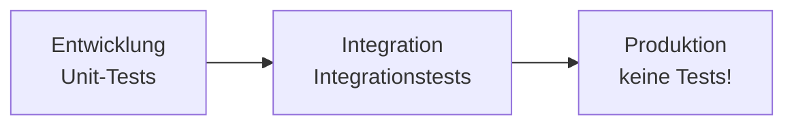

# Netzwerk testen – Testkonzept, Testszenarien & Sicherheit

> [!info] Warum testen?
> Testen ist eine der **wichtigsten Tätigkeiten** einer Informatikerin / eines Informatikers. Ungetestete Netze führen zu Produktionsausfällen und damit zu hohen Kosten. Im LB3-Teilauftrag 4 **muss** dieses Verfahren angewendet werden (siehe [[LB3 – Projekt Sota GmbH]]).

## 3-Plattformen-Ansatz

| Plattform | Was wird getestet? |
|---|---|
| **Entwicklungs-Plattform** | **Unit-Tests**: eine Einheit allein (eine Applikation, ein Gerät, ein Teil des Netzes) |
| **Integrations-Plattform** | **Integrationstests**: das Zusammenspiel, z. B. Performance-, Functional-, Security-, User-Acceptance-Tests |
| **Produktions-Plattform** | **Keine Tests!** Wenn nötig nur in Randstunden, nur durch Fachleute, möglichst **nicht invasiv** |

## Testkonzept – die 6 Bereiche (a–f)
1. **a) Testobjekt / Testsystem** – Was wird getestet? Genau beschreiben, mit Skizze, **Systemgrenze** klar. Bei Geräten: ganze Spezifikation und Konfiguration. Dazu **Testumfeld**: Labor, Adresse, Zeitpunkt/Zeitraum (einmalig, temporär, Dauertest = schon Monitoring).
2. **b) Testmethode / Testmittel** – Womit? Die Methode genau angeben (sie kann selbst fehlerhaft sein).
   - Methoden: firmeninterne Vorgaben, Standards (ISO, ITU, IEEE), **RFCs** (z. B. RFC 7312 IP Performance Metrics), Best Practice (BSI)
   - Mittel: **geeichte Messgeräte** (Seriennummer + Zertifikat notieren), Mess-Software (Portscanner, **Wireshark**; Prüfsummen kontrollieren, keine Malware), Paket-Generatoren für Leistungstests
3. **c) Testpersonen** – Wer testet wann was? (evtl. mit Qualifikation)
4. **d) Testszenario mit Vorhersage** – Ablauf des Tests und **erwartetes Resultat**. Testfälle von Vorgesetzten absegnen lassen, sonst wird es uferlos.
5. **e) Durchführung & Diskussion** – Resultat festhalten und diskutieren. Was wurde **nicht** getestet und warum? → Tests werden **reproduzierbar**.
6. **f) Massnahmen** – Nicht bestandene Tests: Korrektur am System oder an der Testmethode, Änderung beschreiben, **erneut testen**.

> [!example] Beispiel aus dem Skript
> **Test:** Ressourcenzuteilung des Fileservers. Ein User loggt sich ein und legt ein File an den vereinbarten Ort.
> **Vorhersage:** Das File liegt am vereinbarten Ort und der Tester findet es.

## Die vier Fälle: true/false positive/negative

> [!danger] Keine «Hurra, es läuft»-Tests!
> Solche Tests haben ein hohes **Non-Detection-Risk**: ein Fehler wird nicht gefunden, weil die Vorhersage zufällig erfüllt ist. Darum immer alle vier Fälle diskutieren.

| | System funktioniert **wirklich** | System funktioniert **nicht** |
|---|---|---|
| **Resultat = Vorhersage** | ✅ **True Positive** – Tester findet das File, es ist wirklich dort | ⚠️ **False Positive** – Tester «findet» das File, aber es ist in Wirklichkeit nicht dort |
| **Resultat ≠ Vorhersage** | ⚠️ **False Negative** – Tester findet das File nicht, obwohl es dort ist (Beobachtung falsch) | ✅ **True Negative** – File ist wirklich nicht dort, die Zuteilung hat versagt |

**Mögliche Ursachen für falsche Resultate (Troubleshooting nötig):**
- *False Negative:* Testmethode fehlerhaft, Firewall/Gerät verhindert den Test, Tester schaut am falschen Ort.
- *False Positive:* Tester ist selbst am falschen Ort (Rechte von User und Tester falsch), User hat sich doch nicht an die Anweisung gehalten.

> [!tip] Profi-Trick
> Die vier Fälle **absichtlich provozieren**: den User etwas falsch machen lassen oder dem Tester falsche Rechte geben und schauen, ob er die Files trotzdem sieht. So prüft man die Robustheit von System **und** Testmethode.

## Testprotokoll-Vorlage

| Nr. | Testfall | Vorgehen | Erwartetes Resultat | Effektives Resultat | Fall (TP/TN/FP/FN) | OK? |
|---|---|---|---|---|---|---|
| 1 | Ping PC-01 → PC-02 | `ping 192.168.100.52` | Antwort ohne Verlust | | | |
| 2 | User darf in `\Verkauf` schreiben | als User einloggen, Datei anlegen | Datei wird erstellt | | | |
| 3 | User darf **nicht** in `\GL` | als User öffnen | «Zugriff verweigert» | | | |

## Datenschutz
- Das **revidierte Schweizer Datenschutzgesetz (revDSG)** gilt seit dem **1. September 2023** (zusammen mit der Verordnung VDSG). Es ist der europäischen **DSGVO** nachgebildet, mit teils wichtigen Abweichungen.
- Es schützt die Persönlichkeits- und Grundrechte von **natürlichen Personen**. Daten von juristischen Personen (Firmen) sind nicht mehr geschützt.
- Ziel: mehr Transparenz, mehr Selbstbestimmung über eigene Daten. Neue Pflichten für Firmen bei Erhebung, Verlust und Missbrauch von Personendaten.

## Datensicherheit testen
- **Personal Firewall** auf jedem Endgerät muss eingeschaltet und eingestellt sein (Windows-Sicherheit → Firewall & Netzwerkschutz). Screenshot der Einstellungen machen.
- **Perimeter-Firewall** mit Online-Tools testen, z. B. Penetration-Testing-Tools, **intruder.io** für Switches, Router, Drucker.
- Bekannte Sicherheitslücken nachschlagen: **CERT Vulnerability Database**, **NIST NVD**, Bund: Bundesamt für Cybersicherheit (früher **MELANI**).

> [!danger] Nur eigene Systeme testen!
> Fremde Systeme zu testen bzw. zu hacken ist eine **Straftat**. Man kann die Lehrstelle verlieren und bekommt es mit der Staatsanwaltschaft zu tun.

## Siehe auch
- [[Netzwerk konfigurieren & testen (Befehle)]]
- [[Verbindungen & Störungen]]
- [[Praxisauftrag VM-Netzwerk]]
