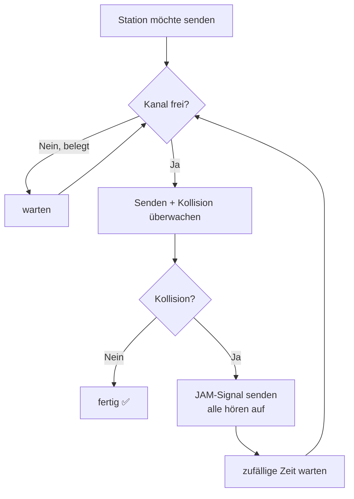

# Netzwerkgeräte & Zugriffsverfahren

Geräte teilt man ein in **Frontend** (Benutzerendgeräte: PC, Notebook, Drucker, IP-Telefon) und **Backend** (Netzwerkkomponenten: Switch, Router, AP, Server). Übersicht über Firewall, DMZ, Core/Distribution/Access-Switches: [[Netzwerk Grundlagen]].

## Netzwerkkarte (NIC) und MAC-Adresse
- **NIC** = Network Interface Card: Steckkarte oder Chip auf dem Mainboard. Physikalische Schnittstelle zwischen Rechner und Netz.
- Deckt **OSI-Schicht 1 und 2** ab (siehe [[OSI-Modell]]).
- Zur Karte passt das Medium: TP, LWL oder WLAN. Wechselt man das Medium, braucht es eine andere Karte.
- Jede Karte hat ab Werk eine **weltweit eindeutige MAC-Adresse** (Media Access Control):
  - **48 Bit**, in **Hex** geschrieben, z. B. `00-07-E9-1A-00-A0` oder `00:07:E9:1A:00:A0`
  - **erste 24 Bit = Hersteller** (OUI, hier Intel), **letzte 24 Bit = Karte**
  - Hersteller nachschlagen bei der IEEE
  - lässt sich per Software ändern (→ MAC-Spoofing, siehe [[IP-Adressierung & Subnetting#Spoofing]])
- **Broadcast-MAC-Adresse:** `FF-FF-FF-FF-FF-FF` = «an alle senden»
- Anzeigen: Windows `ipconfig /all` (Physische Adresse) · Linux `ifconfig` / `ip a` · Android: Einstellungen → Über das Telefon → Status
- **Auto Negotiation**: die Karte handelt Geschwindigkeit und Duplex-Verfahren selbst aus (Duplex: **Auto Sense**).
- **LEDs** zeigen Verbindung (Link), Aktivität und Geschwindigkeit.

## Hub vs. Switch

| | Hub (veraltet) | Switch |
|---|---|---|
| Prinzip | «verkleinerter **Bus** im Gerät» | «**Schalter**»: verbindet die zwei Stationen direkt |
| Daten gehen an | **alle** Stationen | **nur** die Zielstation (anhand MAC-Adresse) |
| Gleichzeitig senden | nur **eine** Station | **mehrere** Paare gleichzeitig |
| Übertragungsrate | wird **geteilt** (3 Sender → je ⅓) | **volle** 100/1000 Mbit/s pro Station |
| Kollisionen | ja | **nein** (prinzipbedingt) |
| OSI-Schicht | 1 | **2** |

→ **Switches sind Hubs immer vorzuziehen.**

### Leistungsmerkmale eines Switches
- Anzahl Ports und Geschwindigkeit
- Anzahl **SFP/GBIC**-Steckplätze (für Glasfaser-Module)
- Anzahl **PoE**-Ports (Power over Ethernet: Strom übers Netzwerkkabel, z. B. für APs und IP-Telefone)
- Anzahl speicherbarer **MAC-Adressen** (MAC-Tabelle)
- Switching-Verfahren und **Latenz** (Verzögerung)
- **VLAN**-fähig, **managebar** (Web-Oberfläche), **stackable**, Lüfter
- Port-LEDs (Aktivität, Geschwindigkeit)
- **Green Ethernet**: passt die Sendeleistung der Kabellänge an und spart Strom im Standby

## Weitere Geräte

| Gerät | Aufgabe | OSI |
|---|---|---|
| **Repeater** | verstärkt das Signal, verlängert die Strecke | 1 |
| **Medienkonverter** | verbindet verschiedene Medien, z. B. Kupfer ↔ Glasfaser (Fast Ethernet → Multimode). Verhält sich **transparent**. | 1 oder 2 |
| **Powerline (PowerLAN, PLC)** | Netzwerk über die **Stromleitung**, theoretisch bis 1 Gbit/s. Einfach, aber anfällig für Störungen (Dimmer, Netzteile). | 1/2 |
| **Access Point** | verbindet WLAN-Geräte mit dem kabelgebundenen LAN, siehe [[WLAN-Standards]] | 2 |
| **Router** | verbindet **verschiedene Netze**, z. B. LAN ↔ Internet | **3** |
| **Firewall** | prüft und filtert Verkehr nach Regeln, bis in die Anwendungsprotokolle | 3–**7** |

## Router
- Hat **mindestens zwei Netzwerkanschlüsse** (z. B. 1 WAN-Port + 4 LAN-Ports).
- Verbindet Netze mit verschiedenen Protokollen und Architekturen, steht oft an der **Aussengrenze** des Netzes.
- Entscheidet mit der **Routing-Tabelle**, welchen Weg ein Paket nimmt. Sie enthält:
  - alle bekannten Netzwerkadressen
  - Verbindungsarten in andere Netze
  - Weginformationen zu anderen Routern
  - Verbindungskosten
- **Statisches Routing**: Admin trägt Routen von Hand ein und pflegt sie.
- **Dynamisches Routing**: Router tauschen sich selbst aus und passen sich bei Ausfällen automatisch an.

## CSMA/CD
Das **Zugriffsverfahren** von Ethernet regelt, **wer wann senden darf** (auf dem Bus oder am Hub). Alle Stationen sind **gleichberechtigt**, auch ein Server oder Admin kann nicht vordrängeln.
- **CSMA** = Carrier Sense Multiple Access: zuerst **hören**, ob die Leitung frei ist, nur dann senden.
- **CD** = Collision Detection: wenn trotzdem zwei gleichzeitig senden (**Kollision**), sind beide Daten kaputt.

- Kollisionen kosten Zeit → je **mehr Stationen**, desto mehr Kollisionen, desto langsamer.
- Kollisionen gibt es **nur bei Hub/Bus**, bei **Switches nicht** (Vollduplex, jede Station hat ihre eigene Leitung).

## Verbindung prüfen
1. Kabel einstecken → **Link Light** an Netzwerkkarte und Switch prüfen (leuchtet? welche Rate?)
2. Leuchtet nichts → **Kabeltester** benutzen
3. Danach logisch prüfen mit `ipconfig` und `ping` → [[Netzwerk konfigurieren & testen (Befehle)]]

## Siehe auch
- [[Kabel, Stecker & Ethernet-Varianten]]
- [[Netzwerk Grundlagen]]
- [[OSI-Modell]]
