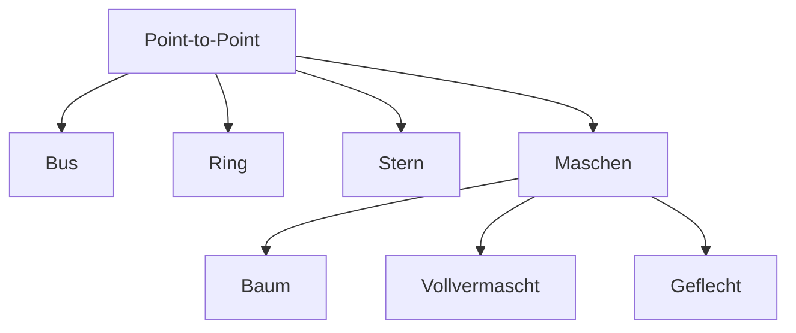

# Netzwerktopologien

Unterschiedliche Verbindungsarten von Rechnern in einem Netz nennt man Netzwerktopologie. Sie erfolgt meistens physikalisch, also per Kabel.

- Die einfachste Art der Topologie ist die **Point-to-Point**-Topologie (zwei Hosts direkt mit Kabel verbunden).
- Um mehrere Hosts miteinander zu verbinden, benutzt man meistens Netzwerkkomponenten mit Verteilfunktion (z. B. Switches oder Router).
- **Bus, Ring, Stern und Maschen** sind die vier Grundtopologien.

## Bus-Topologie

![[bus-topologie.jpg]]

> [!success] Vorteile
> Einfache Installation, kurze Leitungen. Verbindung aller Hosts über die gleiche Leitung (Bus).

> [!failure] Nachteile
> Begrenzte Netzausdehnung, bei Kabelbruch: Netzausfall.

## Ring-Topologie

![[ring-topologie.jpg]]

> [!success] Vorteile
> Verteilte Steuerung, grosse Netzausdehnung. Ringförmige Verbindung der Geräte über geschlossene Kabelstrecke.

> [!failure] Nachteile
> Aufwändige Fehlersuche, hoher Verkabelungsaufwand, Netzausfall bei Störungen.

## Stern-Topologie

![[stern-topologie.jpg]]

> [!success] Vorteile
> Einfache Vernetzung und Erweiterung, hohe Ausfallsicherheit. Sternförmige Verbindung mehrerer Hosts über eine zentrale Netzwerkkomponente (Hub/Switch).

> [!failure] Nachteile
> Hoher Verkabelungsaufwand, Netzausfall bei Überlastung der Zentrale.

## Maschen-Topologie (Mesh)

![[maschen-topologie.jpg]]

> [!success] Vorteile
> Dezentrale Steuerung, hohe Ausfallsicherheit, beliebig weite Netzerweiterung. Keine verbindlichen Strukturen, nicht zwingend eine Verbindung zwischen allen Hosts.

> [!failure] Nachteile
> Teure Vernetzung, aufwändige Administration.

## Details aus der Theorie (W03, Teilthema 1)

> [!info] Definition
> Eine **Netzwerk-Topologie** ist die **physikalische Anordnung** der Stationen, die über Kabel oder Funk verbunden sind. Sie bestimmt die Hardware und das **Zugriffsverfahren** und beeinflusst damit Medium, Übertragungsgeschwindigkeit und Datendurchsatz.

**Bus**
- Ein zentrales Kabel (Bus), alle Geräte teilen sich das Medium (**shared media**).
- **Passiv**: die Stationen bereiten das Signal nicht auf, es breitet sich in **beide Richtungen** aus.
- Senden zwei gleichzeitig → **Kollision**, Daten zerstört → es darf **nur eine Station senden** ([[Netzwerkgeräte & Zugriffsverfahren#CSMA/CD|CSMA/CD]]).
- Signal wird **gedämpft** → Länge begrenzt, mit **Repeatern** verlängerbar.
- Beide Enden brauchen **Abschlusswiderstände** (Terminatoren), sonst werden Signale **reflektiert**. Stichleitungen kurz halten.

**Ring**
- Geschlossene Kabelstrecke, jede Station hat **genau einen Vorgänger und einen Nachfolger**.
- Daten fliessen **nur in eine Richtung**.
- Keine aktiven Komponenten, ein **Protokoll** regelt den Zugriff (z. B. Token Ring).
- Unterbruch an einer Stelle → **Netz fällt aus**. Varianten: **Doppelring**, **Ring mit Backbone**.

**Stern**
- Jede Station hat ein **eigenes Kabel** zum zentralen Verteiler (früher Hub, heute **Switch**).
- Funktioniert, bis die **Zentrale ausfällt**. Leicht erweiterbar und einfach zu pflegen.

**Stern-Bus (gemischt)**
- Stationen sind sternförmig an Hubs/Switches, die Switches untereinander über eine **Busleitung** verbunden.

**Baum (Stern-Stern)**
- Mehrere Switches bilden je einen Stern und hängen an einem **Haupt-Switch** (dort oft auch die wichtigen Server).
- Beispiel: Bürogebäude mit 3 Stockwerken, jedes Stockwerk ein Stern, alle Stockwerk-Switches an einem zentralen Switch.

**Vermascht (Mesh)**
- Zwischen den Knoten gibt es **mehrere Verbindungen** → bei Ausfall gibt es einen **redundanten** Weg.
- Typisch für **WANs**, das **Internet** ist ein vermaschtes Netz. Varianten: einfach vermascht und **vollvermascht** (jeder mit jedem).

### Vor- und Nachteile (Tabelle aus der Theorie)

| Topologie | ➕ Vorteile | ➖ Nachteile |
|---|---|---|
| **Bus** | einfach installierbar, einfach erweiterbar, wenig Kabel | Ausdehnung begrenzt, Kabelbruch = Netzausfall, aufwendiger Zugriff, nur eine Station sendet |
| **Ring** | verteilte Steuerung, grosse Ausdehnung | aufwendige Fehlersuche, Störung = Netzausfall, viel Kabel |
| **Stern** | einfache Vernetzung und Erweiterung, hohe Ausfallsicherheit | viel Kabel, Ausfall/Überlastung des Switches = Netzausfall |
| **Masche** | dezentrale Steuerung, unbegrenzte Ausdehnung, hohe Ausfallsicherheit | aufwendige Administration, teure Vernetzung |

> [!tip] Merksatz für die Prüfung
> Im **LAN** findet man heute fast nur noch die **Stern-Topologie** (bzw. den Baum aus mehreren Sternen). Das **Internet** ist **vermascht**.

## Weitere Topologien
- **Baum-Topologie:** kostengünstig, hohe Ausfallsicherheit
- **Vollvermaschte Topologie:** volle Bandbreite
- **Geflecht-Topologie:** hohe Geschwindigkeit, einfaches Management
- In der Praxis oft eine **Mischung aus mehreren Topologien**

## Universelle Gebäudeverkabelung (UGV)
Man kann dasselbe Kabel für unterschiedliche Nutzungen verwenden, was sehr flexibel macht. In der Brüstung, in einem Aufputz-Kanal, in Rohren oder einer Trasse kann man Kabel verlegen und so verstecken. Sie ist dort entstanden, wo wir noch keine Konvergenz hatten (getrennte Netze für Telefon/Daten).

- **Letzte Meile:** Man kann wählen, welche Zentrale am Ende vom Kabel ist. Point-to-Multi-Point ist von Swisscom.
- Norm **EN 50173-1** beschreibt, wie eine strukturierte Verkabelung aussehen muss.

## Siehe auch
- [[Netzwerk Grundlagen]]
- [[OSI-Modell]]
