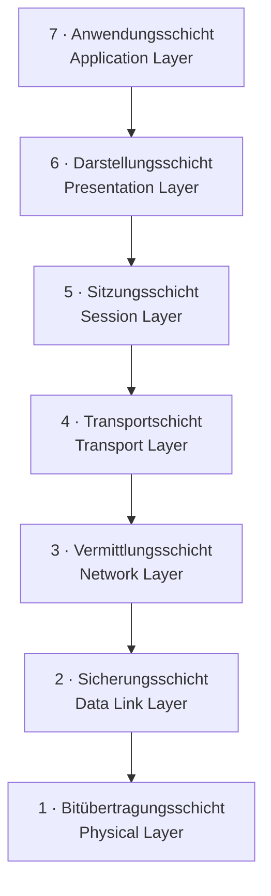
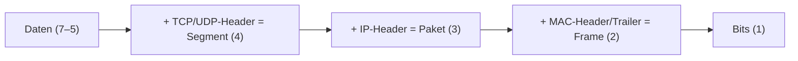

# OSI-Modell einfach erklärt

OSI = **Open Systems Interconnection**. Referenzmodell für Netzwerkprotokolle. Probleme sind dadurch leichter lösbar, weil die Kommunikation zwischen den Schichten klar definiert ist.

![[osi-modell-uebersicht.jpg]]

Beim Endgerät werden die Schichten beim Empfang **andersherum** durchlaufen als beim Senden.

## Die 7 Schichten (von oben nach unten)

### Schicht 7 – Anwendungsschicht (Application Layer)
Schnittstelle zur Anwendung: Anfrage raus, Wiedergabe im erforderlichen Format rein.

### Schicht 6 – Darstellungsschicht (Presentation Layer)
Verschlüsselung, Komprimierung und Übersetzung, z. B. in HTTP oder HTTPS. Daten sollen von jeder Hard- und Software empfangen und gelesen werden können.

### Schicht 5 – Kommunikationsschicht / Sitzungsschicht (Session Layer)
Verbindungen zwischen den Endsystemen – die "Sitzung" bzw. "Session". Zeit zwischen Öffnen und Schliessen der Kommunikation. Checkpoints helfen bei Vermittlungsfehlern.

### Schicht 4 – Transportschicht (Transport Layer)
Fehler beim Transport: Daten werden bei Bedarf erneut geschickt. Zwischen Sender und Empfänger.

### Schicht 3 – Vermittlungsschicht (Network Layer)
Zerlegung in Datenpakete → Transport → Zusammenfügen der Pakete beim Empfänger. Hier sind die **IP-Adressen** angesiedelt, siehe [[IP-Adressierung & Subnetting]].

### Schicht 2 – Sicherungsschicht (Data Link Layer)
Datentransfer zwischen zwei Geräten **im selben Netzwerk**. Zerlegung in Fragmente → Transport → Zusammenfügen der Fragmente. Hier ist die **MAC-Adresse** angesiedelt.

### Schicht 1 – Bitübertragungsschicht (Physical Layer)
Schnittstelle zum Übertragungsmedium (Kabel). Überträgt den reinen Bitstrom zwischen Sender und Empfänger.

> [!tip] Merkhilfe
> Oben = näher an der Anwendung/Mensch, unten = näher an der Hardware/Kabel. Beim Senden geht man 7→1, beim Empfangen 1→7.

## Vertiefung aus Skript und Präsentation (W01)

### Herkunft und Zweck
- **ISO** = International Organization for Standardization (Sitz Genf), **OSI** = Open Systems Interconnection.
- Entwicklung ab **1977**, Standard seit **1983 (ITU)** und **1984 (ISO)**. Genormt in **ITU X.200**.
- Zweck: Kommunikation über **unterschiedlichste Systeme** hinweg ermöglichen und die **Weiterentwicklung** erleichtern. Jede Schicht hat eng begrenzte Aufgaben, deshalb kann man eine Schicht **austauschen**, ohne die anderen zu ändern.
- Für eine vollständige Kommunikation müssen **alle Funktionen der 7 Schichten** vorhanden sein.

> [!warning] Zwei häufige Irrtümer
> - Das **Medium** (Kupfer, Glas, Luft) gehört **nicht** zu Schicht 1. Schicht 1 wandelt nur die Bits in Signale für das Medium um.
> - Es gibt **keinen Layer 8**.
> - Schicht 7 ist **nicht die Applikation** selbst, sie stellt der Applikation nur die Kommunikationsprotokolle bereit.

![[osi-zusammenfassung-schichten.png]]

### Was man pro Schicht merken muss (blau im Skript)

| Schicht | Name | Merken | Daten­einheit | Geräte |
|---|---|---|---|---|
| 7 | Anwendung (Application) | stellt **Applikationsprotokolle** bereit (HTTP, FTP, SMTP, DNS) | Daten | **Gateway, Firewall** (schauen in die Protokolle) |
| 6 | Darstellung (Presentation) | **Zeichensätze**, Übersetzen, Verschlüsseln, Komprimieren | Daten | – |
| 5 | Sitzung (Session) | **Session-Handling**: Sitzung aufbauen, verwalten, beenden (z. B. Disk voll, Papier leer) | Daten | – |
| 4 | Transport | **TCP** (verbindungsorientiert) / **UDP** (verbindungslos), **Ports**, TPDU, Transportsicherung | Segment (TPDU) | – |
| 3 | Vermittlung (Network) | **IP-Adresse**, **Pakete**, **Routing** zwischen Netzen | Paket | **Router** |
| 2 | Sicherung (Data Link) | **MAC-Adresse**, **Frames**, Flusskontrolle, Fehlerkorrektur, **Ethernet** | Frame | **Switch**, Bridge, Access Point |
| 1 | Bitübertragung (Physical) | Bits ↔ elektrische/optische/Funk-Signale | Bit | Hub, Repeater, Medienkonverter, Kabel/Stecker |

**Ports:** in RFC 1340 festgelegt, z. B. WWW = Port 80 (HTTPS 443, FTP 21, SMTP 25, DNS 53).

> [!tip] Eselsbrücke (Schicht 1 → 7)
> **«Pizza Dient Nur Teuren Sushi-Pfannen Ab»** → **P**hysical, **D**ata Link, **N**etwork, **T**ransport, **S**ession, **P**resentation, **A**pplication.

### Protokolle pro Schicht (Präsentation)

| Nr | Schicht | Beispiele |
|---|---|---|
| 7 | Anwendung | Web-Browser, E-Mail-Programme, HTTP, DNS |
| 6 | Darstellung | ASCII, HTML, XML, MIME |
| 5 | Sitzung | (laut Folie) HTTP, FTP, POP3, SMTP |
| 4 | Transport | TCP, UDP, SPX, NetBEUI |
| 3 | Vermittlung | IP, ICMP, IPX, X.25 |
| 2 | Sicherung | Ethernet, PPP, HDLC, X.75 |
| 1 | Bitübertragung | IEEE 802 (physisch), ATM, V.100 |

### Datenfluss: Kapselung (Encapsulation)
Beim **Senden** gibt jede Schicht von oben nach unten einen eigenen **Header** dazu (Schicht 2 auch einen Trailer). Beim **Empfangen** wird von unten nach oben jeder Header wieder entfernt. Jede Schicht «spricht» logisch mit derselben Schicht auf der Gegenseite.

## OSI-Modell vs. TCP/IP-Modell
Im Alltag läuft das Internet mit dem **TCP/IP-Modell** (4 Schichten). Die OSI-Schichten 5, 6 und 7 sind dort **eine** Anwendungsschicht, 1 und 2 sind die Netzzugangsschicht.

![[osi-vs-tcpip-modell.png]]

| OSI | TCP/IP | Beispiele |
|---|---|---|
| 7 Anwendung · 6 Darstellung · 5 Sitzung | **Anwendungsschicht** (Application) | HTTP, FTP, SMTP, DNS, Telnet, SNMP |
| 4 Transport | **Transportschicht** | TCP, UDP |
| 3 Vermittlung | **Internetschicht** | IP, ICMP, IGMP, ARP |
| 2 Sicherung · 1 Bitübertragung | **Netzzugangsschicht** (Network Access / Link) | Ethernet, WLAN, Frame Relay, ATM |

> [!important] Folge für die Praxis
> Weil TCP/IP **keine eigene Sitzungs- und Darstellungsschicht** hat, müssen die **Applikationen** das selbst erledigen:
> - Sitzung: Webshop merkt sich den Warenkorb mit **Session-ID / Cookies**.
> - Darstellung: Browser und Mailprogramm verwalten die **Zeichensätze** selbst.
>
> RFC 1122 beschreibt Link-, IP- und Transport-Layer, RFC 1123 die Anwendungsprotokolle.

## Siehe auch
- [[Netzwerk Grundlagen]]
- [[Netzwerkgeräte & Zugriffsverfahren]]
- [[IP-Adressierung & Subnetting]]
- [[Netzwerktopologien]]
