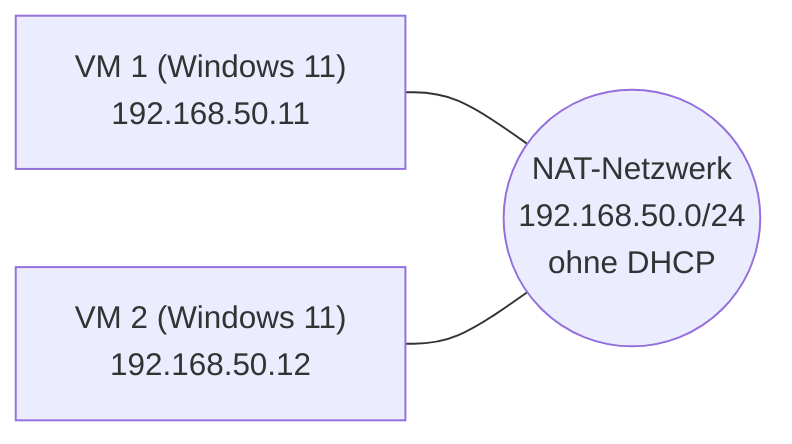

# Praxisauftrag: Zwei Windows-11-VMs über virtuelles LAN verbinden

> Verlinkt mit [[Virtualisierung & VM-Netzwerke]] (Netzwerktypen), [[IP-Adressierung & Subnetting]] und [[Lizenzierung – OEM, Retail, KMS, MAK]] (Windows aktivieren).

## Ziel
Zwei virtuelle Windows-11-Computer in einem eigenen NAT-Netzwerk **ohne DHCP-Server** verbinden. Die IP-Adressen werden von Hand gesetzt, die VMs pingen sich gegenseitig, und eine Datei-Freigabe (SMB) wird getestet.

## Checkliste
- [ ] ePortfolio aktualisieren/erweitern, in der Linkliste verlinken und freigeben
- [ ] 2 VMs mit Windows 11 aufsetzen und verbinden
- [ ] Windows-Updates installieren
- [ ] Guest Additions installieren
- [ ] Windows-Lizenz aktivieren
- [ ] OVA-Appliance exportieren
- [ ] Dokumentieren (Screenshots und Probleme)
- [ ] Teilauftrag 1: IP-Adressen und Ping
- [ ] Teilauftrag 2: SMB-Freigabe

## Netzwerkplan

| Gerät | IP-Adresse | Subnetzmaske |
|---|---|---|
| VM 1 | 192.168.50.11 | 255.255.255.0 (/24) |
| VM 2 | 192.168.50.12 | 255.255.255.0 (/24) |

Das Subnetz ist ein Vorschlag. Es muss ein privater Bereich sein (192.168.x.x, 10.x.x.x oder 172.16–31.x.x) und bei beiden VMs gleich.

## Vorgehen

### 1. NAT-Netzwerk ohne DHCP erstellen (VirtualBox)
1. Datei → Werkzeuge → **Netzwerk-Manager** → Reiter **NAT-Netzwerke** → Erzeugen.
2. IPv4-Präfix `192.168.50.0/24` eintragen.
3. **DHCP aktivieren** ausschalten.
4. In den Einstellungen jeder VM: Netzwerk → Angeschlossen an **NAT-Netzwerk** → das neue Netzwerk wählen.

### 2. Teilauftrag 1: IP-Adressen setzen und pingen
1. In der VM: Einstellungen → Netzwerk und Internet → Ethernet → IP-Zuweisung **Manuell** (IPv4).
2. IP-Adresse, Subnetzmaske `255.255.255.0` eintragen. Gateway und DNS bleiben leer, ein Internetzugang ist nicht verlangt.
3. Kontrolle in CMD: `ipconfig`
4. Test von VM 1 aus: `ping 192.168.50.12`, und umgekehrt von VM 2 aus.

**Häufiges Problem:** Die Windows-Firewall blockiert Ping standardmässig. Dann in der Firewall die eingehende Regel **Datei- und Druckerfreigabe (Echoanforderung – ICMPv4 eingehend)** aktivieren.

### 3. Teilauftrag 2: SMB-Freigabe
1. Auf VM 2 einen Ordner anlegen, z. B. `C:\Freigabe`.
2. Rechtsklick → Eigenschaften → Freigabe → **Erweiterte Freigabe** → Ordner freigeben → Berechtigungen für den Benutzer setzen.
3. Das Netzwerkprofil muss **Privat** sein (nicht Öffentlich), sonst ist die Freigabe blockiert.
4. Auf VM 1 im Explorer `\\192.168.50.12\Freigabe` eingeben und mit dem lokalen Benutzer von VM 2 anmelden. Dieser Benutzer braucht ein **Passwort**, leere Passwörter funktionieren nicht über das Netzwerk.
5. Als Test eine Textdatei in der Freigabe erstellen und auf VM 2 prüfen, ob sie da ist.

## Dokumentation (hier mit eigenen Screenshots füllen)
- [ ] Screenshot: NAT-Netzwerk mit ausgeschaltetem DHCP
- [ ] Screenshot: `ipconfig` auf beiden VMs
- [ ] Screenshot: erfolgreicher Ping in beide Richtungen
- [ ] Screenshot: Freigabe-Einstellungen
- [ ] Screenshot: Zugriff von VM 1 und Testdatei

### Probleme und Lösungen
Hier trage ich ein, was nicht auf Anhieb geklappt hat und wie ich es gelöst habe.

- *(noch leer)*
