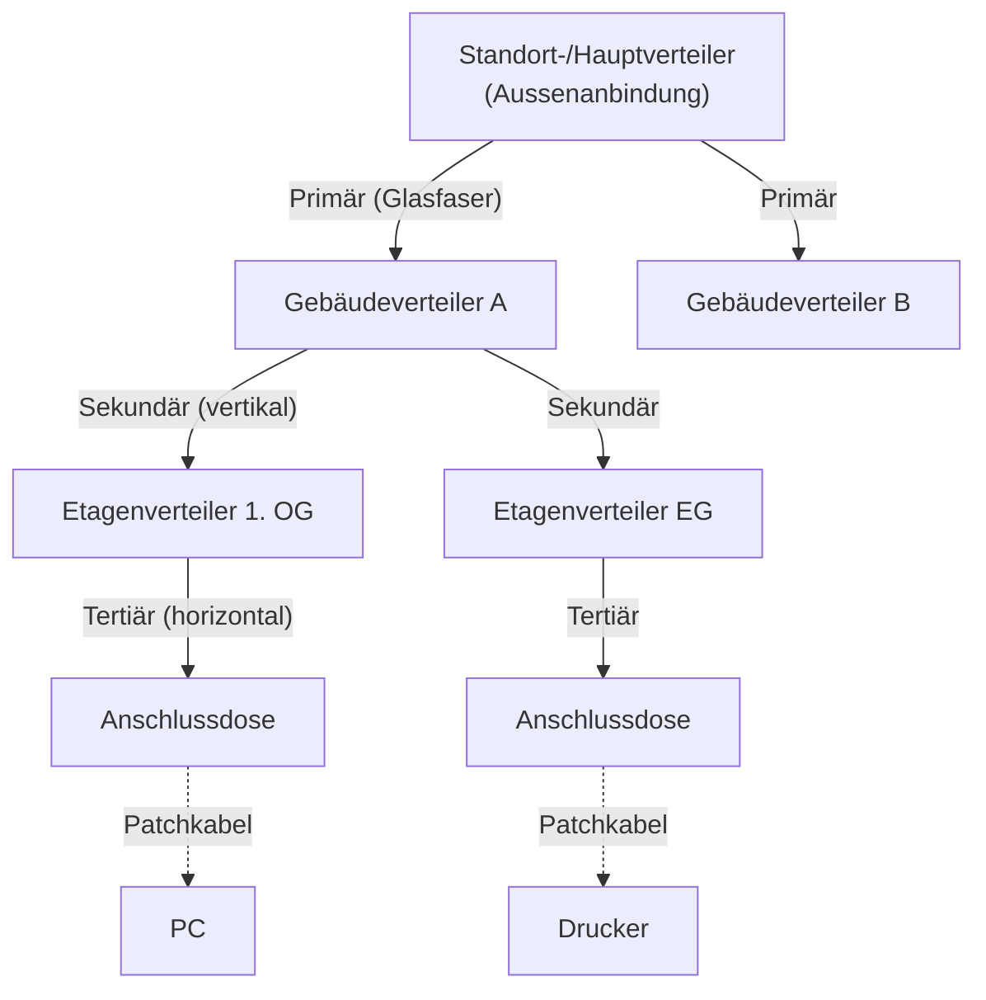

# Universelle Gebäudeverkabelung (UGV)

> [!info] Kurz gesagt
> Bei der UGV werden die Kabel **fest im Gebäude verlegt** (Kabelkanal, Brüstung, Decke, Doppelboden) und enden auf beiden Seiten in einer **Buchse** (Dose bzw. Patchpanel). Die Geräte werden mit **Patchkabeln** angeschlossen. Dieselbe Verkabelung ist **universell**: für Ethernet, Telefonie oder Gebäudeautomation, je nachdem, was man an die Enden anschliesst.

## Fliegend oder universell?

| | Fliegende Verkabelung | UGV (fest) |
|---|---|---|
| Wo | kleine Firma, temporär, kurze Distanzen (**bis ca. 10 m**) | grössere Netze, neue Gebäude |
| Kabel | flexible **Litze** (Patchkabel) | starrer **Draht** |
| Enden | Stecker direkt am Switch und am PC | **Buchsen** in Dose und Patchpanel, dazu Patchkabel |
| Vorteil | schnell, günstig | sauber, geschützt, langlebig, flexibel nutzbar, Nachmieter kann sie weiter nutzen |

## Strukturierte Verkabelung nach EN 50173-1
Die Norm **EN 50173-1** von **CENELEC** (Europäisches Komitee für elektrotechnische Normung) gibt einen einheitlichen Aufbau vor. Man unterscheidet drei Bereiche plus Patchkabel:

| Bereich | Auch genannt | Was wird verbunden? | Eigenschaften / Medium |
|---|---|---|---|
| **Primär** | Campus-, Geländeverkabelung | **Gebäude untereinander**, Standortverteiler (Aussenanbindung) ↔ Gebäudeverteiler | grosse Distanzen, hohe Raten, wenige Anschlüsse → **Glasfaser** (wenig Dämpfung, keine EM-Störung, **galvanische Trennung** bei Blitzschlag). Router-Anschlüsse meist LWL. |
| **Sekundär** | Steigbereichs-, Gebäudeverkabelung | **vertikal: Stockwerke untereinander**, Gebäudeverteiler (Serverraum) ↔ Etagenverteiler | Router via Core-Switch zu den Distribution-Switches, oft Glasfaser |
| **Tertiär** | Etagen-, Stockwerkverkabelung | **horizontal: innerhalb eines Stockwerks**, Etagenverteiler (Switch) ↔ Anschlussdosen | **Twisted Pair**, selten Glasfaser |
| **Patchkabel** | Anschlusskabel | Dose ↔ Gerät, Patchpanel ↔ Switch | flexible Litze |

## Maximale Längen

![[ugv-maximale-laengen.png]]

| Strecke | Max. Länge |
|---|---|
| Primär: **Singlemode-Glasfaser** | **80 km** |
| Sekundär: **Multimode-Glasfaser** | **500 m** |
| Tertiär: **Kupferkabel Cat 6** (fest) | **90 m** |
| **Patchkabel** (je Seite) | **5 m** |
| Gesamte TP-Strecke Ethernet | **100 m** (= 90 m fest + 2 × 5 m Patch) |

> [!tip] Merkregel 90 + 10
> Die fest verlegte Strecke plant man mit **ca. 90 m**. Die restlichen **10 m** sind für die Patchkabel auf beiden Seiten (Dose → PC und Patchpanel → Switch).

## Aufbau im Rack (Verteilerschrank)

![[montageprinzip-ugv.png]]

Prinzip: **Rack – UGV – Wanddosen – Patchkabel – Gerät**
- An einer **zentralen Stelle** (wo auch Router und Internetanschluss sind) steht ein **19-Zoll-Rack**.
- **Oben das Patchpanel**: hier enden alle UGV-Kabel (RJ45) bzw. die Glasfasern.
- **Darunter der Switch**. Mit kurzen **Patchkabeln** werden die Panel-Ports den Switch-Ports zugewiesen → Ordnung und Übersicht.
- Weiter unten Router, Server, **USV** (unterbrechungsfreie Stromversorgung).

![[rack-musteraufbau.png]]

**Musteraufbau von oben nach unten:** LWL-Panel Primär → LWL-Panel Sekundär → Telefoniepanel → UKV-Panel Tertiär → Aktivkomponenten (Switches) → Server → USV.
Den Rack-Aufbau plant man erst, wenn **alle Komponenten bekannt** sind.

### Passive UGV-Komponenten

| Komponente | Wissenswertes |
|---|---|
| **19"-Verteilerschrank (Rack)** | Höhe in **Höheneinheiten** (HE oder U). **1 HE = 1,75" = 4,445 cm**. Tiefe und Innenmasse sind nicht normiert. |
| **Patchpanel Kupfer** | z. B. 24 Ports RJ45 auf 1 HE, auch als Mini-Patchbox 4× RJ45 |
| **Patchpanel Glasfaser** | für LWL-Stecker (SC/ST/LC) |
| **Anschlussdose RJ45** | **UP** = Unterputz (in der Wand), **AP** = Aufputz (auf der Wand); Anschlussmodule z. B. RJ45 Cat 6 |
| **LWL-Anschlussdose** | z. B. **FTTH-Anschlussdose** vom Provider |
| Werkzeug | **Beschaltungswerkzeug (LSA)** für Kabel an Buchsen, **Crimpzange** für RJ45-Stecker |

> Aktive Komponenten = Geräte mit Strom, die Daten verarbeiten (Switch, Router, Server, Endgeräte). Passive = Rack, Panel, Dosen, Kabel.

## Beschriftung und Namenskonvention
- Beschriftung muss **eindeutig, gut sichtbar und dauerhaft** sein, damit sich jeder im Supportfall sofort zurechtfindet.
- **Kabel und Dosen:** auf **beiden Seiten gleich** beschriften (Dose und Patchpanel). Jede Nummer darf **pro Gebäude nur einmal** vorkommen.
- **Verteilschränke** ebenfalls eindeutig beschriften.
- **Aktive Komponenten:** firmeninterne Namenskonvention. Empfohlen: einheitlicher Aufbau, **max. 16 Zeichen**, gleiche Länge, **keine Sonderzeichen** ausser `-` und `_`.

| Aufbau | Beispiel |
|---|---|
| Firma – Geräteart – Laufnummer | `TecAG-RT-0001` (Router), `TecAG-NB-0001` (Notebook) |

| Backend (Netzwerk) | | Frontend (Benutzer) | |
|---|---|---|---|
| AP | Accesspoint | MF | Multifunktionsdrucker |
| RT | Router | NB | Notebook |
| SW | Switch | PR | Printer |
| | | TF | IP-Telefon Tischapparat |
| | | TM | IP-Telefon mobil |
| | | WS | Workstation (PC) |

Standort und Raum lässt man meist weg, weil sie in der **Inventarliste** stehen (Notebooks haben ohnehin keinen festen Ort).

## Bauliche Gegebenheiten & Installation planen (Skript Kap. 3)
- Ideal: ein **eigener, abschliessbarer Technikraum** für das Rack, nicht in einem Büro.
- Heute dank Cloud oft nur noch **Router, Firewall und 1–2 Switches** im Rack. Ausnahme: heikle Daten (Anwälte, Medizin, Personaldaten) bleiben im Haus.
- UGV am besten in einem **eigenen Kabeltrassee / Kabelkanal** verlegen, wo möglich im **Doppelboden**, sonst Wandkanäle.
- **Nicht** in bestehende Telefon- oder Kabel-TV-Röhrchen einziehen: zu eng, Ecken haben zu kleine **Biegeradien** (v. a. für Glasfaser).
- Kabel **nie quetschen** (Vorsicht bei Türen) und nicht zu stark biegen, sonst geht die Übertragungsrate gegen null.
- Genug **Überlänge** lassen, damit man eine defekte Dose durch Nachziehen reparieren kann.
- Kanäle führen evtl. vom Boden auf Deckenhöhe → bei der Längenberechnung mitrechnen.
- **Genaue Pläne**, wo die Kabel in Boden, Wand oder Decke liegen, damit sie später zugänglich bleiben.
- Rack und Patchpanel **sauber aufgeräumt und angeschrieben**, sonst sucht man stundenlang (Kabel-Beschriftungsgerät benutzen).

> [!warning] 60-%-Regel
> Rund **60 % aller Netzausfälle** haben mit Steckern und schlechten Kabeln zu tun. Saubere Verkabelung ist deshalb extrem wichtig, und bei Problemen sucht man **zuerst hier**.

Aus dem physischen Plan erstellt man die **Stückliste (Materialliste)** und berechnet den Installationspreis → [[Offerte erstellen]].

## Wie entsteht ein Ethernet-Netzwerk? (Wer macht was?)

| # | Arbeitsschritt | Ausführend | Verantwortlich |
|---|---|---|---|
| 1 | Grobplanung: Standorte der Frontend-Geräte (PC, Drucker, Telefon) auf dem Grundriss | Auftraggeber + Architekt | Auftraggeber |
| 2 | Informatikfirma wählen, benötigte **Dienste** besprechen | Auftraggeber + Informatiker | Auftraggeber |
| 3 | **Anschlusspunkte** und Ausführung festlegen (Wand-/Bodendose, AP/UP) | Architekt + Elektroplaner | Architekt |
| 4 | Standorte der **Verteilerschränke** und Platzbedarf, Kabelwege, Steigzonen, Kupfer oder Glas, Geschwindigkeit | Elektroplaner | Elektroplaner + Informatiker |
| 5 | Prüfung auf **Konformität** (Vorschriften, interne Richtlinien) | Elektroplaner / Ingenieur | Elektroplaner / Ingenieur |
| 6 | Vergabe an Elektro-Installationsfirma | Elektroplaner | Elektroplaner |
| 7 | Installation der Anschlüsse auf der Baustelle | Telematiker / Elektromonteur | Elektroplaner |
| 8 | **Bauabnahme**: Anschlüsse ausmessen, **Messprotokoll** | Elektroplaner übergibt mit Protokoll | Elektroplaner |
| 9 | Frontend- und Backend-Geräte installieren, in Betrieb nehmen | Informatiker | Informatiker |
| 10 | Übergabe mit **Abnahmeprotokoll** und **Schulung** | Informatiker | Informatiker |
| 11 | **Serviceverträge** aushandeln | Informatiker | Auftraggeber |

## Norm & Begriffe
- **EN 50173-1**: strukturierte Verkabelung (siehe oben)
- **Letzte Meile**: Strecke von der Zentrale des Providers bis zum Kunden
- Die UGV entstand, als Telefon und Daten noch **getrennte Netze** waren (keine Konvergenz). Heute läuft alles über IP, die UGV bleibt aber flexibel.

## Siehe auch
- [[Logischer & physischer Netzwerkplan]]
- [[Kabel, Stecker & Ethernet-Varianten]]
- [[LB3 – Projekt Sota GmbH]]
- [[Netzwerktopologien]]
