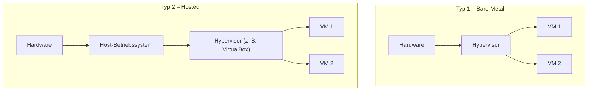

# Virtualisierung (Modul 117)

> [!info] Ergänzung
> Die VM-Netzwerktypen (NAT, Bridged, Host-only, internes Netz) und die Windows-Editionen stehen schon in [[Virtualisierung & VM-Netzwerke]] (Modul 187). Hier steht, was die M117-Präsentation zusätzlich bringt.

## Was ist Virtualisierung?
Software legt eine **Abstraktionsschicht über die physische Hardware**, um **virtuelle Computer, Server, Speicher oder Netzwerke** zu erzeugen. So laufen **mehrere unabhängige VMs** mit eigenem Betriebssystem gleichzeitig auf **einem** physischen Rechner.

| Begriff | Bedeutung |
|---|---|
| **Hypervisor** | zentrale Software, verwaltet CPU und RAM und verteilt sie an die VMs |
| **Typ-1 (Bare-Metal)** | läuft **direkt auf der Hardware**, für Server (z. B. VMware ESXi, Proxmox, Hyper-V Server) |
| **Typ-2 (Hosted)** | läuft als **Programm auf einem Betriebssystem**, für Desktop/Tests (z. B. VirtualBox, VMware Workstation) |
| **VM** | isolierter, eigenständiger Computer mit eigenem OS |
| **Host / Wirt** | der echte PC, auf dem der Hypervisor läuft |
| **Gast** | das Betriebssystem in der VM |

## Vorteile
- **Serverkonsolidierung**: viele virtuelle Server auf einer Maschine → bessere Auslastung
- **Kosten sparen**: weniger Hardware, Strom, Kühlung, Platz
- **Isolation & Sicherheit**: Probleme oder Tests in einer VM stören den Host nicht
- **Flexibilität**: schnell bereitstellen, **klonen**, migrieren

## Virtualisierungsarten

| Art | Gast-OS weiss, dass es virtualisiert ist? | Eigenschaften |
|---|---|---|
| **Vollvirtualisierung** | nein | Hypervisor emuliert die komplette Hardware, Gast-OS muss **nicht angepasst** werden |
| **Paravirtualisierung** | ja | Gast-OS ist **angepasst** und schickt optimierte Befehle (**Hypercalls**) direkt an den Hypervisor → spart Leistung |

## Produkte
Oracle **VirtualBox** (gratis, Desktop) · **Proxmox VE** (gratis Server) · **VMware Workstation Pro** (Desktop) · **VMware ESXi** (Server) · **Hyper-V** · **Xen** · **KVM**

## Setup-Vorbereitung
- Im **BIOS/UEFI** muss **Intel VT-x** bzw. **AMD-V** aktiviert sein (→ [[BIOS & UEFI]])
- **Windows 11**: mind. **4 GB RAM und 1 CPU** (plus TPM 2.0 und Secure Boot in der VM)
- **Windows Server 2025**: mind. **6 GB RAM und 2 CPUs**
- LB3 (Skript): Host mit ca. **8 GB RAM** und **80 GB** freiem Speicher

## Ablauf
1. **Wirt**: Software herunterladen (virtualbox.org), installieren, **Extension Pack** dazu
2. **Gast**: **ISO** des Betriebssystems herunterladen (z. B. Windows 11, Windows Server 2025)
3. VM erstellen und Windows installieren
4. Nach der Installation:
   - [ ] **Windows-Updates**
   - [ ] **Guest Additions** installieren (Treiber, Maus, Bildschirm, gemeinsame Ordner)
   - [ ] **Lizenz aktivieren** (→ [[Lizenzierung – OEM, Retail, KMS, MAK]])
   - [ ] **OVA-Appliance exportieren** (Sicherung/Weitergabe der ganzen VM)
   - [ ] **Dokumentieren**

## Netzwerk für M117-VMs
- Für die LB3 und den [[Praxisauftrag VM-Netzwerk]]: beide VMs im **internen Netzwerk** bzw. **NAT-Netzwerk**, damit sie sich auf **Layer 3 pingen** können.
- Für Internet in der VM: **zweiter Adapter** mit **NAT** oder **Bridge**.
- Ping-Regel in der Windows-Firewall aktivieren → [[Netzwerk konfigurieren & testen (Befehle)]]

## Siehe auch
- [[Virtualisierung & VM-Netzwerke]]
- [[LB3 – Projekt Sota GmbH]]
- [[Praxisauftrag VM-Netzwerk]]
