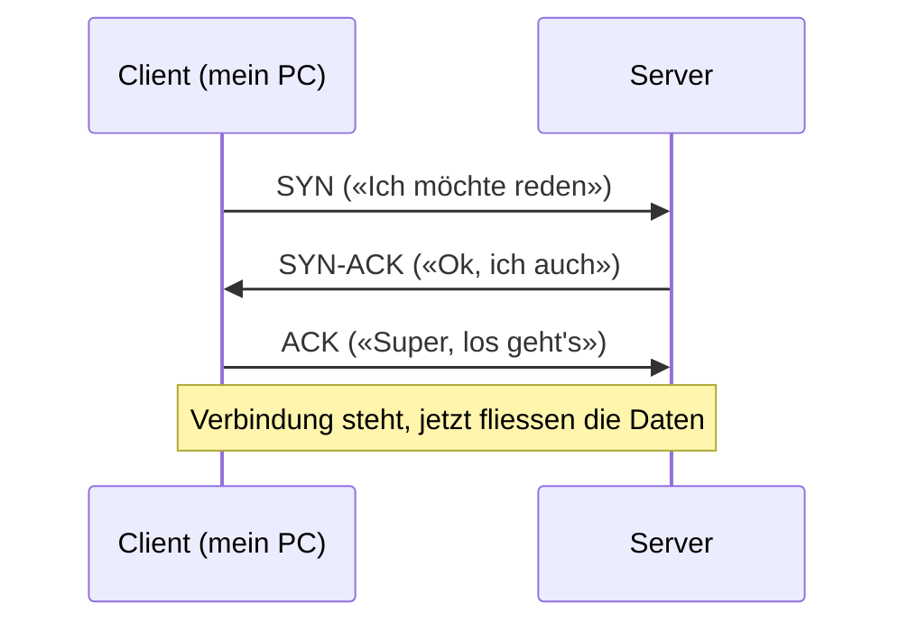

# Arbeitsplatzaufbau & IPv4-Netzwerkkonfiguration

> [!info] Worum ging es im Unterricht?
> Einen Arbeitsplatz aufbauen und den PC fürs Netzwerk mit **IPv4** konfigurieren. Dazu: Was ist ein **Protokoll**, welche **Kabel** und **WLAN-Standards** gibt es, was macht **TCP** und wofür ist **tracert**.
> Viele Grundlagen dazu stehen ausführlicher in Modul 117: [[IP-Adressierung & Subnetting]], [[Netzwerk konfigurieren & testen (Befehle)]], [[OSI-Modell]].

## IP = Internet Protocol
**IP** ist das Protokoll, das jedem Gerät eine **Adresse** gibt (z. B. `192.168.1.10`) und die **Datenpakete** von einem Netz ins andere **weiterleitet** (Routing). Es arbeitet auf **OSI-Schicht 3**.

> [!warning] Kleine Korrektur zu meiner Notiz
> IP **adressiert** die Computer, **verteilt** die Adressen aber nicht selbst. Das Verteilen macht ein anderes Protokoll: **DHCP** (Dynamic Host Configuration Protocol), meist im Router. Ohne DHCP trägt man die Adresse **von Hand** ein.

## Was ist ein Protokoll?

![[protokoll-gemeinsame-sprache.svg]]

Ein **Protokoll** ist eine **Sammlung von Regeln**, wie zwei Geräte miteinander kommunizieren. Wie bei Menschen: Wenn beide Deutsch sprechen und wissen, wer wann redet, klappt das Gespräch. Computer brauchen dasselbe, nur viel genauer.

Ein Protokoll legt fest:
1. **Adressen**: Wer sendet, wer empfängt? (IP-Adresse, MAC-Adresse)
2. **Format**: Wie ist ein Paket aufgebaut? (Header mit Absender/Empfänger + die eigentlichen Daten)
3. **Ablauf**: Wer darf wann senden, wie baut man eine Verbindung auf?
4. **Fehlerbehandlung**: Was passiert, wenn ein Paket verloren geht oder kaputt ankommt?

### Beispiele für Protokolle

| Protokoll | Wofür? | Alltagsbeispiel | OSI-Schicht |
|---|---|---|---|
| **Ethernet** | Daten übers Kabel im lokalen Netz | PC ↔ Switch | 2 |
| **WLAN (802.11)** | Daten über Funk | Handy ↔ Router | 1–2 |
| **IP** | Adressieren und weiterleiten | Paket findet den Weg zu www.tbz.ch | 3 |
| **ICMP** | Kontroll- und Fehlermeldungen | `ping`, `tracert` | 3 |
| **TCP** | zuverlässig übertragen, nichts geht verloren | Webseiten, E-Mail, Downloads | 4 |
| **UDP** | schnell, ohne Kontrolle | Videocalls, Games, Streaming | 4 |
| **DHCP** | IP-Adressen automatisch verteilen | PC bekommt beim Start eine IP | 7 |
| **DNS** | Namen in IP-Adressen übersetzen | www.tbz.ch → 149.126.4.25 | 7 |
| **HTTP/HTTPS** | Webseiten laden | Browser | 7 |

> [!tip] Merkhilfe
> Bei jeder Kommunikation arbeiten **mehrere Protokolle zusammen**, wie ein Brief: **HTTP** ist der Briefinhalt, **TCP** der Einschreibe-Service (Empfang wird bestätigt), **IP** die Adresse auf dem Couvert, **Ethernet/WLAN** der Postbote auf der letzten Strecke.

## Zwei PCs miteinander verbinden

![[zwei-pcs-verbinden.svg]]

### Mit Kabel direkt verbinden (ohne Switch)
- Ein normales **Netzwerkkabel (RJ45)** reicht. Heutige Netzwerkkarten erkennen automatisch, wie sie senden müssen (**Auto-MDI-X**). Früher brauchte man ein **Crossover-Kabel**.
- Das **Link-Light** an der Netzwerkbuchse zeigt: Die Kabelverbindung steht (Schicht 1 und 2).
- Damit Programme (ping, Dateifreigabe) funktionieren, braucht jeder PC zusätzlich eine **IP-Adresse** (Schicht 3).

| Fall | Einstellung | Ergebnis |
|---|---|---|
| ① **ohne IP** | IPv4 nicht konfiguriert | Kabel ok, aber **kein ping**: Ohne Adresse weiss niemand, wohin die Pakete sollen |
| ② **automatisch, ohne DHCP-Server** | «IP automatisch beziehen» | Windows gibt sich selbst eine **APIPA-Adresse 169.254.x.x**. Beide PCs sind im Netz 169.254.0.0/16 → ping geht meist, aber **kein Internet** |
| ③ **manuell, gleiches Netz** ✔ | PC A `192.168.1.10/24`, PC B `192.168.1.20/24` | **ping geht** |
| ④ **manuell, verschiedene Netze** | PC A `192.168.1.10/24`, PC B `192.168.2.20/24` | **kein ping**: Das dritte Oktett ist verschieden, es bräuchte einen **Router** |

### Schritt für Schritt (Fall ③)
1. Beide PCs mit dem Kabel verbinden, **Link-Light** prüfen.
2. `Win + R` → `ncpa.cpl` → Ethernet-Adapter → Rechtsklick **Eigenschaften** → **Internetprotokoll, Version 4 (TCP/IPv4)** → Eigenschaften.
3. **«Folgende IP-Adresse verwenden»**:
   - PC A: IP `192.168.1.10`, Subnetzmaske `255.255.255.0`
   - PC B: IP `192.168.1.20`, Subnetzmaske `255.255.255.0`
   - Standardgateway und DNS **leer lassen** (kein Router, kein Internet)
4. Kontrollieren mit `ipconfig`.
5. Ping in der Windows-Firewall erlauben: Eingehende Regel **«Datei- und Druckerfreigabe (Echoanforderung – ICMPv4 eingehend)»** aktivieren.
6. Auf PC A: `ping 192.168.1.20` → Antworten = Verbindung klappt ✔

> [!example] Mit Switch oder Router
> Mit einem **Switch** dazwischen funktioniert es genau gleich (alle im selben Netz). Steht ein **Router mit DHCP** im Netz (wie zuhause), bekommen beide PCs ihre Adresse **automatisch** und sind sofort im gleichen Netz, inklusive Gateway und Internet.

## Netzwerkkabel-Kategorien

| Kategorie | Max. Frequenz | Max. Geschwindigkeit | Max. Länge | Einsatz |
|---|---|---|---|---|
| **Cat 5e** | 100 MHz | **1 Gbit/s** | 100 m | ältere/günstige Installationen, Patchkabel |
| **Cat 6** | 250 MHz | 1 Gbit/s (10 Gbit/s nur bis ca. 55 m) | 100 m | heute Standard |
| **Cat 6a** | 500 MHz | **10 Gbit/s** | 100 m | Neuinstallationen, Server, zukunftssicher |
| Cat 7 / 7a | 600 / 1000 MHz | 10 Gbit/s | 100 m | geschirmt (S/FTP) |
| Cat 8 | 2000 MHz | 25–40 Gbit/s | **30 m** | Rechenzentrum |

- Das **«a»** steht für *augmented* (erweitert): Cat 6a ist eine verbesserte Cat 6.
- Höhere Kategorie = höhere Frequenz = schneller, aber teurer und dicker.
- Mehr dazu: [[Kabel, Stecker & Ethernet-Varianten]]

## Ethernet vs. WLAN

| | **Ethernet (Kabel)** | **WLAN (Funk)** |
|---|---|---|
| Geschwindigkeit | stabil, 1–10 Gbit/s | schwankt je nach Distanz und Hindernissen |
| Ping/Latenz | tief und gleichmässig | höher, schwankend |
| Störungen | kaum | Wände, Nachbar-WLANs, Mikrowelle |
| Sicherheit | man muss physisch ans Kabel | Funk geht durch Wände → **WPA2/WPA3** nötig |
| Mobilität | fest | beweglich |
| Gut für | Arbeits-PC, Server, Gaming | Laptop, Handy, Tablet |

### 2,4 GHz vs. 5 GHz

![[wlan-24-vs-5-ghz.svg]]

> [!tip] Faustregel
> **Weit weg oder durch Wände → 2,4 GHz. Nah am Router und schnell → 5 GHz.** Moderne Router senden auf beiden Bändern und verteilen die Geräte automatisch (Band Steering).

### WLAN-Standards aus dem Unterricht

| Standard | Name | Frequenz | Max. Geschwindigkeit (theoretisch) |
|---|---|---|---|
| 802.11n | Wi-Fi 4 | 2,4 + 5 GHz | 600 Mbit/s |
| **802.11ac** | **Wi-Fi 5** | **nur 5 GHz** | ca. 3,5–6,9 Gbit/s |
| **802.11ax** | **Wi-Fi 6** | 2,4 + 5 GHz | ca. 9,6 Gbit/s |
| 802.11ax | **Wi-Fi 6E** | zusätzlich **6 GHz** | ca. 9,6 Gbit/s |
| 802.11be | Wi-Fi 7 | 2,4 + 5 + 6 GHz | ca. 46 Gbit/s |

Wi-Fi 6 ist vor allem **effizienter, wenn viele Geräte gleichzeitig** im WLAN sind (z. B. Schulzimmer). Mehr dazu: [[WLAN-Standards]]

## TCP und Congestion Control
**TCP** (Transmission Control Protocol, OSI-Schicht 4) sorgt dafür, dass Daten **vollständig und in der richtigen Reihenfolge** ankommen.

**1. Verbindungsaufbau: 3-Way-Handshake**

**2. Jedes Paket wird bestätigt (ACK).** Fehlt eine Bestätigung, wird das Paket **nochmals gesendet**.

**3. Congestion Control (Staukontrolle)**: Damit das Netz nicht verstopft, passt TCP an, **wie viele Daten** es auf einmal schickt:

![[tcp-congestion-control.svg]]

| Phase | Was passiert | Vergleich Autobahn |
|---|---|---|
| **Slow Start** | mit wenig Daten starten, bei Erfolg **verdoppeln** | vorsichtig auffahren, dann beschleunigen |
| **Congestion Avoidance** | ab der Schwelle nur noch **langsam steigern** | auf Tempo bleiben, vorsichtig etwas schneller |
| **Stau erkannt** (Paket verloren) | Menge **halbieren**, verlorenes Paket neu senden | Stau vorne → bremsen |

> [!note] Flow Control ≠ Congestion Control
> **Flow Control** schützt den **Empfänger** (er sagt, wie viel er aufnehmen kann). **Congestion Control** schützt das **Netz dazwischen** (Router und Leitungen sollen nicht überlaufen).

### TCP vs. UDP

| | **TCP** | **UDP** |
|---|---|---|
| Verbindung | wird aufgebaut (Handshake) | keine, einfach losschicken |
| Zuverlässig | ja, Bestätigung und Neusenden | nein, Verlorenes bleibt verloren |
| Reihenfolge | wird garantiert | nicht garantiert |
| Tempo | etwas langsamer | schneller |
| Beispiele | Web, E-Mail, Downloads | Videocalls, Online-Games, DNS, Streaming |

## tracert – was macht der Befehl?

![[tracert-hops.svg]]

- **`ping`** fragt nur: «Bist du **erreichbar** und wie lange dauert die Antwort?»
- **`tracert`** (trace route = «Route verfolgen») zeigt den **ganzen Weg**: jeden **Router (Hop)**, über den die Pakete bis zum Ziel laufen, mit der Zeit pro Hop. Am PC selbst wird **nichts verändert**, es ist ein reiner Diagnose-Befehl.

**So funktioniert es:** Jedes IP-Paket hat einen Zähler **TTL** (Time To Live). Jeder Router zieht 1 ab, bei 0 wirft er das Paket weg und meldet sich beim Absender. `tracert` schickt Pakete mit TTL 1, 2, 3 … und erfährt so nacheinander jeden Router auf dem Weg.

**Wofür?** Herausfinden, **wo** eine Verbindung hängt oder langsam ist: beim eigenen Router (Hop 1), beim Provider oder irgendwo im Internet.

| Befehl | Beispiel | Bemerkung |
|---|---|---|
| `tracert www.tbz.ch` | Weg zu einer Webseite | Windows |
| `tracert -d 8.8.8.8` | ohne Namensauflösung, schneller | `-d` = keine DNS-Namen |
| `traceroute www.tbz.ch` | dasselbe auf Linux/macOS | |
| `pathping www.tbz.ch` | tracert + Paketverlust pro Hop | dauert länger |

> `* * * Zeitüberschreitung` bei einem Hop ist oft **normal**: Manche Router antworten aus Sicherheitsgründen nicht, leiten die Pakete aber trotzdem weiter.

## Siehe auch
- [[Netzwerk konfigurieren & testen (Befehle)]]
- [[IP-Adressierung & Subnetting]]
- [[OSI-Modell]]
- [[Kabel, Stecker & Ethernet-Varianten]]
- [[WLAN-Standards]]
- [[Virtualisierung & VM-Netzwerke]]
