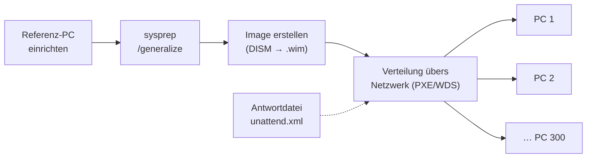

# Erweiterte Installationsoptionen – Imaging & Sysprep

> [!question] Die Frage heute
> Wie kann man ein Betriebssystem, das schon fertig eingerichtet ist, kopieren und für alle z. B. 300 Mitarbeiter auf verschiedene Geräte verteilen – und das automatisch?

## Problem & Lösung
**Problem:** Eine manuelle Einzelinstallation ist bei 50+ Geräten nicht praktisch (dauert ewig und jeder PC ist am Schluss ein bisschen anders eingerichtet).

**Lösung:** Standardisierte, automatisierte Massenverteilung
1. Referenzinstallation **einmal** erstellen
2. Daraus ein Image machen
3. Image auf beliebig viele Geräte klonen/verteilen

## Ablauf
Der Admin setzt einen Laptop auf (= **Referenz-Computer**). Darauf wird alles eingestellt, was später alle haben sollen: Windows-Updates, Software, Einstellungen. Dieser PC dient dann als Grundlage für das Image.

Beim Image wird die komplette Systempartition "fotografiert" und als Datei gespeichert (meist eine `.wim`-Datei). Sobald man dieses Image hat, kann man es auf beliebig viele andere Geräte installieren. Statt von einer ISO startet der Zielcomputer dann über das Netzwerk (**PXE-Boot**, z. B. mit WDS oder MDT) oder von einem USB-Stick mit **WinPE**, und das Image wird über das Netzwerk auf ihn übertragen.



## Wie erstellt man ein Image?

### 1. Sysprep (System Preparation Tool)
Sysprep ist grösstenteils dafür verantwortlich, dass man ein System klonen kann. Man braucht **Adminrechte**, um Sysprep laufen zu lassen.
- Liegt unter `C:\Windows\System32\Sysprep\sysprep.exe`
- Entfernt gerätespezifische Informationen: **SID** (Security Identifier), Computername, gerätespezifische Treiber und den Aktivierungsstatus
- Bereitet die Installation fürs Imaging/Klonen vor
- **Ohne Sysprep:** doppelte SIDs → Konflikte im Netz (v. a. in einer Domäne)

```cmd
sysprep /generalize /oobe /shutdown
```
| Parameter | Bedeutung |
|---|---|
| `/generalize` | Entfernt alles Gerätespezifische (SID, Treiber, Aktivierung) |
| `/oobe` | Beim nächsten Start kommt die Ersteinrichtung (Out-of-Box Experience) wie bei einem neuen PC |
| `/shutdown` | PC fährt danach herunter, damit man direkt das Image machen kann |

> [!warning] Wichtig
> Nach Sysprep den Referenz-PC **nicht** wieder normal starten, sonst wird er neu eingerichtet und das Generalisieren ist weg. Direkt von WinPE/USB starten und das Image erstellen.

### 2. Image erstellen
z. B. mit **DISM.exe** (Deployment Image Servicing and Management) oder Drittanbieter-Tools (z. B. Clonezilla, Acronis).
```cmd
DISM /Capture-Image /ImageFile:D:\Referenz.wim /CaptureDir:C:\ /Name:"Win11-Firma"
```

## Antwortdateien (unattend.xml)
Eine Antwortdatei ist eine Datei, die automatisch auf die Fragen bei der Installation antwortet, z. B. Sprache, Partitionierung, Benutzerkonto, "Standortfreigabe aktivieren?", "Erweiterte Diagnosedaten senden?" usw.
- **Ziel:** vollautomatische, unbeaufsichtigte Installation (**Unattended Installation**), niemand muss danebensitzen und klicken
- Enthält vordefinierte Antworten im **XML-Format**
- Wird erstellt mit dem **Windows System Image Manager (SIM)**, der Teil vom **Windows ADK** (Assessment and Deployment Kit) ist
- Wird bei der Installation automatisch eingelesen (heisst `autounattend.xml` auf dem USB-Stick oder `unattend.xml` beim Image)

### Beispiel
Ausschnitt aus einer Antwortdatei, die die Ersteinrichtung (OOBE) überspringt, Schweizer Einstellungen setzt und einen lokalen Admin anlegt:
```xml
<settings pass="oobeSystem">
  <component name="Microsoft-Windows-International-Core" ...>
    <InputLocale>de-CH</InputLocale>   <!-- Tastatur Deutsch (Schweiz) -->
    <SystemLocale>de-CH</SystemLocale>
    <UserLocale>de-CH</UserLocale>
  </component>
  <component name="Microsoft-Windows-Shell-Setup" ...>
    <TimeZone>W. Europe Standard Time</TimeZone>  <!-- Bern/Zürich -->
    <OOBE>
      <HideEULAPage>true</HideEULAPage>       <!-- Lizenzbedingungen überspringen -->
      <ProtectYourPC>3</ProtectYourPC>         <!-- Standort, Diagnosedaten usw. NICHT aktivieren -->
      <HideOnlineAccountScreens>true</HideOnlineAccountScreens> <!-- kein Microsoft-Konto -->
    </OOBE>
    <UserAccounts>
      <LocalAccounts>
        <LocalAccount>
          <Name>ICT-Admin</Name>
          <Group>Administrators</Group>
        </LocalAccount>
      </LocalAccounts>
    </UserAccounts>
  </component>
</settings>
```
`...` steht für Attribute wie Prozessorarchitektur, die der SIM automatisch einfügt.

## Treiber ins Image einbetten
Treiber können **vor** der Verteilung ins Image eingebettet werden.
- **Werkzeug:** `DISM /Add-Driver`
- **Vorteil:** Das Zielgerät braucht nach der Installation keine manuelle Treiberinstallation.
```cmd
DISM /Image:C:\Mount /Add-Driver /Driver:C:\Treiber /Recurse
```
(`/Recurse` = alle Treiber in den Unterordnern auch mitnehmen)

## Image vs. Backup
Man könnte meinen, ein Image ist einfach ein besseres Backup, weil man direkt alles kopiert hat. Das stimmt aber nur halb:
- **Deployment-Image (mit Sysprep):** eine **neutrale Vorlage** ohne persönliche Daten und ohne SID, gedacht, um **viele neue** Geräte gleich aufzusetzen.
- **Backup / System-Abbild:** eine 1:1-Kopie von **einem bestimmten** PC inkl. Benutzerdaten, gedacht, um **genau diesen** PC wiederherzustellen.

Mit der gleichen Technik (z. B. DISM oder Acronis) kann man also beides machen, der Zweck ist aber ein anderer.

## Siehe auch
- [[Benutzerverwaltung – Admin vs. Standardbenutzer]]
- [[Lizenzierung – OEM, Retail, KMS, MAK]] (bei Massenverteilung wird meist per KMS/MAK aktiviert)
- [[Betriebssysteme Übersicht]]
- [[BIOS & UEFI]]
