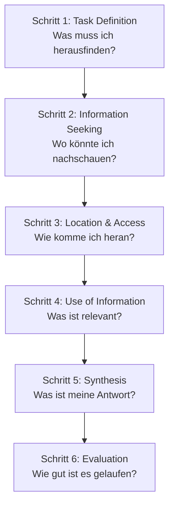

# Week 06 – Das Big-6-Modell

Modell zur systematischen Problemanalyse bei Recherche-Aufgaben.

## Die 6 Schritte

| Schritt | Bedeutung |
|---|---|
| 1. Task Definition | Was muss ich herausfinden? |
| 2. Information Seeking | Wo könnte ich nachschauen? |
| 3. Location & Access | Wie komme ich an die Information heran? |
| 4. Use of Information | Was davon ist relevant? |
| 5. Synthesis | Was ist meine Antwort? |
| 6. Evaluation | Wie gut ist es gelaufen? |

> [!important] Jeder Schritt beantwortet 4 Fragen: a) Was werde ich tun (Verb)? b) Wo/Wie (Datei, Ordner, Person)? c) Was erwarte ich zu finden? d) Wie halte ich es fest?

## Praxis-Szenario: HZ1 – The Overloaded Helpdesk
Siehe [[W01 – WH-Fragen & Problemanalyse]] für die Firmen-Daten (Müller & Partner AG, Sandra Keller).

**Guiding Question:** *"What information would change your recommendation? Start there, not with a search."*
**Ziel:** Eine Empfehlung für Sandra Keller zur Priorisierung von Tickets vor dem ERP-Rollout.

### Was einen guten Schritt 1 ausmacht
| Zu vage | Spezifisch & messbar |
|---|---|
| "Find out about the helpdesk." | "How many tickets came from Zürich compared with Winterthur last month?" |

## Unterschied Planning Sheet vs. Research Plan
- Das **Planning Sheet** ist für einen selbst – nach den 6 Big-6-Schritten geordnet (weil man so denkt).
- Der **Research Plan** ist für jemand anderen – nach der tatsächlichen Arbeitsreihenfolge geordnet (weil jemand anderes es befolgen muss). Ein Plan, der die Big-6-Namen einfach kopiert, ist noch kein echter Plan, sondern nur das Planning Sheet.

### Allgemeine Beispielprobleme für eine Firma
1. Zu viel Support-Zeit geht für Passwort-Resets drauf, die Nutzer selbst machen könnten.
2. Die gleichen Druckerfehler tauchen wieder auf, und es gibt keine dokumentierte Lösung.
3. Anleitungen für häufige IT-Aufgaben sind über E-Mail, Chat und in Köpfen verstreut.
4. Mitarbeitende finden Dinge nicht auf dem gemeinsamen Laufwerk.
5. Mitarbeitende wissen nicht, wen sie bei welchem Problem kontaktieren sollen.
6. Meeting-Room-Technik ist unzureichend und fällt oft aus, viele Meetings verzögern sich dadurch.
7. Manche Geräte sind so alt, dass sie die Mitarbeitenden ausbremsen, und es gibt aktuell keinen Ersatzplan.

### Worked Example – Schritt 3 richtig gemacht
**Step 3 – Check for existing instructions**
- a) Was: prüfen, welche der Top-Kategorien bereits dokumentierte Anleitungen für Mitarbeitende haben
- b) Wo/wie: der IT-Dokumentationsordner auf SharePoint, plus die zwei Agents fragen, was sie typischerweise verschicken
- c) Was ich erwarte zu finden: eine kurze Liste von Kategorien, die zu Self-Service verschoben werden könnten
- d) Wie festhalten: eine Spalte "Has instructions?" zur Analyse-Tabelle hinzufügen

> [!tip] Wichtig bei c): Es beschreibt, was man danach wissen wird – nicht nur, was man tun wird. Wenn man nicht sagen kann, was man erwartet zu finden, ist der Schritt noch nicht fertig durchdacht.

## Big-6-Matching-Übung (Beispiel-Zuordnung)
| Aktion | Big-6-Schritt |
|---|---|
| "Agree exactly what Sandra needs to know, then narrow it down to three specific points." | 1. Task Definition |
| "Decide: I will use the ticket log, staff interviews, and the SLA document." | 2. Information Seeking |
| "Book a 15-minute meeting with Sandra and two of the agents for Thursday." | 3. Location & Access |
| "Download the last 3 months of ticket data from the helpdesk system." / "Go through the ticket data line by line and mark the patterns by category and resolution time." | 3./4. |
| "Summarise findings and write the recommendation for Sandra Keller." | 5. Synthesis |
| "Look back: is anything Sandra needed still missing?" / "I spent too long on the spreadsheet. Next time I would interview the agents earlier." | 6. Evaluation |

## Siehe auch
- [[W01 – WH-Fragen & Problemanalyse]]
- [[W03 – Prompting mit RTCF]]
